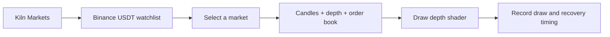

# Kiln: Shader Lab

**A Flutter rendering and profiling demo for "Beyond Skia: Deep-Dive GPU Scheduling and Profiling with Impeller on Android 10+"**

Kiln is currently a live Binance markets dashboard. It loads a USDT watchlist, opens a
market snapshot with candles and an order book, and measures the first draw of a fragment
shader used for the depth chart. The same Dart source can be built as two Android product
flavors: **Kiln Impeller** and **Kiln Skia**.

The app reads the display refresh rate at runtime and reports the corresponding frame
budget. On a 120 Hz display that budget is 8.33 ms per frame. The dashboard records the
measured draw and recovery window in a shared run board so the comparison can be repeated
on the same device.

## Why "Kiln"

A kiln fires pottery before it is used. Impeller does the same with shaders: they are
compiled when the engine is built, not while your app runs. That is the difference from
Skia, and the starting point of the talk.

## What the app shows



The dashboard uses public Binance market-data endpoints and a public trade WebSocket. It
does not contain trading or account functionality. During a measured draw, live price
notifications are held until the timing window closes so incoming data does not dirty the
frame being measured.

Both flavors use the same Flutter SDK, Dart code, assets and profile build mode. The
`impeller` flavor enables Impeller and reports the selected backend; Flutter uses Vulkan
when the device driver is valid and otherwise falls back to OpenGL ES. The `skia` flavor
disables Impeller for a controlled comparison and uses Skia on OpenGL ES.

The talk material documents both the current Shader Lab run and the earlier F1 replay
concept. The [abstract alignment](docs/talk/abstract-alignment.md) and stage documents are
useful for the talk, but are not a description of the current launcher surface.

## Status

**Implemented.** The markets watchlist, Binance REST/WebSocket gateway, candle chart,
order-book ladder, depth-fill shader, frame timer, run board, and Android `impeller` and
`skia` flavors are implemented and covered by package/app tests. The F1 replay scenarios
remain in `samples/` as reference material for the broader talk narrative; they are not
currently wired into the launcher.

## Repository layout

```text
apps/
  kiln/           Flutter app; Binance dashboard and Android renderer flavors
packages/
  shader_lab/     Shared dashboard, shader, timing and presentation package
docs/             PRD, TRD, research, design, talk, reference, history and deep-dive notes
samples/          kiln_samples: broken and fixed rendering reference examples
tool/             Documentation and profiling support tools
```

See [TRD §4](docs/technical/TRD.md) for the original deep-dive architecture and full
monorepo tree. Some planning documents still describe the earlier F1 replay concept.

## Sample code

[`samples/`](samples/README.md) is a small Flutter package of standalone rendering examples.
Every scenario has a `...Broken` and a `...Fixed` widget with the same constructor. These
examples support the deep-dive notes and tests; they are not currently reachable from the
Kiln launcher.

```text
cd samples
flutter pub get
flutter analyze
flutter test
```

## Run the app

Use a physical Android 10+ device for renderer and frame-timing comparisons. From the app
directory:

```bash
cd apps/kiln
flutter pub get
flutter run --profile --trace-systrace --flavor impeller
```

To run the controlled Skia comparison, use the same command with `--flavor skia`. The
flavors install side by side as `dev.fluttercon.kiln` and `dev.fluttercon.kiln.skia`.

For deterministic benchmark data, add `--dart-define=KILN_BENCHMARK=true`. This replaces
Binance with the bundled fixture while leaving the renderer and timing path unchanged.
Backend evidence capture is documented in [`tool/benchmark/README.md`](tool/benchmark/README.md).

For a cold Skia shader run, clear only that app's data before launching it:

```bash
adb shell pm clear dev.fluttercon.kiln.skia
```

Run the automated checks from each package when changing code:

```bash
cd packages/shader_lab && flutter test
cd ../../apps/kiln && flutter test
```

## Documentation

Start at [`docs/README.md`](docs/README.md).

| Document | Purpose |
|---|---|
| [PRD](docs/product/PRD.md) | Product requirements: goals, audience, scope, success metrics |
| [TRD](docs/technical/TRD.md) | Technical requirements: architecture, instrumentation, build modes |
| [Renderer proof plan](docs/technical/renderer-proof-plan.md) | Phased plan for backend evidence, deterministic benchmarks, traces and stage delivery |
| [Impeller architecture](docs/research/01-impeller-architecture.md) | How Impeller turns paint calls into Vulkan work |
| [Profiling toolchain](docs/research/02-profiling-toolchain.md) | DevTools, Perfetto, AGI and the diagnosis method |
| [OpenF1 data](docs/research/03-openf1-data.md) | Historical F1 telemetry research used by the talk concept |
| [Design system](docs/design/design-system.md) | "Obsidian & Aurora" palette, typography, motion |
| [Screens](docs/design/screens.md) | Planned F1 screens and their anti-patterns |
| [Talk outline](docs/talk/talk-outline.md) | 40-minute narrative and slide list |
| [Demo script](docs/talk/demo-script.md) | What to click and say, minute by minute |
| [Stage runbook](docs/talk/stage-runbook.md) | Setup, rehearsal and failure recovery |
| [Rosetta](docs/reference/rosetta.md) | Flutter concepts mapped to Android and iOS |
| [Sources](docs/reference/sources.md) | Primary sources behind the research |
| [History](docs/history/README.md) | Skia to Impeller, OpenGL ES to Vulkan, Systrace to Perfetto |
| [Talk vocabulary](docs/talk/vocabulary.md) | Aligned meanings for draw, path, shaders, layers, profiling |
| [Abstract alignment](docs/talk/abstract-alignment.md) | Every abstract promise mapped to a demo moment |
| [Media](docs/talk/media/README.md) | Skia to Impeller concept video and embed notes |
| [Deep-dive notes](docs/README.md#deep-dive-notes-notes) | Flutter internals, Skia, Impeller, Vulkan, scheduling, profiling, patterns |

## Requirements

- Flutter 3.47+ (stable)
- A physical Android 10+ (API 29+) device with Vulkan 1.1 and a 120 Hz display
- Profile mode for every measurement on a **physical device** with **`adb` on PATH**; see
  [How to run (DevTools and Perfetto)](docs/technical/TRD.md#110-how-to-run-so-devtools-and-perfetto-see-everything):
  - **Kiln Impeller:** `cd apps/kiln` → `flutter run --profile --trace-systrace --flavor impeller`
  - **Kiln Skia:** same directory and SDK → `flutter run --profile --trace-systrace --flavor skia`
  - Before a verified cold Skia run: `adb shell pm clear dev.fluttercon.kiln.skia`
- DevTools attaches to whichever app `flutter run` started; switch apps by stopping one run and
  starting the other (or use exported traces / a second laptop)
- Both flavors use Flutter 3.47+ and the same Android/JDK toolchain — [TRD §11.1](docs/technical/TRD.md)

## Data and trademarks

Market data comes from [Binance public market-data endpoints](https://data.binance.vision/).
The app uses read-only public data and does not send orders. The F1/OpenF1 references in
the talk and research documents describe planned or illustrative material and are not the
source of data for the current app.

## License

See [LICENSE](LICENSE).
