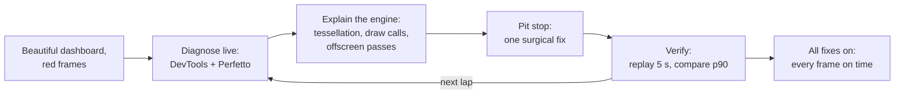

# Kiln: Pit Wall

**The live demo app for "Beyond Skia: Deep-Dive GPU Scheduling and Profiling with Impeller on Android 10+"**
Droidcon / FlutterCon KE 2026

Kiln is an F1 race-replay dashboard built with Flutter. It looks like a premium product,
but every component hides a realistic rendering anti-pattern. On stage, each one is
profiled live with Flutter DevTools and Perfetto, explained at the Impeller and Vulkan
level, and fixed with a "pit stop" toggle until every frame fits the 8.33 ms budget of a
120 Hz display: about 4 ms for the UI thread and 4 ms for the raster thread.

> OpenF1 car data arrives about 3.7 times per second. The screen refreshes 120 times per
> second. That is about 32 frames between data points, and every frame has 8.33 ms.

## Why "Kiln"

A kiln fires pottery before it is used. Impeller does the same with shaders: they are
compiled when the engine is built, not while your app runs. That is the difference from
Skia, and the starting point of the talk.

## What the demo shows



| Lap | Screen | Anti-pattern | Fix |
|---|---|---|---|
| 1 | Telemetry Duel | Rebuilding thousands of path segments every frame | Reduce to screen resolution, build once, separate cursor layer |
| 2 | Speed Ribbon, thrashed live (1× to 8×) | Thousands of `drawPath` calls | One `drawVertices` call, then a build-time fragment shader in the same draw |
| 3 | Pit Wall | `canvas.saveLayer` per car glow, hidden `saveLayer` in the tower, one blur per card, static map repainting | Gradient glows, leaf fades, `RepaintBoundary`, `BackdropGroup` |
| 4 | Race Control | JSON decoded in `build()` on the main thread | `Isolate.run` |

Before the laps, a **Shader Lab** screen shows why Impeller exists. One Flutter project
builds the same screen as two Android product flavors: **Kiln Skia** and **Kiln Impeller**.
Both use the same Flutter SDK, Dart code, assets and profile build mode; only the renderer
configuration, package ID and launcher label differ. On a verified cold run, Skia's
first-use frames can spike while shader programs are generated and compiled; its repeat
run is smoother, while Impeller avoids Skia-style shader generation during the frame. A short
[concept video](docs/talk/media/README.md) introduces the idea before the live run.

Every promise in the registered abstract is mapped to a demo moment in
[Abstract alignment](docs/talk/abstract-alignment.md).

## Status

**Building.** Shader Lab, its timers, run board and the same-source `impeller` and `skia`
Android product flavors are built. Lights Out, Pit Wall and the four laps are next.

## Repository layout

```text
apps/
  kiln/           One Flutter app; builds Impeller and Skia Android flavors
packages/
  shader_lab/     Shared Shader Lab screen used by both flavor APKs
docs/             PRD, TRD, research, design, talk, reference, history and deep-dive notes
samples/          kiln_samples: broken and fixed reference code for the deep-dive notes
tool/             OpenF1 session export script
```

See [TRD §4](docs/technical/TRD.md) for the full monorepo tree.

## Sample code

[`samples/`](samples/README.md) is a small Flutter package. Every scenario has a
`...Broken` and a `...Fixed` widget with the same constructor, so the demo app can swap
them with one toggle.

```text
cd samples
flutter pub get
flutter analyze
flutter test
```

## Documentation

Start at [`docs/README.md`](docs/README.md).

| Document | Purpose |
|---|---|
| [PRD](docs/product/PRD.md) | Product requirements: goals, audience, scope, success metrics |
| [TRD](docs/technical/TRD.md) | Technical requirements: architecture, instrumentation, build modes |
| [Impeller architecture](docs/research/01-impeller-architecture.md) | How Impeller turns paint calls into Vulkan work |
| [Profiling toolchain](docs/research/02-profiling-toolchain.md) | DevTools, Perfetto, AGI and the diagnosis method |
| [OpenF1 data](docs/research/03-openf1-data.md) | Telemetry source, limits and licence |
| [Design system](docs/design/design-system.md) | "Obsidian & Aurora" palette, typography, motion |
| [Screens](docs/design/screens.md) | Every screen with its anti-pattern and fix |
| [Talk outline](docs/talk/talk-outline.md) | 40-minute narrative and slide list |
| [Demo script](docs/talk/demo-script.md) | What to click and say, minute by minute |
| [Stage runbook](docs/talk/stage-runbook.md) | Setup, rehearsal and failure recovery |
| [Rosetta](docs/reference/rosetta.md) | Flutter concepts mapped to Android and iOS |
| [Sources](docs/reference/sources.md) | Primary sources behind the research |
| [History](docs/history/README.md) | Skia to Impeller, OpenGL ES to Vulkan, Systrace to Perfetto |
| [Talk vocabulary](docs/talk/vocabulary.md) | Aligned meanings for draw, path, shaders, layers, profiling |
| [Abstract alignment](docs/talk/abstract-alignment.md) | Every abstract promise mapped to a demo moment |
| [Media](docs/talk/media/README.md) | Skia to Impeller concept video and embed notes |
| [Deep-dive notes](docs/README.md#deep-dive-notes-notes) | Flutter internals, Skia, Impeller, Vulkan, scheduling, profiling, patterns |

## Requirements

- Flutter 3.47+ (stable)
- A physical Android 10+ (API 29+) device with Vulkan 1.1 and a 120 Hz display
- Profile mode for every measurement on a **physical device** with **`adb` on PATH**; see
  [How to run (DevTools and Perfetto)](docs/technical/TRD.md#110-how-to-run-so-devtools-and-perfetto-see-everything):
  - **Kiln Impeller:** `cd apps/kiln` → `flutter run --profile --trace-systrace --flavor impeller --dart-define='KILN_RENDERER=Impeller · Vulkan'`
  - **Kiln Skia:** same directory and SDK → `flutter run --profile --trace-systrace --flavor skia --dart-define='KILN_RENDERER=Skia · OpenGL ES'`
  - Before a verified cold Skia run: `adb shell pm clear dev.fluttercon.kiln.skia`
- DevTools attaches to whichever app `flutter run` started; switch apps by stopping one run and
  starting the other (or use exported traces / a second laptop)
- Both flavors use Flutter 3.47+ and the same Android/JDK toolchain — [TRD §11.1](docs/technical/TRD.md)

## Data and trademarks

Telemetry comes from [OpenF1](https://openf1.org), an independent, community-run API, and is
used here for a non-commercial, educational demo. Kiln is not affiliated with Formula 1, the
FIA, Formula One Management or any team, and uses none of their logos or liveries.

## License

See [LICENSE](LICENSE).
