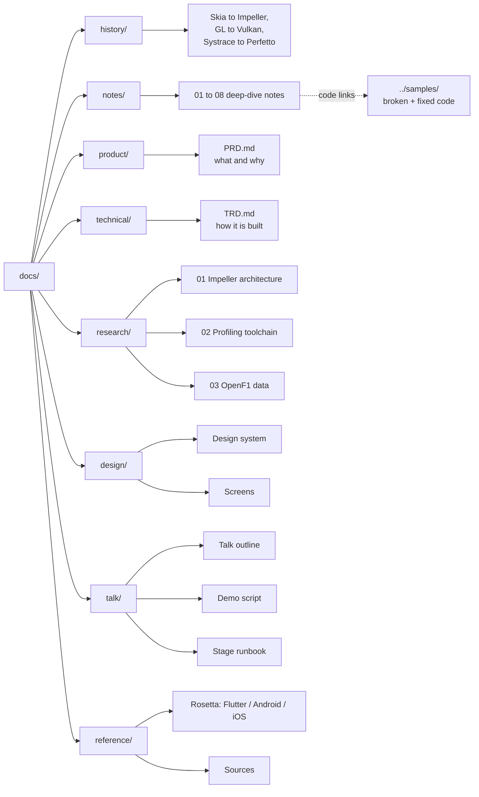

# Kiln: Pit Wall — Documentation

Documentation for **Kiln: Pit Wall**, the live demo app for the talk
**"Beyond Skia: Deep-Dive GPU Scheduling and Profiling with Impeller on Android 10+"**
(Droidcon / FlutterCon KE 2026).

Kiln is an F1 race-replay dashboard that looks premium but is deliberately built with
rendering anti-patterns. On stage, each anti-pattern is profiled live and fixed with a
"pit stop" toggle until every frame fits the 8.33 ms budget of a 120 Hz display.

## How the docs are organised

| Folder | Document | Read it when you need to know… |
|---|---|---|
| `product/` | [PRD](product/PRD.md) | What we are building, for whom, and how we know it succeeded |
| `technical/` | [TRD](technical/TRD.md) | Architecture, modules, instrumentation and technical requirements |
| `research/` | [Impeller architecture](research/01-impeller-architecture.md) | How Impeller turns Flutter paint calls into Vulkan work |
| `research/` | [Profiling toolchain](research/02-profiling-toolchain.md) | DevTools, Perfetto, AGI and what each one can prove |
| `research/` | [OpenF1 data](research/03-openf1-data.md) | The telemetry source, its limits and licence |
| `design/` | [Design system](design/design-system.md) | Colours, typography, motion and stage readability rules |
| `design/` | [Screens](design/screens.md) | Every screen, its hidden anti-pattern and its fix |
| `talk/` | [Talk outline](talk/talk-outline.md) | The 40-minute narrative and key messages |
| `talk/` | [Demo script](talk/demo-script.md) | Exactly what to click and say, minute by minute |
| `talk/` | [Stage runbook](talk/stage-runbook.md) | Setup, rehearsal checklist and failure recovery |
| `reference/` | [Rosetta](reference/rosetta.md) | Flutter concepts mapped to Android and iOS equivalents |
| `reference/` | [Sources](reference/sources.md) | Every primary source used in the research |
| `history/` | [History overview](history/README.md) | How we got from Skia, OpenGL ES and Systrace to today's tools |

### History (`history/`)

The transition from the old stack to the modern one, with timelines and "then vs now"
tables. Read this before the deep-dive notes if you want the story first.

| # | Document | Covers |
|---|---|---|
| — | [Overview](history/README.md) | Combined timeline 2012 to 2026, then-vs-now table |
| 01 | [Rendering engine](history/01-rendering-engine.md) | Skia, shader jank, SkSL warm-up, Impeller milestones, thread merge |
| 02 | [Graphics APIs](history/02-graphics-apis.md) | OpenGL ES to Vulkan and Metal, why Android 10+, ANGLE |
| 03 | [Profiling tools](history/03-profiling-tools.md) | Systrace to Perfetto, Observatory to DevTools, AGI |

### Deep-dive notes (`notes/`)

Speaker notes covering the whole stack, in the order the talk builds it. Code examples
are not pasted into the notes; they link to the maintained sample package in
[`samples/`](../samples/README.md).

| # | Note | Covers |
|---|---|---|
| 01 | [How Flutter runs](notes/01-how-flutter-runs.md) | Layers, AOT, trees, frame pipeline, merged threads |
| 02 | [The Skia era](notes/02-skia-era.md) | Runtime shader compilation, warm-up attempts, why Impeller exists |
| 03 | [Impeller internals](notes/03-impeller-internals.md) | Modules, life of a `drawPath`, tessellation, MSAA, offscreen passes |
| 04 | [Vulkan primer](notes/04-vulkan-primer.md) | Command buffers, render passes, pipelines, tile-based GPUs, load/store ops |
| 05 | [Frame scheduling](notes/05-frame-scheduling.md) | 120 Hz budget, pipelining, kinds of jank, frame timeline |
| 06 | [Profiling playbook](notes/06-profiling-playbook.md) | DevTools, Perfetto config and SQL, AGI, engine flame graphs |
| 07 | [Optimisation patterns](notes/07-optimization-patterns.md) | Eight patterns, each linked to broken and fixed sample code |
| 08 | [Glossary](notes/08-glossary.md) | Every term used in the talk |

## Reading order

1. New to the project: **PRD**, then **Screens**, then **Talk outline**.
2. Learning the material: the **history** overview, then **notes 01 → 08** in order.
3. Building the app: **TRD**, **Design system**, then **note 07** with the `samples/` code.
4. Rehearsing: **Demo script**, then **Stage runbook**.

## Conventions

- Requirement IDs: `FR-x` (functional), `NFR-x` (non-functional), `TR-x` (technical).
- Every factual claim about Flutter or Impeller links to a source in [Sources](reference/sources.md).
- Frame-time numbers in these docs are **targets or illustrations** unless marked as measured.
