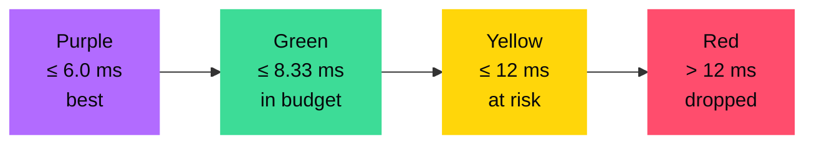
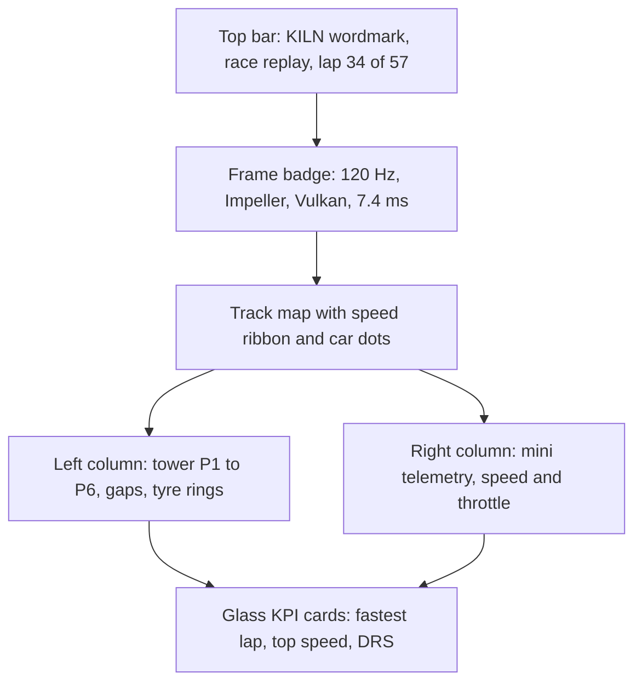

# Design system — "Obsidian & Aurora"

A dark, instrument-panel look inspired by a pit wall: calm surfaces, precise numbers,
and colour used only when it carries meaning. Tuned for projectors.

## Principles

1. **Colour means something.** Accents encode data or state, never decoration.
2. **Numbers are the hero.** Every metric uses monospaced, tabular figures so digits never jitter.
3. **Readable from the back row.** Large type, strong contrast, no thin weights.
4. **Motion reveals cause and effect.** Jank pulses red; a fix sweeps green.
5. **The design is also a test load.** Glass and glow exist because they are realistic sources of GPU cost.

## Colour palette

### Surfaces and text

| Token | Hex | Use |
|---|---|---|
| `bg` | `#07080C` | App background (obsidian) |
| `surface` | `#10131A` | Cards, panels |
| `surfaceElevated` | `#171B24` | Sheets, controls, pressed states |
| `hairline` | `#262B36` | Borders, dividers, track underlay |
| `textPrimary` | `#F2F4F8` | Primary text and numbers |
| `textSecondary` | `#9AA3B2` | Labels, captions |

### Accents

| Token | Hex | Meaning |
|---|---|---|
| `ember` | `#FFB547` | Brand accent, leader highlight, throttle trace |
| `aurora` | `#4FD1FF` | Data accent, speed trace, DRS |
| `violet` | `#8B5CF6` | GPU / raster-related UI |

### F1 timing colours (frame state)

The frame-budget display reuses the colours F1 fans already read on timing screens.

| Token | Hex | Frame state | Rule at 120 Hz |
|---|---|---|---|
| `purple` | `#B26BFF` | Best | ≤ 6.0 ms |
| `green` | `#3DDC97` | In budget | ≤ 8.33 ms |
| `yellow` | `#FFD60A` | At risk | ≤ 12 ms |
| `red` | `#FF4D6D` | Dropped | > 12 ms |

### Tyre compounds (tower)

| Compound | Ring colour |
|---|---|
| Soft | `#FF4D6D` |
| Medium | `#FFD60A` |
| Hard | `#F2F4F8` |

## Typography

| Role | Font | Weight | Size (sp) |
|---|---|---|---|
| Display (Lights Out, finale) | Space Grotesk | 600 | 40–56 |
| Screen title | Space Grotesk | 600 | 24 |
| Section label | Inter | 500, letter-spaced 0.08em | 12–13 |
| Body | Inter | 400 | 16 |
| Numbers, timings, codes | JetBrains Mono, tabular figures | 500–600 | 16–28 |

Fonts are bundled as assets (no runtime downloads).

## Spacing and shape

| Token | Value |
|---|---|
| Spacing scale | 4, 8, 12, 16, 24, 32 |
| Card radius | 16 |
| Sheet radius | 24 |
| Pill radius | 999 |
| Border | 1 px `hairline` |

## Motion

| Event | Motion |
|---|---|
| Frame over budget | Engine Room bar and badge pulse red (one 200 ms pulse, not looping) |
| Pit stop applied | Green sweep across the toggled card (300 ms) |
| Position change in tower | Row slides to new position (fixed mode uses transforms only) |
| Lights Out | Five lights on at 1 s intervals, all out together |

All decorative motion respects the system "remove animations" setting, except the replay itself.

## Stage readability rules

- No presented text below 16 sp; numbers at least 18 sp.
- Contrast at least 4.5:1 for text (all text tokens above pass on `bg` and `surface`).
- Avoid large pure-black areas next to bright glows; projectors crush blacks.
- Test the palette on the actual projector or a cheap one during rehearsal.

## Example: Pit Wall layout

