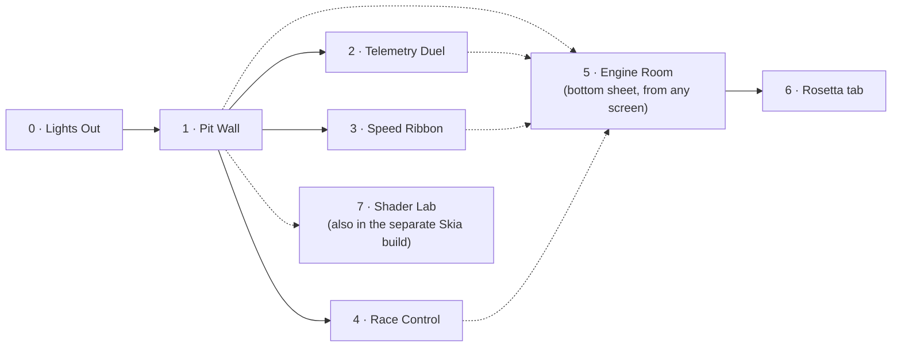

# Screens

Every screen, what it shows, the anti-pattern it hides, and the fix. Requirement IDs refer
to the [PRD](../product/PRD.md); pit stop IDs refer to the [TRD](../technical/TRD.md).

## Navigation

Every screen can also be opened with a `kiln://scenario/<id>` deep link.

---

## 0 · Lights Out

**Purpose:** a dramatic, clean start and a clear "frame zero" in the trace.

- Five red lights switch on one per second, then all go out; the replay starts.
- Emits a `KILN::LightsOut` span so the start is easy to find in Perfetto.
- No anti-pattern.

## 1 · Pit Wall (home)

**Purpose:** the "beautiful but lying" dashboard. Hosts four anti-patterns: one inside a
custom painter, three in the widget tree.

| Area | Shows | Anti-pattern (broken) | Fix (pit stop) |
|---|---|---|---|
| Track map | Circuit outline, speed-coloured ribbon, 20 car dots | Circuit and cars in one painter; `shouldRepaint` always true, so the static circuit repaints every frame | `map-layers`: static circuit behind a `RepaintBoundary`, cars in a separate light painter |
| Car glow | Soft team-colour halo under each car dot | Cars painter calls `canvas.saveLayer` with a blur for every car: 20 offscreen passes | `car-glow`: each halo is a circle filled with a `RadialGradient`; same look, no layer |
| Tower | P1–P20, gaps, tyre rings | Position changes animated with group `Opacity`; rows clipped with `Clip.antiAliasWithSaveLayer` | `tower-fade`: fade leaf colours instead of the group, rounded decoration instead of a clip |
| KPI cards | Fastest lap, top speed, DRS | One `BackdropFilter` per frosted card | `glass-group`: `BackdropGroup` + `BackdropFilter.grouped` with identical filters |

**What the audience sees in traces:** raster thread over budget; offscreen-layer
checkerboard lights up the car dots, the tower and the cards; with Track Paints on, the
circuit's paint event appears every frame until `map-layers` is applied.

## 2 · Telemetry Duel

**Purpose:** the path tessellation lesson.

- Two drivers' speed, throttle and brake traces for the current lap, overlaid, with a moving cursor and a delta line.
- **Broken:** every frame builds new `Path` objects with thousands of segments for every trace.
- **Fix (`duel-paths`):** each trace is reduced to at most two samples per pixel column, built once per size, and the cursor moves in its own painter.
- **Talk point:** every path is flattened and triangulated on the CPU on the raster thread, every frame — Impeller has no raster cache. Drawing ~400 segments instead of 4,000 curves is the raster win; skipping the rebuild is the UI win.
- **Code:** [`samples/lib/src/telemetry_duel`](../../samples/lib/src/telemetry_duel)

## 3 · Speed Ribbon

**Purpose:** the canvas we thrash on stage, and the draw-call volume lesson (Vulkan).

- Full-screen circuit, coloured segment by segment by the selected driver's speed.
- **Thrash dial (1×, 2×, 4×, 8×):** multiplies segment density and adds a speed trail for
  every car. At 1× the ribbon is about a thousand segments; at 8× the raster thread is far
  over budget. The dial sits on the screen itself, not only in the Engine Room, so the
  audience sees the stress being applied.
- **Broken:** one `drawPath` call per segment, each with its own paint.
- **Fix (`ribbon-vertices`):** one `drawVertices` call with a colour per vertex. The vertex
  count still grows with Thrash; the draw count stays at one.
- **Second fix (`ribbon-shader`):** colour and an animated glow computed by a fragment shader
  compiled at build time, in the same single draw. Shows Impeller's precompiled pathway.
- **Talk point:** on Vulkan, cost is volume: tessellations, pipeline binds, buffer binds and
  draws recorded into the command buffer every frame
  ([flutter#193399](https://github.com/flutter/flutter/issues/193399)).

## 4 · Race Control

**Purpose:** prove that not every jank is GPU jank.

- Feed of flags, penalties and messages, with new batches arriving during the replay.
- **Broken:** each batch's JSON is decoded inside `build()`; the UI bar turns red while raster stays green.
- **Fix (`feed-isolate`):** `Isolate.run` decodes off the main thread; the list reads cached results.
- **Talk point:** since Flutter 3.29 Dart runs on the platform main thread, so blocking it now also blocks platform work — exactly like blocking the main thread in Kotlin or Swift.

## 5 · Engine Room (bottom sheet)

**Purpose:** the instrument panel. Always one swipe away.

| Element | Detail |
|---|---|
| Budget bars | UI and Raster, each with a 4.17 ms target tick and an 8.33 ms limit line; Total against 8.33 ms in F1 timing colours |
| Thrash | Current level (1× to 8×), mirrored from the Speed Ribbon dial |
| Stats | Rolling p50, p90, p99 and jank count over the last 240 frames |
| Renderer badge | "Impeller · Vulkan" or "Impeller · OpenGL ES", refresh rate |
| Pit stops | One switch per fix, labelled with the thread it helps |
| Actions | Replay 5s, Box all, Reset |

Built cheaply on purpose (TR-7): its own `RepaintBoundary`, one painter, text updated at most four times per second.

## 6 · Rosetta (tab inside Engine Room)

Translation table for Kotlin and iOS engineers. Content: [Rosetta](../reference/rosetta.md).

## 7 · Shader Lab

**Purpose:** show shader compilation jank live: Skia compiling on first use versus Impeller's
ahead-of-time shaders. Built twice (see [TRD §11.1](../technical/TRD.md#111-shader-lab-two-apks-two-renderers)).

- A dark, empty stage with one button: **Lights on**.
- Pressing it reveals a scene that uses many effects for the first time at once: gradients,
  a frosted blur panel, a `ShaderMask` title, blend-mode colour filters, anti-aliased clips
  and the `speed_ramp.frag` shader.
- Top right: the renderer badge ("Skia · OpenGL ES" or "Impeller · Vulkan") so the audience
  always knows which build is on screen.
- Centre bottom: **worst frame since entry** in large type (milliseconds), coloured with the
  F1 timing colours.
- No anti-pattern and no pit stops: the only variable is the renderer.

| Run | What the audience should see |
|---|---|
| Skia, first entry after `pm clear` | Worst frame spikes; DevTools shows a long raster frame |
| Skia, second entry | Much smaller: shaders are now cached on the device |
| Impeller, first entry | Flat or close to flat; nothing generated mid-frame |

## Anti-pattern coverage

