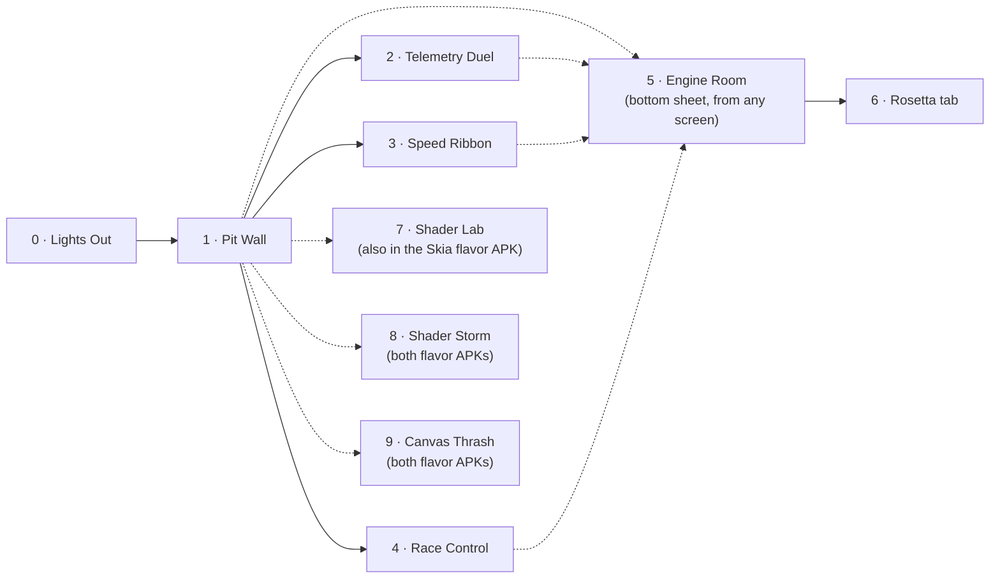
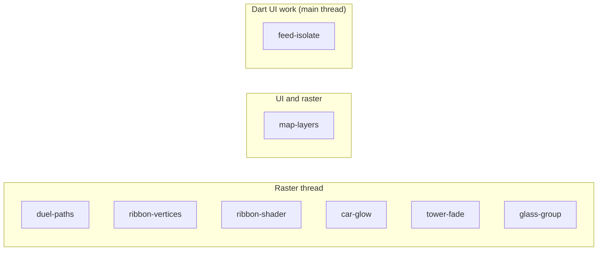

# Screens

Every screen, what it shows, the anti-pattern it hides, and the fix. Requirement IDs refer
to the [PRD](../product/PRD.md); pit stop IDs refer to the [TRD](../technical/TRD.md).

## Navigation

The current Kiln launcher shows two entries: **Shader Storm** and **Canvas Thrash**. The
Markets screen (Shader Lab) is still in the app at the `/shaderlab` route but is not listed,
because it needs live Binance data. Screens 0 to 6 describe the earlier F1 concept.

Every screen can also be opened with a `kiln://scenario/<id>` deep link.

---

## 0 · Lights Out

**Purpose:** a dramatic, clean start and a clear "frame zero" in the trace.

- Five red lights switch on one per second, then all go out; the replay starts.
- Emits a `KILN::LightsOut` span so the start is easy to find in Perfetto.
- No anti-pattern.

## 1 · Pit Wall (home)

**Purpose:** the "beautiful but lying" dashboard. Hosts four anti-patterns: one inside a
custom painter, three in the widget tree.

| Area | Shows | Anti-pattern (broken) | Fix (pit stop) |
|---|---|---|---|
| Track map | Circuit outline, speed-coloured ribbon, 20 car dots | Circuit and cars in one painter; `shouldRepaint` always true, so the static circuit repaints every frame | `map-layers`: static circuit behind a `RepaintBoundary`, cars in a separate light painter |
| Car glow | Soft team-colour halo under each car dot | Cars painter calls `canvas.saveLayer` with a blur for every car: 20 offscreen passes | `car-glow`: each halo is a circle filled with a `RadialGradient`; same look, no layer |
| Tower | P1–P20, gaps, tyre rings | Position changes animated with group `Opacity`; rows clipped with `Clip.antiAliasWithSaveLayer` | `tower-fade`: fade leaf colours instead of the group, rounded decoration instead of a clip |
| KPI cards | Fastest lap, top speed, DRS | One `BackdropFilter` per frosted card | `glass-group`: `BackdropGroup` + `BackdropFilter.grouped` with identical filters |

**What the audience sees in traces:** raster thread over budget; offscreen-layer
checkerboard lights up the car dots, the tower and the cards; with Track Paints on, the
circuit's paint event appears every frame until `map-layers` is applied.

## 2 · Telemetry Duel

**Purpose:** the path tessellation lesson.

- Two drivers' speed, throttle and brake traces for the current lap, overlaid, with a moving cursor and a delta line.
- **Broken:** every frame builds new `Path` objects with thousands of segments for every trace.
- **Fix (`duel-paths`):** each trace is reduced to at most two samples per pixel column, built once per size, and the cursor moves in its own painter.
- **Talk point:** every path is flattened and triangulated on the CPU on the raster thread, every frame — Impeller has no raster cache. Drawing ~400 segments instead of 4,000 curves is the raster win; skipping the rebuild is the UI win.
- **Code:** [`samples/lib/src/telemetry_duel`](../../samples/lib/src/telemetry_duel)

## 3 · Speed Ribbon

**Purpose:** the canvas we thrash on stage, and the draw-call volume lesson (Vulkan).

- Full-screen circuit, coloured segment by segment by the selected driver's speed.
- **Thrash dial (1×, 2×, 4×, 8×):** multiplies segment density and adds a speed trail for
  every car. At 1× the ribbon is about a thousand segments; at 8× the raster thread is far
  over budget. The dial sits on the screen itself, not only in the Engine Room, so the
  audience sees the stress being applied.
- **Broken:** one `drawPath` call per segment, each with its own paint.
- **Fix (`ribbon-vertices`):** one `drawVertices` call with a colour per vertex. The vertex
  count still grows with Thrash; the draw count stays at one.
- **Second fix (`ribbon-shader`):** colour and an animated glow computed by a fragment shader
  compiled at build time, in the same single draw. Shows Impeller's precompiled pathway.
- **Talk point:** on Vulkan, cost is volume: tessellations, pipeline binds, buffer binds and
  draws recorded into the command buffer every frame
  ([flutter#193399](https://github.com/flutter/flutter/issues/193399)).

## 4 · Race Control

**Purpose:** prove that not every jank is GPU jank.

- Feed of flags, penalties and messages, with new batches arriving during the replay.
- **Broken:** each batch's JSON is decoded inside `build()`; the UI bar turns red while raster stays green.
- **Fix (`feed-isolate`):** `Isolate.run` decodes off the main thread; the list reads cached results.
- **Talk point:** since Flutter 3.29 Dart runs on the platform main thread, so blocking it now also blocks platform work — exactly like blocking the main thread in Kotlin or Swift.

## 5 · Engine Room (bottom sheet)

**Purpose:** the instrument panel. Always one swipe away.

| Element | Detail |
|---|---|
| Budget bars | UI and Raster, each with a 4.17 ms target tick and an 8.33 ms limit line; Total against 8.33 ms in F1 timing colours |
| Thrash | Current level (1× to 8×), mirrored from the Speed Ribbon dial |
| Stats | Rolling p50, p90, p99 and jank count over the last 240 frames |
| Renderer badge | "Impeller · Vulkan" or "Impeller · OpenGL ES", refresh rate |
| Pit stops | One switch per fix, labelled with the thread it helps |
| Recovery time | After a pit stop is turned on: "Recovered in 0.42 s" or "Not recovered", kept per pit stop |
| Actions | Replay 5s, Box all, Reset |

Built cheaply on purpose (TR-7): its own `RepaintBoundary`, one painter, text updated at most four times per second.

## 6 · Rosetta (tab inside Engine Room)

Translation table for Kotlin and iOS engineers. Content: [Rosetta](../reference/rosetta.md).

## 7 · Shader Lab

**Purpose:** show shader compilation jank live: Skia generating and compiling shader programs
on first use versus Impeller's offline-compiled shader set. UI lives in
`packages/shader_lab` and ships in the `impeller` and `skia` Android flavors of
`apps/kiln` (see [TRD §4](../technical/TRD.md#4-repository-layout-monorepo) and
[§11.1](../technical/TRD.md#111-shader-lab-one-project-two-flavor-apks)).

- A Binance watchlist, then one instrument: last price, 1-minute candles, and the bid/ask ladder.
  Those use solid paints and are on screen before the measurement.
- One button: **Draw depth**. It draws the already loaded order book with `depth_fill.frag`.
  That fill is the only new shader. The file is loaded before the tap, so the clock starts at the draw.
- Top right: the renderer badge (`Skia · OpenGL ES` or `Impeller`). The Impeller note says Flutter uses Vulkan when the driver is valid.
- The header shows the connected display's refresh rate and frame budget.
- Centre bottom: **recovery time** in large type (`0.912`): how long until frames stayed within that budget. Under it: **accumulated overrun**, **slowest frame**, and **first − repeat**, each with a one-line explanation. Purple when recovery is 0, then green, yellow, red.
- Right side: the **run board**, last 5 runs, newest first, each tagged *First* or *Repeat*.
  The Skia first and repeat runs sit one above the other, so the drop is visible without
  remembering numbers. **Clear** empties it.
- No anti-pattern and no pit stops: the only variable is the renderer.

| Run | What the audience should see |
|---|---|
| Skia, verified cold run after reset | Long recovery time, red; DevTools shows long raster frames |
| Skia, repeat run | Recovery time and the first-minus-repeat gap show the cached-shader improvement |
| Impeller, first run | Close to its repeat run; no Skia-style shader generation occurs mid-frame |

## 8 · Shader Storm

**Purpose:** make the JIT vs AOT difference visible from the back of the room. One tap
draws dozens of never-seen effects in one frame; Skia has to write and compile a shader for
each, Impeller only builds pipelines. UI lives in `packages/shader_lab`
([`shader_storm_screen.dart`](../../packages/shader_lab/lib/src/presentation/shader_storm_screen.dart)).

| Area, top to bottom | Shows |
|---|---|
| Header | Renderer badge, refresh rate and frame budget; one line on how this engine gets its shaders |
| **MOTION** | A dot that moves every frame. A freeze leaves a red bar for 4 s; a freeze longer than 1.6 s paints the whole lane |
| **UI · Dart on the main thread** | One bar per frame of Dart work (`buildDuration`), budget line, peak since the last reveal |
| **RASTER · engine on 1.raster** | One bar per frame of raster-thread work (`rasterDuration`), budget line, peak |
| Scoreboard | **FIRST REVEAL** and **REPEAT**: worst frame in the 16 frames after the tap, and frames over budget |
| Grid | 48, 96 or 144 tiles, each a different mix of gradient, stops, tile mode, blend, blur, colour filter, shape and stroke. The size is chosen before the first reveal of the process |
| Button | **REVEAL N EFFECTS**, then **HIDE** |

| Run (144 tiles, data cleared first) | What the audience should see |
|---|---|
| Skia, first reveal | Whole MOTION lane red; RASTER peak about 1.9 s; UI lane green |
| Skia, repeat | About 25 ms: the programs are cached |
| Impeller, first reveal | About 166 ms; a short red gap |
| Impeller, repeat | About 45–55 ms |

Every reveal writes `KILN::Storm::result` to logcat and to the timeline. Measurements and
traces: [09 · Shader Storm findings](../notes/09-shader-storm-findings.md).

## 9 · Canvas Thrash

**Purpose:** answer *"if compiling shaders is no longer the problem, what is?"*. A live
canvas is thrashed until frames go red, then fixed one cause at a time. UI lives in
`packages/shader_lab`
([`canvas_thrash_screen.dart`](../../packages/shader_lab/lib/src/presentation/canvas_thrash_screen.dart)).

| Area, top to bottom | Shows |
|---|---|
| Header | Title, refresh rate and frame budget, renderer badge |
| Canvas | Made-up market data, always animating: price lines scrolling left, glowing dots riding them, a rippling heat strip, a grid with price labels |
| Lanes | The UI and RASTER lanes from Shader Storm, with peaks since the last settings change |
| **THRASH** | 1×, 2×, 4×, 8×: multiplies lines, points per line, dots and strip segments |
| Fixes | **Simplify paths**, **Batch draws**, **Glow without layers**, **Isolate repaints**, each tagged with the lane it targets; **X-ray** shows the modelled triangles in a lens |
| Counters | Draws, layers, path points, grid repaints per second; with X-ray, line triangles per frame and per second |

| Broken pattern (fix off) | Fixed pattern (fix on) |
|---|---|
| New 8,000-point paths every frame | About two points per pixel column, built once, translated |
| One `drawPath` per heat strip segment | One `drawVertices` call |
| `saveLayer` + blur per dot | Radial gradient per dot |
| Grid painted with the moving content | Grid behind its own `RepaintBoundary` |

The canvas never stops animating, so the lanes always show the current cost. Every
settings change writes `KILN::Thrash::config` to the timeline, and the screen logs
`KILN::Thrash::sample` once a second. Concepts and expected effects:
[10 · Canvas Thrash](../notes/10-canvas-thrash.md).

## Anti-pattern coverage

