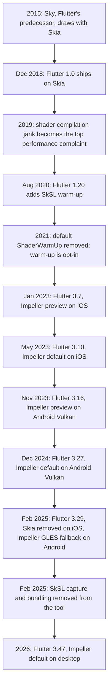
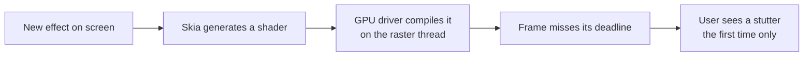
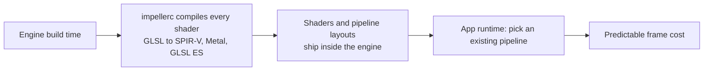
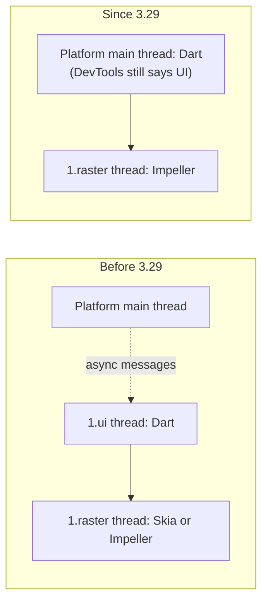

# History 01 — The rendering engine: Skia to Impeller

How Flutter went from "we draw with Skia, like Chrome and Android" to "we ship our own
renderer, Impeller", and what each step taught the team.

## Timeline

## Era 1 — Skia (2015 to 2022)

Flutter drew everything with **Skia**, the same 2D library behind Chrome and Android's own
UI. Skia is excellent and general-purpose, which was also the problem: it generated GPU
shaders on demand for whatever combination of paint, blend and clip it met.

The jank happened **once per shader per install**, which made it hard to catch in
development and impossible to fix by optimising Dart code.

## Era 2 — Workarounds (2019 to 2022)

| Year | Workaround | Why it was not enough |
|---|---|---|
| 2019 | `PaintingBinding.shaderWarmUp`: draw common shapes offscreen at startup | Needed Skia expertise to guess the right draw calls |
| 2020 | **SkSL warm-up** (Flutter 1.20): record shaders with `flutter run --cache-sksl`, bundle with `--bundle-sksl-path` | Device- and driver-specific, had to be re-captured after engine upgrades, and iOS still compiled on device |
| 2021 | Default warm-up removed | Admitted that warm-up could not scale |

The Flutter team's own conclusion in [issue #32170](https://github.com/flutter/flutter/issues/32170):
the real fix needs zero developer effort and must handle shaders no test ever saw. That
meant replacing Skia's runtime model, not patching it.

## Era 3 — Impeller (2023 to now)

**Impeller** is Flutter's own renderer, built around one rule: no shader compilation
while the app runs.

| Release | Date | Milestone |
|---|---|---|
| 3.7 | Jan 2023 | Impeller preview on iOS |
| 3.10 | May 2023 | Impeller is the default on iOS |
| 3.16 | Nov 2023 | Impeller preview on Android, Vulkan devices only, opt-in with `--enable-impeller` |
| 3.27 | Dec 2024 | Impeller is the default on Android devices with Vulkan; older devices stay on Skia |
| 3.29 | Feb 2025 | Skia removed from iOS. Android devices without working Vulkan use **Impeller on OpenGL ES** instead of Skia. MediaTek and PowerVR SoCs moved to OpenGL ES after crash reports. Android Hardware Buffer swapchains put behind a flag. `BackdropGroup` and `ImageFilter.shader` added. |
| 3.47 | 2026 | Impeller is the default on desktop |

### What Impeller deliberately dropped

| Skia behaviour | Impeller behaviour | What it means for you |
|---|---|---|
| Runtime shader generation | All shaders precompiled | No first-use stutter |
| Automatic raster cache | No raster cache | Expensive pictures repainted every frame are your job to fix |
| GPU path rendering (stencil techniques) | CPU tessellation into triangles | Very complex paths cost CPU time on the raster thread |
| One backend per platform | Vulkan, Metal and OpenGL ES backends behind one HAL | Check which backend the device actually uses |

The middle row is why the Kiln Telemetry Duel exists: a scene that was "free" under Skia's
raster cache now shows its true cost. See [Optimisation patterns](../notes/07-optimization-patterns.md).

## The threading change (2025)

Rendering was not the only thing that moved. Until Flutter 3.29, Dart ran on its own
**UI thread**, separate from the platform's main thread. Since 3.29, Dart on Android and
iOS runs on the **platform main thread**, which makes synchronous platform calls possible.
Impeller still runs on the **raster thread**.

## Talking points

- "Skia was not slow. It was **unpredictable**, and unpredictable is worse at 120 Hz."
- "Warm-up was the community trying to fix a renderer from the outside."
- "Impeller moved the cost from the user's first frame to our build machine."
- "Impeller removed the raster cache, so some old 'fast' code is now honestly slow. That is
  what we profile today."
