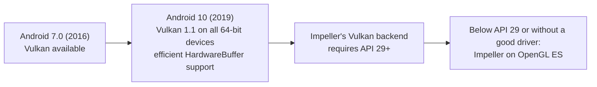
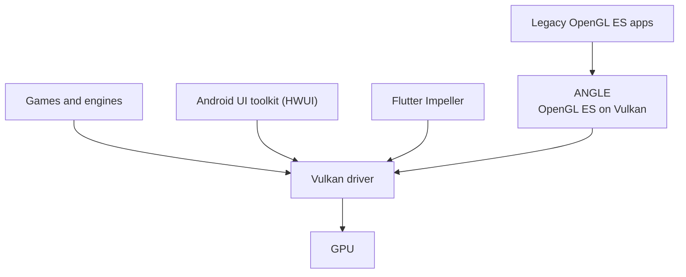

# History 02 — Graphics APIs: OpenGL ES to Vulkan

Impeller on Android is a Vulkan story, but Vulkan did not appear from nowhere. This is the
platform history behind the "Android 10+" in the talk title, with the iOS parallel for the
Swift developers in the room.

## Timeline

```mermaid
flowchart TB
    subgraph android["Android"]
        a1["2007: OpenGL ES 2.0, programmable shaders"]
        a2["2016: Vulkan 1.0; Android 7.0 exposes Vulkan in the NDK"]
        a3["2018: Vulkan 1.1"]
        a4["2019: Android 10; every 64-bit device supports Vulkan 1.1"]
        a5["2024: Android 15 ships ANGLE, OpenGL ES on top of Vulkan, as an option"]
        a6["Mar 2025: Vulkan becomes Android's official graphics API"]
        a7["Android 16 and 17: newer devices run more GL apps through ANGLE"]
        a1 --> a2 --> a3 --> a4 --> a5 --> a6 --> a7
    end
    subgraph ios["iOS"]
        i1["2007 to 2014: OpenGL ES only"]
        i2["2014: Metal, iOS 8"]
        i3["2018: OpenGL ES deprecated in iOS 12"]
        i4["2023: Flutter on iOS uses Impeller on Metal by default"]
        i1 --> i2 --> i3 --> i4
    end
```

## Why OpenGL ES had to go

OpenGL ES is a **state machine with a smart driver**. You set state and issue draws; the
driver validates, tracks resources, compiles shaders and schedules work behind your back.
That hidden work is exactly what turns into unexplained frame spikes.

| | OpenGL ES | Vulkan / Metal |
|---|---|---|
| Who validates state | Driver, on every draw | Application, once, when building pipelines |
| Shader compilation | Driver, often lazily on first draw | Up front, into pipeline objects |
| Command recording | Implicit, single context, single thread | Explicit command buffers, any thread |
| Render pass boundaries | Guessed by the driver | Declared by the app, with load and store operations |
| Cost profile | Unpredictable spikes | Predictable, but every call is your responsibility |

The last row matters for the talk: Vulkan removes hidden driver work but exposes the
**volume** of work. Impeller's remaining Android costs come from how many render passes and
calls a frame needs (see [Vulkan primer](../notes/04-vulkan-primer.md)).

## Why "Android 10+"

Android 10 is the first release where Vulkan 1.1 is guaranteed on 64-bit devices and
`HardwareBuffer` interop is efficient enough for platform views. That is the floor Impeller
picked for its Vulkan backend.

## Where Android is heading

Google's direction since 2024 is one GPU interface: **Vulkan**.

- **Android 15 (2024):** ANGLE included as an optional OpenGL ES driver.
- **March 2025:** Google announces Vulkan as the official Android graphics API.
- **Android 16:** newer devices must use ANGLE for some apps.
- **Android 17:** newer devices are expected to use ANGLE for most apps.

**For Flutter developers:** Impeller already talks Vulkan directly, so it is aligned with
where the platform is going. On a device that falls back to OpenGL ES, that GL may itself
run on Vulkan through ANGLE.

## The parallel for each audience

| Audience | Old stack | Modern stack |
|---|---|---|
| Flutter | Skia on OpenGL ES or Metal | Impeller on Vulkan or Metal |
| Android Views and Compose | HWUI with Skia on OpenGL ES | HWUI with Skia on Vulkan on compatible devices |
| iOS (UIKit, SwiftUI) | Core Animation on OpenGL ES | Core Animation on Metal |

The lesson is the same on every platform: move expensive, unpredictable work out of the
frame and into build time or setup time.
