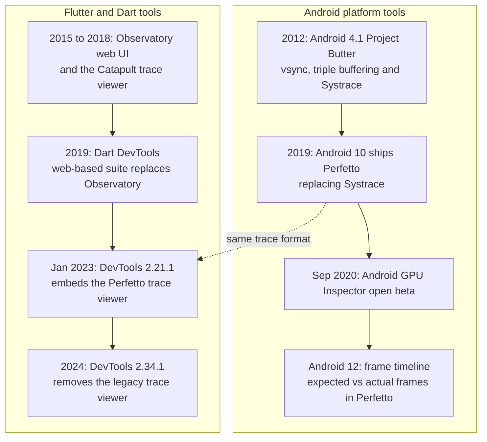
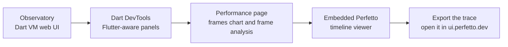

# History 03 — Profiling tools: Systrace and Observatory to Perfetto and DevTools

The talk promises live profiling. This page explains where today's tools came from, so
the audience understands why we use DevTools first, Perfetto second and AGI last.

## Timeline

## Android: Systrace to Perfetto

**Systrace** arrived with Android 4.1 (2012) as part of Project Butter, Google's push for
smooth 60 fps UI. It produced a short HTML report of kernel scheduling and `atrace`
markers. It was the first tool that let app developers see vsync and the render thread.

**Perfetto** became the platform tracing system in Android 10 (2019). It records the same
`atrace` markers plus many more data sources into a protobuf trace that can run for
minutes, and it ships a SQL engine (Trace Processor) for querying traces.

| | Systrace | Perfetto |
|---|---|---|
| Output | Compressed HTML report | Protobuf trace, opened in ui.perfetto.dev |
| Trace length | Seconds | Seconds to hours |
| Data sources | ftrace, atrace | ftrace, atrace, frame timeline, GPU render stages, heap, power, and more |
| Analysis | Visual only | Visual plus SQL |
| Status | Legacy | Recommended on Android 10+ |

Since **Android 12**, Perfetto's frame timeline shows each frame's **expected** and
**actual** timing from SurfaceFlinger. That is the strongest evidence of jank available on
Android, and it does not depend on Flutter's own counters.

## GPU: vendor tools to AGI

Before 2020, seeing GPU work meant vendor tools (Arm, Qualcomm) tied to specific chips.
**Android GPU Inspector** entered open beta in September 2020, starting with Pixel 4 on
Android 11. It reads GPU hardware counters and, for Vulkan apps, GPU activity per render
pass. Device support is still limited, which is why the demo treats AGI as optional.

## Flutter: Observatory to DevTools

- **Observatory** was the Dart VM's original web UI: isolates, heap, CPU profiles, and a
  timeline built on Chrome's Catapult viewer. It was deprecated and later removed from the
  Dart SDK.
- **Dart DevTools** (2019) rebuilt the experience around Flutter: widget inspector, frames
  chart, memory, network and CPU profiler.
- **DevTools 2.21.1 (January 2023)** replaced its own timeline viewer with an embedded
  **Perfetto** viewer, closing the gap with features engine developers used in
  Observatory. **DevTools 2.34.1 (2024)** removed the legacy viewer.

So DevTools and Android's system profiler now share a trace format. A Flutter trace and a
system trace can be read with the same UI and the same SQL.

## The modern workflow, and the history behind each step

| Step in the demo | Tool | Ancestor |
|---|---|---|
| 1. Is a frame over budget? | Engine Room badge (`FrameTiming`) and DevTools frames chart | `PerformanceOverlay` graphs |
| 2. Which thread and which span? | DevTools timeline (embedded Perfetto), `KILN::` spans | Observatory timeline |
| 3. Did the user actually see jank? | Perfetto frame timeline (SurfaceFlinger expected vs actual) | Systrace frame markers |
| 4. Is the GPU the bottleneck? | AGI or vendor tools | Vendor-specific GPU tools |
| 5. What is the raster thread doing in C++? | Local engine build plus CPU flame graph | Not possible for app developers |

## Talking points

- "In 2012 Android needed Project Butter to reach 60 fps. In 2026 we are budgeting
  8.33 ms for 120 Hz, and the tools have had to grow with that."
- "DevTools and Perfetto now speak the same trace format, so a Flutter developer and an
  Android platform engineer can read the same trace."
- "We use the tools in order of cost: DevTools first, Perfetto when we need system truth,
  AGI when the GPU is the suspect."

Practical commands and configs are in the [Profiling playbook](../notes/06-profiling-playbook.md).
