# History — from Skia and Systrace to Impeller and Perfetto

How Flutter rendering, the Android graphics stack and the profiling tools got to where
they are in 2026. The talk title says "Beyond Skia"; this section explains what we moved
beyond, why, and which modern tool replaced each old one.

Every date links back to a primary source in [Sources](../reference/sources.md).

## The three stories

| # | Document | Story |
|---|---|---|
| 01 | [Rendering engine](01-rendering-engine.md) | Skia, shader jank, SkSL warm-up, Impeller on iOS, Android, then everywhere |
| 02 | [Graphics APIs](02-graphics-apis.md) | OpenGL ES to Metal and Vulkan, ANGLE, Vulkan as Android's official API |
| 03 | [Profiling tools](03-profiling-tools.md) | Observatory and Systrace to DevTools, Perfetto and AGI |

## One timeline, three tracks

```mermaid
flowchart LR
    subgraph era1["2012 to 2018: foundations"]
        a1["2012<br/>Systrace ships<br/>with Android 4.1"]
        a2["2014<br/>Apple Metal"]
        a3["2016<br/>Vulkan 1.0<br/>Android 7.0 NDK"]
        a4["Dec 2018<br/>Flutter 1.0<br/>on Skia"]
    end
    subgraph era2["2019 to 2022: the jank years"]
        b1["2019<br/>Shader jank issue<br/>Dart DevTools<br/>Perfetto in Android 10"]
        b2["Aug 2020<br/>SkSL warm-up<br/>Flutter 1.20"]
        b3["Sep 2020<br/>AGI open beta"]
    end
    subgraph era3["2023 to 2026: the Impeller era"]
        c1["Jan 2023<br/>Impeller iOS preview<br/>DevTools embeds Perfetto"]
        c2["May 2023<br/>Impeller default on iOS"]
        c3["Dec 2024<br/>Impeller default<br/>on Android Vulkan"]
        c4["Feb 2025<br/>Skia gone on iOS<br/>Impeller GLES fallback<br/>Dart on main thread"]
        c5["Mar 2025<br/>Vulkan becomes Android's<br/>official graphics API"]
        c6["2026<br/>Impeller default<br/>on desktop"]
    end
    a1 --> a2 --> a3 --> a4 --> b1 --> b2 --> b3 --> c1 --> c2 --> c3 --> c4 --> c5 --> c6
```

## Then and now

What a performance-minded Flutter developer used before, and what replaces it today.

| Concern | Then | Now (2026) | Why it changed |
|---|---|---|---|
| Rendering engine | Skia | Impeller | Shaders are compiled at build time, so first-use compile stutter disappears |
| First-run jank fix | `ShaderWarmUp`, then SkSL capture with `--cache-sksl` | Nothing to do | Impeller ships every pipeline it needs; the SkSL tooling was removed in 2025 |
| Android GPU API | OpenGL ES | Vulkan, with Impeller's OpenGL ES backend as fallback | Explicit command buffers and render passes, lower driver overhead |
| iOS GPU API | OpenGL ES, then Metal under Skia | Metal under Impeller only | Skia was removed from the iOS engine in Flutter 3.29 |
| Repeated expensive pictures | Skia raster cache (automatic) | You decide: `RepaintBoundary`, simpler geometry, pre-built meshes | Impeller has no raster cache, by design |
| Where Dart runs | Separate `1.ui` thread | Platform main thread (DevTools still labels it UI) | Synchronous platform interop without message passing |
| Android system tracing | Systrace (HTML report) | Perfetto (protobuf trace, SQL, web UI) | Long traces, more data sources, queryable |
| Flutter timeline viewer | Observatory, Catapult trace viewer | DevTools Performance page with embedded Perfetto | One tool, frame-aware, exportable |
| GPU inspection | Vendor tools only | Android GPU Inspector, plus vendor tools | GPU counters and Vulkan render stages on supported devices |

## How this section fits the talk

The opening of the talk (see [Talk outline](../talk/talk-outline.md)) spends about two
minutes here. The key line for the audience:

> Skia taught us that unpredictable work is worse than slow work. Impeller made the work
> predictable. Perfetto and DevTools let us prove it.

For the deep technical detail, continue with the [deep-dive notes](../README.md#deep-dive-notes-notes),
starting with [The Skia era](../notes/02-skia-era.md).
