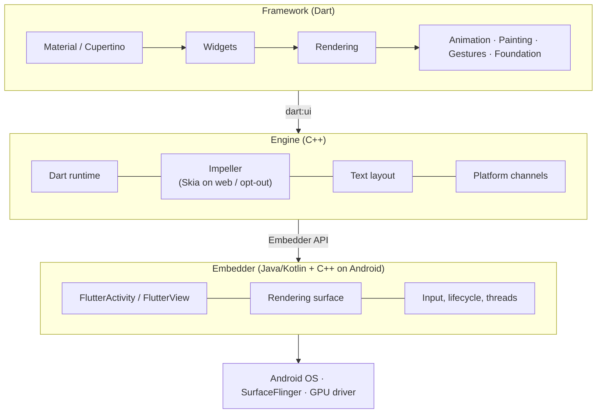
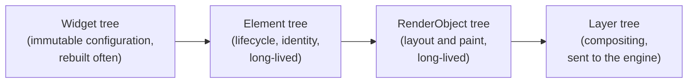
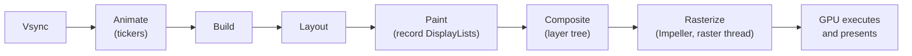
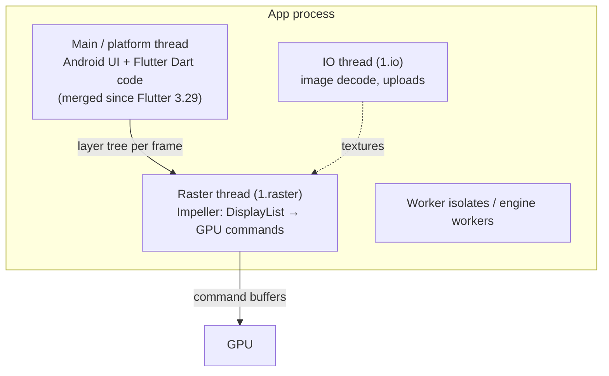
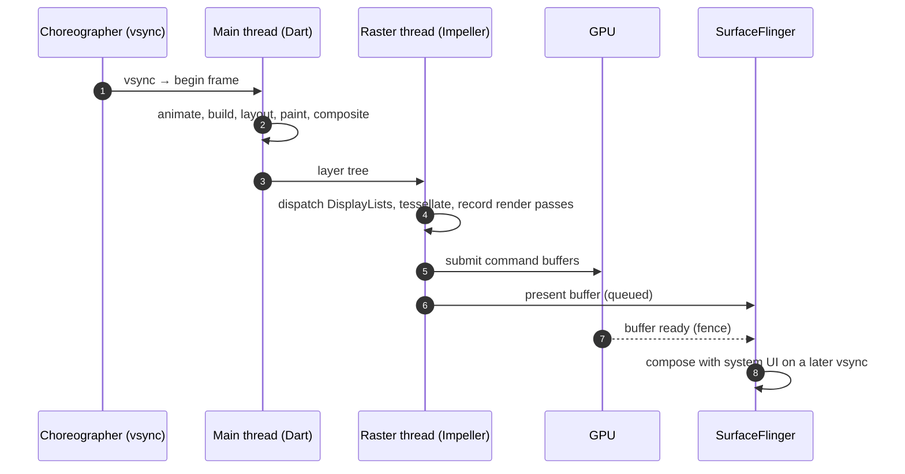

# 01 · How Flutter runs

From your `build()` method to pixels on an Android screen. This is the mental model the
rest of the notes build on.

## The three layers

| Layer | Written in | Responsibility |
|---|---|---|
| Framework | Dart | Widgets, layout, painting, animation, gestures. Everything you write lives here. |
| Engine | C++ | Runs Dart, renders frames (Impeller), lays out text, talks to the platform. Exposed to Dart through `dart:ui`. |
| Embedder | Java/Kotlin + C++ on Android | Hosts the engine in an `Activity`, provides the surface, forwards input, sets up threads. |

Flutter ships its own renderer inside the app. Unlike a Compose or UIKit app, it does not
ask the OS to draw platform widgets; it asks the GPU to draw triangles.

## How Dart is compiled

| Mode | Dart compilation | Use it for |
|---|---|---|
| Debug | JIT, with asserts and hot reload | Development only. **Never measure performance here.** |
| Profile | AOT to native ARM code, plus tracing hooks | All profiling, every number in this talk |
| Release | AOT, no tracing | Shipping |

## Three trees

Rebuilding widgets is cheap. Layout and paint are where the work is. Paint records
drawing commands into **DisplayLists** grouped into **layers**; nothing is rasterized in Dart.

## The frame pipeline

Steps from Animate to Composite are Dart work (DevTools "UI"). Rasterize is engine work on
the raster thread. The GPU then runs the command buffers Impeller submitted.

## Threads (2026)

**The big change:** since Flutter 3.29, Dart runs on the Android main thread; there is no
separate Flutter UI thread. DevTools still calls this work "UI". Consequences:

- Blocking Dart now blocks the Android main thread too, exactly as in Kotlin or Swift.
- Synchronous calls between Dart and the platform become possible (the reason for the change).
- In Perfetto, look for Dart work on the app's **main thread**, not a `1.ui` thread.

The **raster thread** runs on the CPU. "Raster time" means CPU time spent preparing GPU
work, plus any waiting on the GPU — not GPU execution time itself.

## How a frame gets on screen on Android

Main and raster work for consecutive frames overlap: while the raster thread draws frame
N, Dart can already build frame N+1. That pipelining is why each thread gets close to the
full frame budget, not half of it.

## Talk takeaway

> Your Dart code produces a description of a frame. Impeller turns that description into
> GPU work on another thread. Jank lives in one of those two places, and the profiler tells
> you which.

## Sources

[Architectural overview](https://docs.flutter.dev/resources/architectural-overview) ·
[What's new in Flutter 3.29](https://flutter.dev/blog/whats-new-in-flutter-3-29) ·
[Flutter performance profiling](https://docs.flutter.dev/perf/ui-performance)
