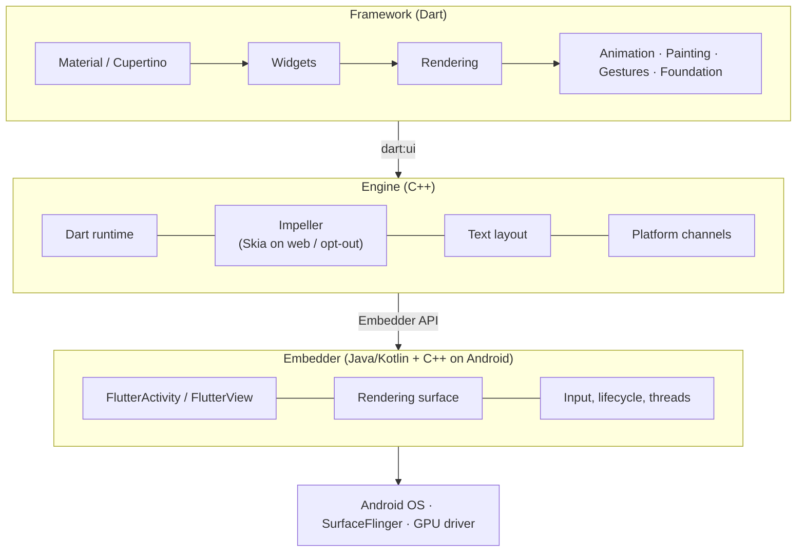
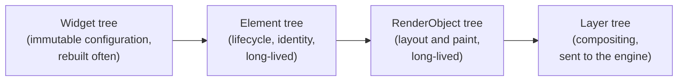
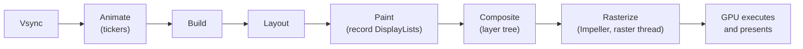
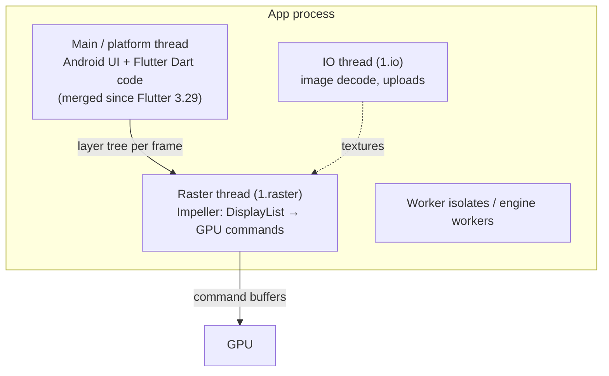
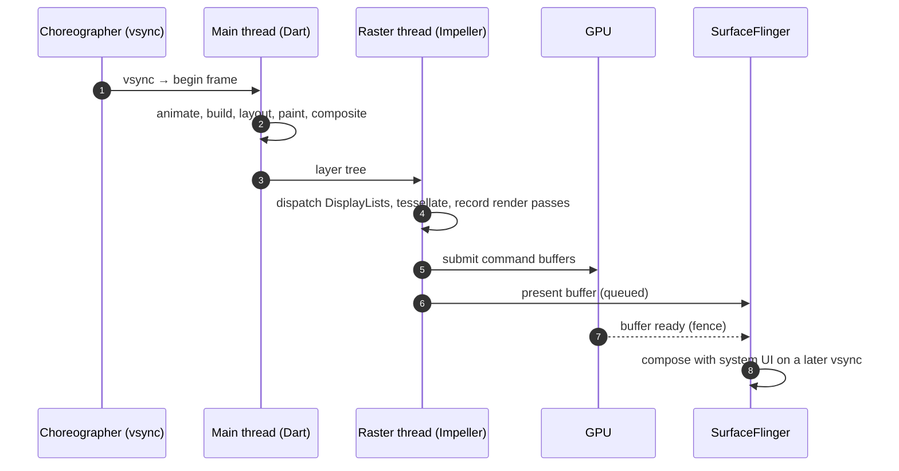

# 01 · How Flutter runs

From your `build()` method to pixels on an Android screen. This is the mental model the
rest of the notes build on.

## First: what is a thread?

An application starts as a **process**: an operating-system container with memory, files
and other resources. A **thread** is one ordered stream of CPU instructions inside that
process. Threads in the same process share memory, but each has its own call stack and
current instruction.

A **CPU core** is hardware that can execute a thread. The operating-system scheduler moves
runnable threads onto available cores and time-slices them when there are more runnable
threads than cores:

- **Concurrency** means multiple threads can make progress over the same period.
- **Parallelism** means threads are literally executing at the same instant on different cores.
- A thread can be **running**, **runnable but waiting for CPU time**, **sleeping**, or
  **blocked** waiting for another resource such as a GPU fence.
- If a frame-critical thread is busy or blocked, it cannot perform its next frame task
  before the display deadline.

At 120 Hz, Flutter must produce a frame opportunity every **8.33 ms**. Multiple threads let
Dart prepare one frame while Impeller rasterizes another, but concurrency does not remove
deadlines: late main-thread or raster-thread work still causes latency or jank.

A Dart **isolate** is related but not identical to a thread. It has its own Dart heap and
event loop and does not share mutable Dart objects with another isolate. `Isolate.run`
moves work away from the main isolate and allows the VM to execute it on worker capacity;
do not assume a permanent one-isolate-to-one-OS-thread mapping.

## The three layers

| Layer | Written in | Responsibility |
|---|---|---|
| Framework | Dart | Widgets, layout, painting, animation, gestures. Everything you write lives here. |
| Engine | C++ | Runs Dart, renders frames (Impeller), lays out text, talks to the platform. Exposed to Dart through `dart:ui`. |
| Embedder | Java/Kotlin + C++ on Android | Hosts the engine in an `Activity`, provides the surface, forwards input, sets up threads. |

Flutter ships its own renderer inside the app. Unlike a Compose or UIKit app, it does not
ask the OS to draw platform widgets; it asks the GPU to draw triangles.

## How Dart is compiled

| Mode | Dart compilation | Use it for |
|---|---|---|
| Debug | JIT, with asserts and hot reload | Development only. **Never measure performance here.** |
| Profile | AOT to native ARM code, plus tracing hooks | All profiling, every number in this talk |
| Release | AOT, no tracing | Shipping |

## Three trees

Rebuilding widgets is cheap. Layout and paint are where the work is. Paint records
drawing commands into **DisplayLists** grouped into **layers**; nothing is rasterized in Dart.

## The frame pipeline

Steps from Animate to Composite are Dart work (DevTools "UI"). Rasterize is engine work on
the raster thread. The GPU then runs the command buffers Impeller submitted.

## Thread names without the ambiguity

In current Flutter, **UI** and **main** often describe the same Dart work from two different
viewpoints:

| Name you see | What it means now | Where to find it |
|---|---|---|
| **Main thread** | The real Android/iOS platform thread. Since Flutter 3.29, it also runs Dart animation, build, layout, paint and compositing. | App's `main` thread in Perfetto |
| **UI** | DevTools and `FrameTiming` label for Dart frame work. It is a phase/metric label, **not a separate current thread**. | DevTools **UI** bar; `buildDuration` |
| **Raster thread** | A separate Flutter engine CPU thread. Impeller replays DisplayLists, tessellates paths, prepares render passes and records/submits GPU commands here. | `1.raster` in Perfetto; DevTools **Raster** bar; `rasterDuration` |
| **GPU** | Hardware executing submitted command buffers asynchronously. It is not a Flutter “GPU thread.” | Perfetto GPU tracks or AGI when supported |
| **Background isolate** | Dart work moved away from the main isolate, normally backed by another worker thread. | Its own isolate/thread events; neither the UI nor raster bar directly |
| **IO thread** | Flutter engine thread for image/resource IO and uploads. | `1.io` in Perfetto |

Older Flutter material can correctly show a separate **`1.ui`** thread. That was the old
model: before 3.29, the platform main thread and Flutter UI thread were distinct. For this
talk and current Kiln builds, say **“Dart UI work on the main thread.”**

Two profiler rules prevent most confusion:

1. A red **UI** bar means `buildDuration` was high on the **main thread**.
2. A red **Raster** bar means `rasterDuration` was high on **`1.raster`**. It does not by
   itself prove whether the CPU, GPU wait, memory bandwidth or scheduling caused the delay;
   use Perfetto or AGI to separate those cases.

## Threads in the app process (2026)

**The big change:** since Flutter 3.29, Dart runs on the Android main thread; there is no
separate Flutter UI thread in this app. DevTools still calls this work "UI". Consequences:

- Blocking Dart now blocks the Android main thread too, exactly as in Kotlin or Swift.
- Synchronous calls between Dart and the platform become possible (the reason for the change).
- In Perfetto, look for Dart work on the app's **main thread**, not a `1.ui` thread.

The **raster thread** runs on the CPU. "Raster time" means CPU time spent preparing GPU
work, plus any waiting on the GPU — not GPU execution time itself.

## How the threads relate to the talk

| Demo moment | Work being stressed | Where it appears |
|---|---|---|
| Shader Lab, Skia cold run | First-use shader generation and driver compilation can stall rendering | Mostly Raster / `1.raster`, with driver work triggered from that path |
| Telemetry Duel | Main records paths; raster thread repeatedly flattens and tessellates excessive geometry | Usually Raster dominant; compare both bars |
| Speed Ribbon Thrash | Main records many canvas operations; raster thread processes and submits thousands of draws | Raster / `1.raster`; Perfetto shows long back-to-back slices |
| Pit Wall layers, blur and `saveLayer` | Extra offscreen render passes and bandwidth | Raster, with GPU/back-pressure possible |
| Track map repaint isolation | Unnecessary paint recording on main plus unnecessary raster work | UI and Raster improve together |
| Race Control JSON decode | Synchronous Dart computation inside `build()` | UI metric on the platform main thread |
| `Isolate.run` pit stop | JSON decoding moves away from the main isolate | Worker execution; main-thread UI metric recovers |

This gives the diagnosis method used in every lap:

1. **UI red:** inspect Dart work on the main thread.
2. **Raster red:** inspect DisplayList complexity, tessellation, draws, layers and waits on
   `1.raster`.
3. **Frame still late but neither looks busy enough:** use Perfetto for scheduling,
   SurfaceFlinger and GPU/back-pressure evidence.

## How a frame gets on screen on Android

Main and raster work for consecutive frames overlap: while the raster thread draws frame
N, Dart can already build frame N+1. That pipelining is why each thread gets close to the
full frame budget, not half of it.

## Talk takeaway

> Your Dart code produces a description of a frame. Impeller turns that description into
> GPU work on another thread. Jank lives in one of those two places, and the profiler tells
> you which.

## Sources

[Architectural overview](https://docs.flutter.dev/resources/architectural-overview) ·
[What's new in Flutter 3.29](https://flutter.dev/blog/whats-new-in-flutter-3-29) ·
[Flutter performance profiling](https://docs.flutter.dev/perf/ui-performance)
