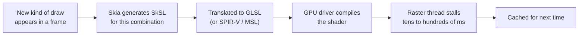

# 02 · The Skia era and why it had to end

Skia is the 2D graphics library behind Chrome and Android's own UI toolkit. It powered
Flutter from the start. Understanding its one structural weakness explains why Impeller exists.

## How Skia renders on the GPU

Skia is extremely general. For each new combination of draw state (shape type, paint,
gradient, blend mode, clip, antialiasing…) it **generates a shader program** on the fly.

The first time an animation used a new effect, the raster thread waited for the driver
compiler. Users saw a stutter **the first time** something happened — known as
**shader compilation jank** or "early-onset jank". It was most visible on iOS (Metal) and
on low-end Android GPUs.

## The workarounds (and why they failed)

| Workaround | Idea | Problem |
|---|---|---|
| Shader warm-up (`ShaderWarmUp`) | Draw common shapes offscreen at startup | Guesswork; slowed startup; default routine was removed in 2021 because it didn't help benchmarks |
| SkSL warm-up (`--cache-sksl`, `--bundle-sksl-path`) | Record shaders used during a manual run, bundle them in the app | Per device and driver, needed re-capturing for every app change; only reliably useful on iOS |
| Raster cache | Cache complex, stable layers as images | Heuristic, uses GPU memory, doesn't fix first-use compilation |

In February 2025 the SkSL bundling was **removed from the Flutter tool**: Skia can no longer
be used on iOS, and on other platforms the generated shaders were device-specific anyway.

## The insight behind Impeller

> You cannot fix runtime shader compilation with a cache. You fix it by not needing
> runtime compilation at all.

Impeller uses a **small, fixed set of shaders** written by the Flutter team, compiled
**when the engine is built**. Every Flutter drawing operation must be expressed with that
set. That is a constraint — and the source of its predictability.

## Skia vs Impeller at a glance

| | Skia (GPU backend) | Impeller |
|---|---|---|
| Shaders | Generated per draw combination at runtime | Fixed set, compiled at engine build time |
| First-use jank | Yes | No (by design) |
| Raster cache | Yes (heuristic) | No |
| Path filling | GPU techniques incl. stencil-based approaches | CPU tessellation to triangles, MSAA for antialiasing |
| Where it runs in 2026 | Web (CanvasKit / skwasm); Android when Impeller is disabled | iOS (only option), Android API 29+, desktop (default since 3.47) |

## What Skia did better (be honest on stage)

- A **raster cache** that could make some static-but-complex scenes cheap after a few frames.
- Mature, heavily tuned paths for some effects; certain blurs measured faster on Skia than on
  Impeller in 2025–2026 issues.

That is why the talk says Impeller is **predictable**, not **always faster**.

## Demo tie-in

A 60-second recorded clip on the demo device:
`flutter run --profile --no-enable-impeller`, open a screen for the first time, and show the
first-frame stutter in DevTools. Then the same screen with Impeller: no stutter, steady cost.

## Sources

[Impeller rendering engine](https://docs.flutter.dev/perf/impeller) ·
[Remove SkSL bundling — flutter#162849](https://github.com/flutter/flutter/pull/162849) ·
[No default shader warm-up — flutter#87126](https://github.com/flutter/flutter/pull/87126) ·
[cache-sksl not usable with Impeller — flutter#140310](https://github.com/flutter/flutter/issues/140310) ·
[Android backdrop filter slower than Skia — flutter#174984](https://github.com/flutter/flutter/issues/174984)
