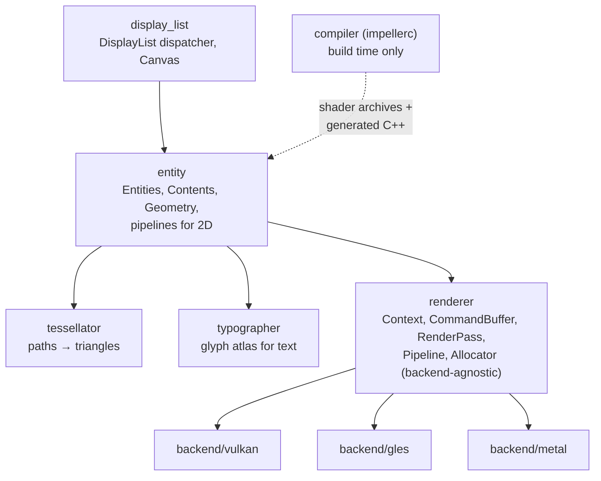
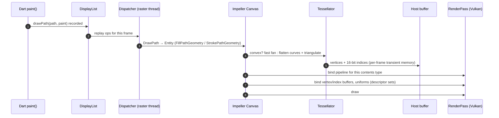
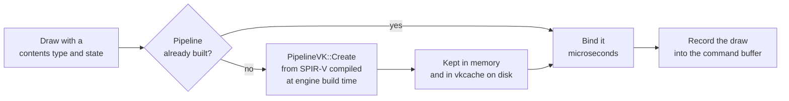

# 03 · Impeller internals

How Impeller is organised and what happens to one `canvas.drawPath` call. Complements the
shorter [research summary](../research/01-impeller-architecture.md).

## Design goals (from the Impeller README)

1. **Predictable performance** — shaders and reflection compiled offline; pipeline state built up front; caching explicit.
2. **Instrumentable** — every GPU resource is labelled.
3. **Portable** — shaders written once, converted per backend.
4. **Uses modern APIs well** — Metal and Vulkan first, OpenGL ES supported.
5. **Concurrency** — work can be spread across threads.

## Module map

| Module | What it does |
|---|---|
| `display_list` | Receives Flutter's DisplayLists on the raster thread and replays them onto an Impeller `Canvas`. |
| `entity` | An **Entity** = transform + blend mode + **Contents** (what to draw) using a **Geometry** (where). Holds the 2D pipelines. |
| `tessellator` | Turns paths into triangles on the CPU. |
| `typographer` | Rasterizes glyphs into an atlas texture; text is drawn as textured quads. |
| `renderer` | Thin abstraction over the GPU API: contexts, command buffers, render passes, pipelines, buffers. |
| `compiler` | `impellerc`: GLSL → SPIR-V → backend formats, plus reflected C++. Runs at build time. |

## Life of a `drawPath`

Key consequences:

- **Tessellation is CPU work on the raster thread, every time the path is drawn.** There is
  no cross-frame geometry cache to rely on, and no raster cache.
- **Curve flattening depends on scale.** The tolerance comes from the transform, so a path
  drawn larger produces more segments.
- **Each separate path is a separate draw** with its own binds. Thousands of small paths
  cost thousands of draws.

## Why triangulation instead of "stencil then cover"?

Many GPU vector renderers fill paths by writing a stencil mask, then covering it. The Impeller
team discussed this publicly ([flutter#123671](https://github.com/flutter/flutter/issues/123671)):

- Flutter's default fill rule is **non-zero**, which is awkward for simple stencil tricks.
- Impeller sometimes splits a `saveLayer` into several passes (backdrop filters, advanced
  blends). Storing a multisampled stencil between passes is expensive on Vulkan
  ([flutter#137302](https://github.com/flutter/flutter/issues/137302)).
- Convex shapes (the common case) already have fast specialised paths.

So Impeller triangulates on the CPU and relies on **MSAA** for smooth edges.

## Antialiasing: 4× MSAA on tile memory

- On mobile, Impeller renders with **4× multisampling**.
- The multisampled colour and the depth/stencil attachments are **device-transient**: they
  live in the GPU's on-chip tile memory and are resolved to the final 1× image before being
  written out, so the 4× data never touches main memory.
- Anything that forces those attachments out of tile memory (an extra render pass, storing
  the stencil) is expensive. That is the deep reason `saveLayer` hurts — see
  [04 · Vulkan primer](04-vulkan-primer.md).

## Offscreen passes

Operations that need the result of earlier drawing as an input require a **new render
target** (a new render pass):

- `saveLayer` with opacity, colour filters, image filters, `ShaderMask`
- `BackdropFilter` (reads what is already drawn)
- Advanced blend modes

Impeller keeps a **render target cache** so offscreen textures are reused between frames
instead of reallocated, but the pass switch itself still costs bandwidth.

**Opacity peephole:** when a group's children don't overlap, the engine can push the opacity
into each draw instead of allocating a layer. Overlapping children (a background plus text)
defeat it.

## Shaders and pipelines

- Impeller's own shaders (solid fill, gradients, texture, blur, blends…) are compiled into the
  engine at build time.
- Your `.frag` files declared in `pubspec.yaml` are compiled by the same `impellerc` when
  **your app** is built — see the
  [`speed_ramp.frag` sample](../../samples/shaders/speed_ramp.frag).
- A pipeline (shaders + fixed state) is chosen per draw; "SetPipeline" is one of the most
  frequent calls in Vulkan traces.
- **Pipelines are not all built up front.** Impeller builds many at startup; a draw that needs
  a combination of shader and state that does not exist yet (for example a blend mode or
  attachment setup not used before) builds it on the raster thread, inside that frame. The
  driver turns the precompiled SPIR-V into GPU machine code at that point.
- Built pipelines are saved to a Vulkan pipeline cache on disk
  (`code_cache/flutter.impeller.vkcache`), so the next launch builds them faster.

Measured on a Mali phone ([note 09](09-shader-storm-findings.md)): revealing 48 new effects
built **30 pipelines in 58 ms** on `1.raster`, about 2 ms each; the repeat built none.
Skia, for the same tiles, built 52 programs in 648 ms.

## Android specifics

- **Backend:** Vulkan on API 29+ devices with Vulkan 1.1 and required extensions; otherwise Impeller's OpenGL ES backend (since 3.29 there is no Skia fallback on Android).
- **Swapchain:** by default a standard Vulkan (KHR) swapchain. The engine also contains an
  `AHardwareBuffer` + `SurfaceControl` swapchain (API 29+) that presents directly through
  SurfaceFlinger transactions; it is opt-in and falls back to KHR.
- **Platform views** using hybrid composition merge the raster and platform threads.

## What Impeller does **not** do

| Myth | Reality |
|---|---|
| "RepaintBoundary caches my widget as an image" | It isolates repaints; Impeller has no raster cache. Use `SnapshotWidget` or `toImageSync` deliberately. |
| "Impeller uses GPU tessellation shaders" | Path tessellation is on the CPU. |
| "No shader compilation means no raster cost" | Raster cost is tessellation, draw volume, offscreen passes and fill rate. |
| "AOT means nothing happens on first use" | Pipelines for new GPU states are still built in the frame (measured 30 in 58 ms for 48 new effects). |
| "Impeller is always faster than Skia" | More predictable; some effects measured slower. |

## Sources

[Impeller README](https://github.com/flutter/flutter/blob/main/engine/src/flutter/impeller/README.md) ·
[Tessellator API](https://api.flutter.dev/impeller/classimpeller_1_1_tessellator.html) ·
[DisplayList dispatcher](https://github.com/flutter/engine/blob/main/impeller/display_list/dl_dispatcher.cc) ·
[Swapchain transients (MSAA)](https://api.flutter.dev/impeller/classimpeller_1_1_swapchain_transients_v_k.html) ·
[AHB swapchain](https://api.flutter.dev/impeller/classimpeller_1_1_a_h_b_swapchain_v_k.html) ·
[flutter#123671](https://github.com/flutter/flutter/issues/123671) ·
[flutter#137302](https://github.com/flutter/flutter/issues/137302) ·
[flutter#142550 (no raster cache)](https://github.com/flutter/flutter/issues/142550)
