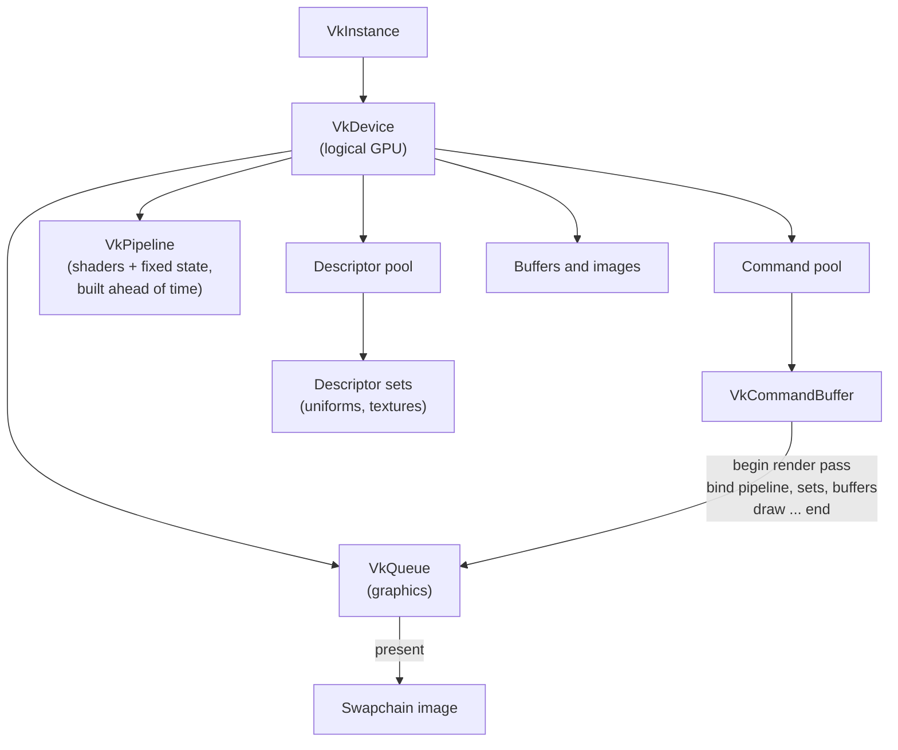
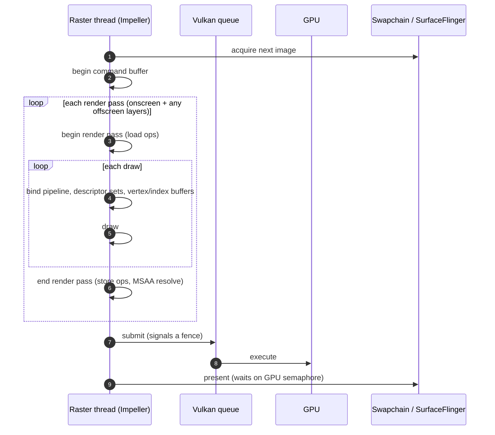
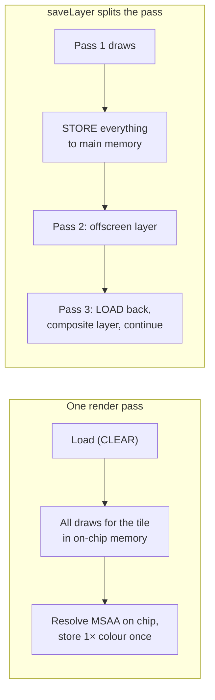

# 04 · Vulkan primer for Flutter engineers

Enough Vulkan to explain what Impeller is doing on Android, and why some Flutter widgets
are expensive on mobile GPUs.

## Why Vulkan matters here

OpenGL ES hides work inside the driver: state validation, resource tracking, shader
compilation at awkward times. Vulkan makes the application (here, Impeller) do that work
explicitly and up front. That suits Impeller's goal of predictability: pipelines are built
ahead of time, and per-frame work is mostly recording and submitting commands.

## Core objects

| Vulkan concept | Plain meaning | Impeller class (Vulkan backend) |
|---|---|---|
| Instance / device / queue | Connection to the GPU and its work queue | `ContextVK` |
| Command buffer | A recorded list of GPU commands | `CommandBufferVK` |
| Render pass | A block of drawing into a set of attachments (colour, depth/stencil) | `RenderPassVK` |
| Pipeline | Compiled shaders + fixed GPU state | `PipelineVK`, `PipelineLibraryVK` |
| Descriptor set | Bindings of uniforms and textures for a draw | `DescriptorPoolVK` |
| Queue submit | Hand recorded commands to the GPU | `CommandQueueVK`, `QueueVK` |
| Fence / semaphore | CPU–GPU and GPU–GPU synchronisation | `FenceWaiterVK` and friends |
| Swapchain | Images that get presented to the screen | `KHRSwapchainVK` (default), `AHBSwapchainVK` (opt-in on Android) |

## One frame in Vulkan terms

From the 2026 investigation in [flutter#193399](https://github.com/flutter/flutter/issues/193399):
one heavy scene issued ~285 draws per frame, which meant ~1,800 small calls
(`SetPipeline`, `SetVertexBuffer`, `SetIndexBuffer`, `BindResource`, `Draw`). No single call
was slow; **volume** was the cost. Descriptor allocation was not the bottleneck (the pool
cache hit ~94% of the time).

## Tile-based GPUs: the key to mobile performance

Almost all mobile GPUs are **tile-based**: they split the screen into small tiles and render
each tile in fast on-chip memory, writing to main memory only at the end of a render pass.

Every **render pass boundary** can force the GPU to write tile contents out to main memory
and read them back later. Memory bandwidth is slow and costs battery. That is why the Flutter
docs describe a render-target switch as forcing a "firehose" GPU to redirect its stream.

### Load and store operations

| Setting | Meaning | Cost on a tiler |
|---|---|---|
| `LOAD_OP_CLEAR` | Start the tile from a clear colour | Cheap (no memory read) |
| `LOAD_OP_LOAD` | Start from the previous contents | Full-screen memory read |
| `LOAD_OP_DONT_CARE` | Contents undefined | Cheapest |
| `STORE_OP_STORE` | Write results to memory | Full-screen memory write |
| `STORE_OP_DONT_CARE` | Discard (e.g. depth, MSAA samples) | Free |

Impeller keeps MSAA and depth/stencil attachments **transient** (never stored) and resolves
MSAA on chip. Offscreen layers break that: the layer must be stored so it can be sampled.

## Mapping Flutter widgets to Vulkan cost

| You write | Impeller does | Vulkan consequence |
|---|---|---|
| Many small `drawPath` calls | One draw each | Many pipeline/buffer binds and draws |
| One `drawVertices` mesh | One draw | One bind set, one draw |
| `Opacity` over overlapping children | `saveLayer` | Extra render pass, store + load |
| `BackdropFilter` per card | Read back + blur per card | Several extra passes |
| `BackdropGroup` with identical filters | One shared backdrop pass | Fewer passes |
| Custom `.frag` shader | Pipeline from a precompiled shader | No runtime compilation |

## Seen in Canvas Thrash

[Canvas Thrash](10-canvas-thrash.md) has a live broken and fixed version of three rows of
the table above:

| Fix | Broken | Fixed | Vulkan consequence |
|---|---|---|---|
| Batch draws | 480 `drawPath` calls for the heat strip at 8× | One `drawVertices` call | Hundreds of bind-and-draw sequences become one |
| Glow without layers | 64 `saveLayer` + blur calls at 8× | Radial gradients in the main pass | 64 extra render passes, each a store and a load on a tiler, disappear |
| Simplify paths | 8,000-point stroked paths, tessellated every frame | About two points per pixel column | Smaller per-frame vertex buffers to fill and upload |

## How to see it

- **Perfetto `gpu.renderstages`** (if the driver supports it): GPU-side render passes per frame.
- **AGI frame profiler**: every Vulkan command, render pass, draw, pipeline and texture for one frame.
- **Stock DevTools**: only the CPU side on the raster thread; per-draw Vulkan events are limited in release engines.

## Sources

[Vulkan tile-based rendering best practices](https://docs.vulkan.org/guide/latest/tile_based_rendering_best_practices.html) ·
[Arm: picking efficient load/store operations](https://developer.arm.com/community/arm-community-blogs/b/mobile-graphics-and-gaming-blog/posts/picking-the-most-efficient-load-store-operations) ·
[Vulkan command buffer usage](https://docs.vulkan.org/samples/latest/samples/performance/command_buffer_usage/README.html) ·
[Flutter performance best practices (saveLayer)](https://docs.flutter.dev/perf/best-practices) ·
[flutter#193399](https://github.com/flutter/flutter/issues/193399) ·
[Impeller swapchain selection](https://api.flutter.dev/impeller/swapchain__vk_8cc_source.html)
