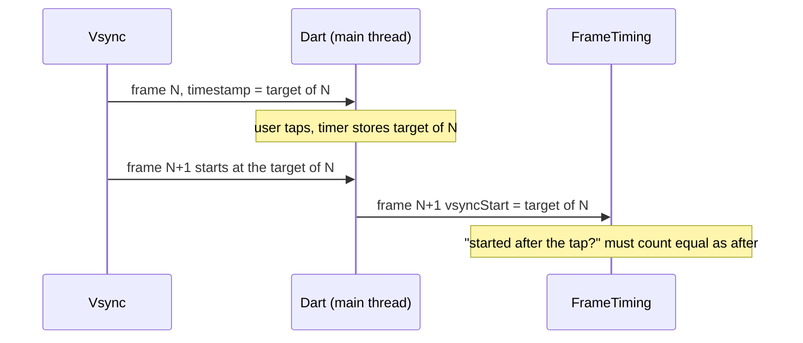
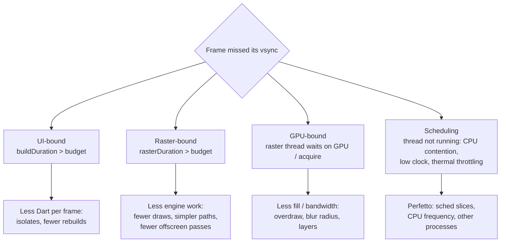

# 05 · Frame scheduling and the 120 Hz budget

How a frame is scheduled, what the budget really is, and the different ways a frame can
be late.

## The budget

| Refresh rate | Frame interval |
|---|---|
| 60 Hz | 16.67 ms |
| 90 Hz | 11.11 ms |
| 120 Hz | **8.33 ms** |

`FrameTiming` reports three durations per frame (in profile and release builds):

| Field | From → to | Meaning |
|---|---|---|
| `buildDuration` | Begin frame → `render()` called | Dart: animate, build, layout, paint, composite |
| `rasterDuration` | Raster start → raster finish | Impeller on the raster thread |
| `totalSpan` | Vsync start → raster finish | End-to-end latency for this frame |

The Kiln monitor that reads these is in
[`frame_budget_monitor.dart`](../../samples/lib/src/frame_budget/frame_budget_monitor.dart).
The engine delivers timings in batches, not per frame, so on-screen readouts lag the
screen slightly. In Shader Storm the bars update a few times a second.

### Two clocks for one frame

Dart and `FrameTiming` describe a frame with different timestamps:

| Where | Timestamp | Meaning |
|---|---|---|
| `SchedulerBinding.currentSystemFrameTimeStamp` (what tickers see) | vsync **target** | When this frame is due on screen |
| `FrameTiming` `vsyncStart` | vsync **start** | When work on this frame began |

When frames run back to back, the previous frame's target equals the next frame's start.
Code that says "ignore frames that started at or before the timestamp I saw when the user
tapped" therefore throws away the very frame it wants to measure. Kiln's `FrameWindow` did
exactly that and reported 68 ms for a 677 ms frame until it was fixed; see
`engine/src/flutter/shell/common/animator.cc` in the Flutter SDK, where the engine passes
the target time to Dart.

## How the profiler names map to threads

| DevTools / `FrameTiming` | Actual execution | Typical causes when high |
|---|---|---|
| **UI** / `buildDuration` | Dart frame phases on the platform **main thread** | Expensive `build`, layout or paint recording; synchronous JSON work; too many rebuilds |
| **Raster** / `rasterDuration` | Impeller engine work on **`1.raster`**, a CPU thread | Path tessellation, draw volume, render passes, blur, resource work, waiting for GPU/surface |
| **Total span** / `totalSpan` | Vsync start through raster finish across the pipeline | End-to-end frame latency; not a third thread and not simply UI + raster because frames pipeline |
| **Expected vs Actual** | SurfaceFlinger frame timeline | Whether the buffer reached Android's compositor on time |

The GPU is downstream of `1.raster`. A long Raster bar can be CPU-bound or can include
waiting caused by GPU/back-pressure; DevTools alone cannot distinguish those. In Perfetto,
inspect whether `1.raster` is running, runnable, sleeping or waiting, then correlate GPU
tracks when the device exposes them.

## Pipelining

```mermaid
gantt
    title Two threads, overlapping frames at 120 Hz (vsync every ~8 ms, illustrative)
    dateFormat x
    axisFormat %L ms
    section Main (Dart)
    Frame 1 build :m1, 0, 5
    Frame 2 build :m2, 8, 13
    Frame 3 build :m3, 16, 21
    section Raster (Impeller)
    Frame 1 raster :r1, 5, 12
    Frame 2 raster :r2, 13, 20
    Frame 3 raster :r3, 21, 28
```

While the raster thread draws frame N, Dart can build frame N+1. So each thread may use up
to the full 8.33 ms and the app still produces one frame per vsync. The "~4 ms UI + ~4 ms
raster" split is the target for **lowest latency** (`totalSpan` within one frame), not a
hard rule for smoothness.

## Ways a frame goes wrong

Perfetto is the only tool that shows the last two: you can see the raster thread **not
running** (runnable but descheduled, or waiting on a fence) rather than busy.

A measured example ([note 09](09-shader-storm-findings.md)): in Impeller's slowest Shader
Storm frame (132 ms), `1.raster` was running for 71 ms, sleeping for 45 ms and runnable but
not scheduled for 16 ms. For most of it, the core was clocked at **700 MHz out of
3.2 GHz** because the phone had been idle. The same test once read 237 ms and usually
135 ms. That is why every Kiln number is a median of repeated runs.

The refresh rate can change under you too: the same phone switched between 120 Hz and
90 Hz, which moves the budget from 8.33 ms to 11.1 ms. Fix it in Android's display settings
before measuring.

## Android's view of the frame

On Android 12+, SurfaceFlinger records an **Expected** and an **Actual** timeline for each
app frame, with a jank classification (for example "App Deadline Missed", "Buffer
Stuffing"). Kotlin engineers know this track; it works the same for Flutter apps. Query it
with [`janky_frames.sql`](../../samples/tool/perfetto/queries/janky_frames.sql).

## Data rate vs refresh rate (Kiln's opening hook)

OpenF1 telemetry arrives at ~3.7 Hz. At 120 Hz that is ~32 frames per sample. Kiln's
replay clock reads the vsync-driven `Ticker`, and every frame interpolates between the two
nearest samples. The interpolation must be trivially cheap so it never shows up as the
bottleneck — the anti-patterns are the story.

## Practical rules

1. Measure in **profile** mode on a **physical** device, the slowest one you support.
2. Read **which bar** is red before changing code.
3. Track **p90/p99**, not averages; jank lives in the tail.
4. Re-measure after every single change (one pit stop at a time).
5. Watch thermals: long sessions raise raster time.

## Sources

[FrameTiming](https://api.flutter.dev/flutter/dart-ui/FrameTiming-class.html) ·
[Flutter performance profiling](https://docs.flutter.dev/perf/ui-performance) ·
[Android system tracing](https://developer.android.com/topic/performance/tracing)
