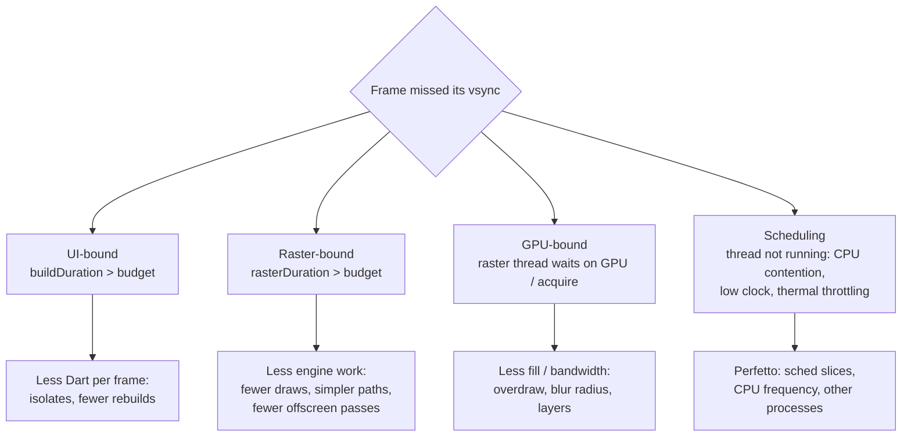

# 05 · Frame scheduling and the 120 Hz budget

How a frame is scheduled, what the budget really is, and the different ways a frame can
be late.

## The budget

| Refresh rate | Frame interval |
|---|---|
| 60 Hz | 16.67 ms |
| 90 Hz | 11.11 ms |
| 120 Hz | **8.33 ms** |

`FrameTiming` reports three durations per frame (in profile and release builds):

| Field | From → to | Meaning |
|---|---|---|
| `buildDuration` | Begin frame → `render()` called | Dart: animate, build, layout, paint, composite |
| `rasterDuration` | Raster start → raster finish | Impeller on the raster thread |
| `totalSpan` | Vsync start → raster finish | End-to-end latency for this frame |

The Kiln monitor that reads these is in
[`frame_budget_monitor.dart`](../../samples/lib/src/frame_budget/frame_budget_monitor.dart).
The engine delivers timings in batches (roughly once per second), so on-screen readouts
update at that rate.

## Pipelining

```mermaid
gantt
    title Two threads, overlapping frames at 120 Hz (vsync every ~8 ms, illustrative)
    dateFormat x
    axisFormat %L ms
    section Main (Dart)
    Frame 1 build :m1, 0, 5
    Frame 2 build :m2, 8, 13
    Frame 3 build :m3, 16, 21
    section Raster (Impeller)
    Frame 1 raster :r1, 5, 12
    Frame 2 raster :r2, 13, 20
    Frame 3 raster :r3, 21, 28
```

While the raster thread draws frame N, Dart can build frame N+1. So each thread may use up
to the full 8.33 ms and the app still produces one frame per vsync. The "~4 ms UI + ~4 ms
raster" split is the target for **lowest latency** (`totalSpan` within one frame), not a
hard rule for smoothness.

## Ways a frame goes wrong

Perfetto is the only tool that shows the last two: you can see the raster thread **not
running** (runnable but descheduled, or waiting on a fence) rather than busy.

## Android's view of the frame

On Android 12+, SurfaceFlinger records an **Expected** and an **Actual** timeline for each
app frame, with a jank classification (for example "App Deadline Missed", "Buffer
Stuffing"). Kotlin engineers know this track; it works the same for Flutter apps. Query it
with [`janky_frames.sql`](../../samples/tool/perfetto/queries/janky_frames.sql).

## Data rate vs refresh rate (Kiln's opening hook)

OpenF1 telemetry arrives at ~3.7 Hz. At 120 Hz that is ~32 frames per sample. Kiln's
replay clock reads the vsync-driven `Ticker`, and every frame interpolates between the two
nearest samples. The interpolation must be trivially cheap so it never shows up as the
bottleneck — the anti-patterns are the story.

## Practical rules

1. Measure in **profile** mode on a **physical** device, the slowest one you support.
2. Read **which bar** is red before changing code.
3. Track **p90/p99**, not averages; jank lives in the tail.
4. Re-measure after every single change (one pit stop at a time).
5. Watch thermals: long sessions raise raster time.

## Sources

[FrameTiming](https://api.flutter.dev/flutter/dart-ui/FrameTiming-class.html) ·
[Flutter performance profiling](https://docs.flutter.dev/perf/ui-performance) ·
[Android system tracing](https://developer.android.com/topic/performance/tracing)
