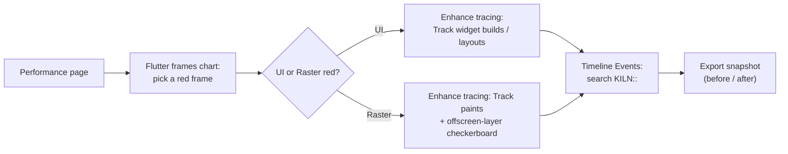

# 06 · Profiling playbook

Hands-on steps for every tool used in the talk. The higher-level tool map is in
[Profiling toolchain](../research/02-profiling-toolchain.md).

## 0. Ground rules

- Physical device, **profile** build, Impeller on Vulkan confirmed.
- Airplane mode, fixed brightness, device cool.
- One change at a time; replay the same 5 s workload before and after.

## 1. Run the app

`--trace-systrace` sends Flutter and Dart timeline events into Android's trace buffer, so
they appear in Perfetto next to system events. DevTools keeps working.

**Kiln (Impeller)** — from `apps/kiln`:

```text
cd apps/kiln
flutter run --profile --trace-systrace
```

Open Shader Lab from the home screen, or
`adb shell am start -a android.intent.action.VIEW -d "kiln://scenario/shaderlab"`.

**Kiln Skia (Shader Lab only)** — from `apps/kiln_skia`:

```text
cd apps/kiln_skia
fvm flutter pub get
fvm flutter run --profile --trace-systrace
```

Before a Skia **first-run** demo: `adb shell pm clear dev.fluttercon.kiln.skia`.

DevTools attaches to whichever app **`flutter run`** started. Switch apps = stop one run and
start the other (or use exported snapshots). See [TRD §11.0](../technical/TRD.md#110-how-to-run-so-devtools-and-perfetto-see-everything).

For the full Pit Wall demo (when built), use the same **`--profile --trace-systrace`** pattern
from `apps/kiln` only.

## 2. Mark your own code

Wrap scenario work in named spans so anyone can find it in a trace:

- Helper: [`kiln_trace.dart`](../../samples/lib/src/core/kiln_trace.dart) → `KILN::<Scenario>::<phase>`
- Example use: [`telemetry_duel_broken.dart`](../../samples/lib/src/telemetry_duel/telemetry_duel_broken.dart)

## 3. Flutter DevTools



| Feature | Use it to |
|---|---|
| Flutter frames chart | Spot red frames and which thread caused them |
| Frame analysis tab | Get hints for one frame (for example expensive `saveLayer`) |
| Timeline events | See every event in the frame, including `KILN::` spans |
| Enhance tracing | Add build / layout / paint events (adds overhead — turn off for final numbers) |
| Offscreen layers checkerboard | Highlight `saveLayer` usage on the device screen |
| CPU profiler | Find hot Dart functions for UI-bound frames |
| Export / import | Keep before/after evidence and stage backups |

## 4. Perfetto system trace

Config: [`kiln_trace_config.pbtx`](../../samples/tool/perfetto/kiln_trace_config.pbtx)
(scheduling, CPU frequency, gfx/view atrace, frame timeline, GPU render stages).

```text
record_android_trace -c samples/tool/perfetto/kiln_trace_config.pbtx -o kiln.perfetto-trace
```

`record_android_trace` comes from the Perfetto project and records over `adb`, so it does
not disconnect `flutter run`. (The Perfetto website's WebUSB recorder requires stopping the
`adb` server — avoid it on stage.)

What to look at in the Perfetto UI:

1. The app process: **main thread** (Dart since 3.29) and **`1.raster`**.
2. `KILN::` slices on those threads.
3. **Expected / Actual Timeline** tracks for the app (Android 12+).
4. CPU tracks: is the raster thread running, runnable or sleeping when the frame is late?
5. GPU render stages, if the driver exposes them.

Saved queries (run in the Perfetto UI "Query (SQL)" page or `trace_processor`):

| Query | Answers |
|---|---|
| [`kiln_spans.sql`](../../samples/tool/perfetto/queries/kiln_spans.sql) | Average and max cost of every Kiln span |
| [`raster_thread_slices.sql`](../../samples/tool/perfetto/queries/raster_thread_slices.sql) | The longest raster-thread work |
| [`janky_frames.sql`](../../samples/tool/perfetto/queries/janky_frames.sql) | Frames SurfaceFlinger classified as janky, with the jank type |

## 5. Android GPU Inspector (preparation only)

- **Frame profiler (Vulkan):** every Vulkan call, render pass and draw for one frame; count
  render passes before and after the `saveLayer` fixes.
- **System profiler:** GPU counters (for example fragment load, memory bandwidth) over time.
- Requires a debuggable build; capture screenshots for the Q&A appendix.

## 6. Engine CPU flame graph (preparation only)

When you need to see *inside* Impeller on the raster thread (for example tessellation time):

1. Build a local engine in profile mode with `--no-stripped`.
2. In the app's Gradle config keep native symbols: `packagingOptions { doNotStrip "**/*.so" }`.
3. `flutter run --profile --local-engine=android_profile_arm64 --local-engine-host=host_profile_arm64`
4. Android Studio → Profiler → CPU → *Callstack Sample Recording* → select the raster thread → flame graph.

## 7. Reading results: a checklist

- [ ] Which thread is over budget, and in what share of frames (p90, p99)?
- [ ] Which `KILN::` span or framework event dominates that thread?
- [ ] Are there offscreen layers? How many render passes per frame (AGI)?
- [ ] Is the raster thread busy, or waiting (fence, acquire) or descheduled?
- [ ] After the fix: did the expected thread improve, and did nothing else regress?

## Sources

[DevTools Performance view](https://docs.flutter.dev/tools/devtools/performance) ·
[Perfetto GPU data sources](https://perfetto.dev/docs/data-sources/gpu) ·
[Android system tracing](https://developer.android.com/topic/performance/tracing) ·
[AGI quickstart](https://developer.android.com/agi/start) ·
[Impeller Android CPU profiling](https://github.com/flutter/engine/blob/main/impeller/docs/android_cpu_profile.md)
