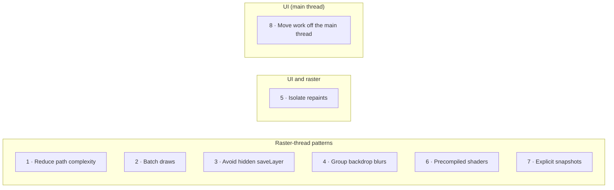

# 07 · Optimisation patterns for Impeller

Each pattern: the symptom, why it happens in Impeller/Vulkan terms, the fix, and the sample
code. Every sample has a `...Broken` and a `...Fixed` widget with the same constructor, so
the demo app can swap them with one pit-stop toggle. All samples live in
[`samples/lib/src`](../../samples/lib/src).

---

## 1 · Reduce path complexity (Telemetry Duel)

| | |
|---|---|
| **Symptom** | Raster bar red; `KILN::TelemetryDuel::paint` long |
| **Why** | Each path is flattened and triangulated on the CPU every frame. 4,000 curve segments per trace is far more than the ~400 pixels it is drawn across. |
| **Fix** | Reduce each trace to at most two samples (min and max) per pixel column, build the path once per size, and move the per-frame cursor into its own painter. |
| **Broken** | [`telemetry_duel_broken.dart`](../../samples/lib/src/telemetry_duel/telemetry_duel_broken.dart) |
| **Fixed** | [`telemetry_duel_fixed.dart`](../../samples/lib/src/telemetry_duel/telemetry_duel_fixed.dart), decimation in [`telemetry_trace.dart`](../../samples/lib/src/telemetry_duel/telemetry_trace.dart) |

Note for experts: the static layer is still rasterized every frame (no raster cache). The
raster win comes from fewer segments, not from the `RepaintBoundary`.

## 2 · Batch draws (Speed Ribbon)

| | |
|---|---|
| **Symptom** | Raster bar red; thousands of draw events |
| **Why** | Each `drawPath` becomes its own draw with pipeline, buffer and uniform binds. On Vulkan the cost is the volume of calls. |
| **Fix** | Build the whole ribbon as one triangle mesh with a colour per vertex and draw it with one `drawVertices`. Cache the mesh per size; dispose it when replaced. |
| **Broken** | [`speed_ribbon_broken.dart`](../../samples/lib/src/speed_ribbon/speed_ribbon_broken.dart) |
| **Fixed** | [`speed_ribbon_fixed.dart`](../../samples/lib/src/speed_ribbon/speed_ribbon_fixed.dart), mesh builder in [`ribbon_geometry.dart`](../../samples/lib/src/speed_ribbon/ribbon_geometry.dart) |

Related batching APIs: `drawRawPoints` (many points or lines), `drawAtlas` (many sprites from one texture).

## 3 · Avoid hidden `saveLayer` (Tower)

| | |
|---|---|
| **Symptom** | Raster red; checkerboard highlights the rows |
| **Why** | `Opacity` over overlapping children needs an offscreen layer (a new render pass), and `Clip.antiAliasWithSaveLayer` adds another. On tile-based GPUs each pass switch stores and reloads tile memory. |
| **Fix** | Fade the leaf colours instead of the group, and draw the rounded background as a decoration instead of clipping. |
| **Broken** | [`tower_row_broken.dart`](../../samples/lib/src/tower/tower_row_broken.dart) |
| **Fixed** | [`tower_row_fixed.dart`](../../samples/lib/src/tower/tower_row_fixed.dart) |

`FadeTransition` alone is **not** the fix: it avoids rebuilds, but still uses an opacity
layer. Other hidden `saveLayer` sources: `ShaderMask`, `ColorFilter`, some `Chip` and `Text`
configurations.

## 4 · Group backdrop blurs (Glass KPI cards)

| | |
|---|---|
| **Symptom** | Raster red when glass cards are visible |
| **Why** | Each `BackdropFilter` reads back the scene and blurs it in its own pass. |
| **Fix** | Wrap the cards in `BackdropGroup` and use `BackdropFilter.grouped` so the engine performs one shared backdrop pass. |
| **Broken** | [`glass_cards_broken.dart`](../../samples/lib/src/glass/glass_cards_broken.dart) |
| **Fixed** | [`glass_cards_fixed.dart`](../../samples/lib/src/glass/glass_cards_fixed.dart) |

Only valid when every filter is **identical** (Kiln shares one `kilnGlassBlur`) and the
cards **don't overlap**. Lower blur sigma also reduces cost.

## 5 · Isolate repaints (Track map)

| | |
|---|---|
| **Symptom** | UI paint and raster both busy although only small dots move |
| **Why** | Static circuit and moving cars share one painter whose `shouldRepaint` always returns true. |
| **Fix** | Static circuit in its own painter behind a `RepaintBoundary`, only repainting when its data changes; cars in a light painter driven by a `Listenable`. |
| **Broken** | [`track_map_broken.dart`](../../samples/lib/src/track_map/track_map_broken.dart) |
| **Fixed** | [`track_map_fixed.dart`](../../samples/lib/src/track_map/track_map_fixed.dart) |

Use `CustomPainter(repaint: listenable)` instead of rebuilding widgets for animation.

## 6 · Use precompiled fragment shaders

| | |
|---|---|
| **When** | An effect would otherwise need many draws or layers (gradients, glows, procedural fills) |
| **Why** | `.frag` files are compiled by `impellerc` at app build time; at runtime one rect draw runs the shader. |
| **Sample** | [`speed_ramp.frag`](../../samples/shaders/speed_ramp.frag) and [`speed_ramp_painter.dart`](../../samples/lib/src/shaders/speed_ramp_painter.dart) |

Uniform order in Dart (`setFloat` indices) must match the declaration order in the shader.

## 7 · Take explicit snapshots of static, complex content

Impeller will not cache a complex static layer for you. When something expensive is static
for a while (or during a short transition):

- `SnapshotWidget` with a `SnapshotController` (used by Android's zoom page transition), or
- `Picture.toImageSync` / `OffsetLayer.toImageSync` and draw the image.

Trade-off: GPU memory and stale content. Re-snapshot when the content or size changes.

## 8 · Move work off the main thread (Race Control)

| | |
|---|---|
| **Symptom** | **UI** bar red, raster green |
| **Why** | JSON decoded in `build()` runs on the main thread (Dart's home since 3.29) every rebuild. |
| **Fix** | Decode once on a background isolate with `Isolate.run`; the list reads cached results. Keep the closure capturing only plain data. |
| **Broken** | [`race_control_broken.dart`](../../samples/lib/src/race_control/race_control_broken.dart) |
| **Fixed** | [`race_control_fixed.dart`](../../samples/lib/src/race_control/race_control_fixed.dart) |

## Quick reference

| If the trace shows… | Try first |
|---|---|
| Long paint spans with big paths | Pattern 1 |
| Thousands of draws | Pattern 2 |
| Checkerboard / `saveLayer` events | Patterns 3 and 4 |
| Static content repainting with animations | Pattern 5 |
| Expensive layered effects | Patterns 6 and 7 |
| Red UI bar, green raster | Pattern 8 |
