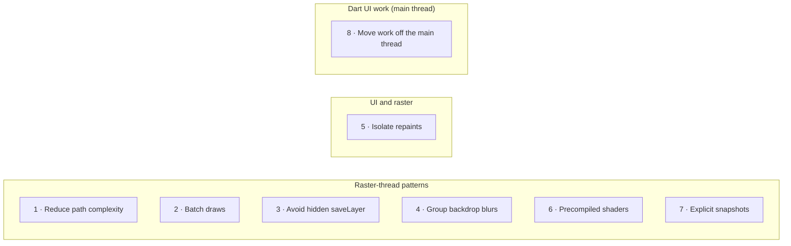

# 07 · Optimisation patterns for Impeller

Each pattern: the symptom, why it happens in Impeller/Vulkan terms, the fix, and the sample
code. The target convention is a `...Broken` and `...Fixed` widget with the same constructor,
so the demo app can swap them with one pit-stop toggle. Existing reference samples live in
[`samples/lib/src`](../../samples/lib/src); the dedicated car-glow pair and shader-lit
Speed Ribbon integration remain release requirements in
[Abstract alignment](../talk/abstract-alignment.md#promise--delivery-map).

Four patterns can be switched live, on one canvas, in the
[Canvas Thrash](10-canvas-thrash.md) screen:

| Pattern | Canvas Thrash fix |
|---|---|
| 1 · Reduce path complexity | Simplify paths |
| 2 · Batch draws | Batch draws |
| 3 · Avoid hidden `saveLayer` | Glow without layers (an explicit `saveLayer` per glow, the car-glow case) |
| 5 · Isolate repaints | Isolate repaints |



---

## What “use Impeller's precompiled pathways” actually means

Impeller ships a bounded, offline-compiled shader set and Flutter compiles declared app
fragment shaders during the app build. That removes Skia-style shader generation during a
frame. It does **not** make every Canvas operation cheap.

Optimize the work that remains:

1. **Record less on main:** use `CustomPainter(repaint:)` to skip build/layout, implement
   `shouldRepaint` from real inputs, and separate static from moving painters.
2. **Give raster less geometry:** decimate paths and build reusable geometry when data or
   size changes, not every animation tick.
3. **Submit fewer draws:** batch triangles with `drawVertices`; batch sprites with
   `drawAtlas` or `drawRawAtlas`.
4. **Avoid unnecessary offscreen passes:** remove avoidable `saveLayer`, group opacity,
   save-layer clips and repeated backdrop filters.
5. **Load once, reuse per frame:** preload `FragmentProgram`, retain `FragmentShader`, mesh,
   path and typed-buffer objects for their valid lifetime.
6. **Measure the actual bottleneck:** UI red means Dart recording on main; Raster red means
   work or waits on `1.raster`. Use offscreen checkerboarding and Perfetto before changing code.

`saveLayer` is not forbidden. It is required when group compositing semantics matter—for
example overlapping children must receive one group opacity or a destination-dependent
blend must be isolated. The rule is: **know why the layer is required, bound it tightly,
and prove its cost is acceptable.**

`shouldRepaint == false` and `RepaintBoundary` are also not raster caches. The framework
can still call `paint` for size or ancestor reasons, and Impeller does not use Skia's legacy
raster cache. They reduce invalidation and DisplayList recording; they do not promise that
the GPU reuses old pixels.

## 1 · Reduce path complexity (Telemetry Duel)

| | |
|---|---|
| **Symptom** | Raster bar red; `KILN::TelemetryDuel::paint` long |
| **Why** | Each path is flattened and triangulated on the CPU every frame. 4,000 curve segments per trace is far more than the ~400 pixels it is drawn across. |
| **Fix** | Reduce each trace to at most two samples (min and max) per pixel column, build the path once per size, and move the per-frame cursor into its own painter. |
| **Broken** | [`telemetry_duel_broken.dart`](../../samples/lib/src/telemetry_duel/telemetry_duel_broken.dart) |
| **Fixed** | [`telemetry_duel_fixed.dart`](../../samples/lib/src/telemetry_duel/telemetry_duel_fixed.dart), decimation in [`telemetry_trace.dart`](../../samples/lib/src/telemetry_duel/telemetry_trace.dart) |

### Instead of rebuilding full-resolution curves every frame

```dart
void paint(Canvas canvas, Size size) {
  for (final trace in traces) {
    // Thousands of curves are allocated, recorded, flattened and tessellated.
    canvas.drawPath(buildFullResolutionPath(trace.values, size), trace.paint);
  }
  paintCursor(canvas, size, progress.value);
}

bool shouldRepaint(CustomPainter oldDelegate) => true;
```

### Build screen-sized geometry when its inputs change

```dart
// cachedPath decimates to roughly one useful sample per output pixel and caches by Size.
void paint(Canvas canvas, Size size) {
  for (final trace in traces) {
    canvas.drawPath(trace.cachedPath(size), trace.paint);
  }
}

bool shouldRepaint(TracePainter old) => old.traces != traces;
```

Put the moving cursor in a second painter:

```dart
class CursorPainter extends CustomPainter {
  CursorPainter(this.progress) : super(repaint: progress);

  final ValueListenable<double> progress;

  @override
  void paint(Canvas canvas, Size size) {
    paintCursor(canvas, size, progress.value);
  }

  @override
  bool shouldRepaint(CursorPainter old) => old.progress != progress;
}
```

**Cost removed:** path construction and DisplayList recording on main; curve flattening and
tessellation on Raster. The listener requests paint directly, so cursor ticks do not require
widget build or layout.

Note for experts: the static layer is still rasterized every frame (no raster cache). The
raster win comes from fewer segments, not from the `RepaintBoundary`.

## 2 · Batch draws (Speed Ribbon)

| | |
|---|---|
| **Symptom** | Raster bar red; thousands of draw events |
| **Why** | Each `drawPath` becomes its own draw with pipeline, buffer and uniform binds. On Vulkan the cost is the volume of calls. |
| **Fix** | Build the whole ribbon as one triangle mesh with a colour per vertex and draw it with one `drawVertices`. Cache the mesh per size; dispose it when replaced. |
| **Broken** | [`speed_ribbon_broken.dart`](../../samples/lib/src/speed_ribbon/speed_ribbon_broken.dart) |
| **Fixed** | [`speed_ribbon_fixed.dart`](../../samples/lib/src/speed_ribbon/speed_ribbon_fixed.dart), mesh builder in [`ribbon_geometry.dart`](../../samples/lib/src/speed_ribbon/ribbon_geometry.dart) |

### Instead of one allocation and draw per segment

```dart
for (var i = 0; i < segmentCount; i++) {
  final segment = Path()..addPolygon(segmentCorners(i), true);
  canvas.drawPath(segment, Paint()..color = segmentColor(i));
}
```

### Build and retain one mesh, then submit one draw

```dart
ui.Vertices? mesh;
Size? meshSize;

void paint(Canvas canvas, Size size) {
  if (mesh == null || meshSize != size) {
    mesh?.dispose();
    mesh = buildRibbonVertices(size);
    meshSize = size;
  }
  canvas.drawVertices(mesh!, BlendMode.srcOver, ribbonPaint);
}
```

Dispose the retained `ui.Vertices` when the painter/controller owning it is disposed.

**Cost removed:** Dart allocations and DisplayList commands on main; thousands of raster
submissions, pipeline/buffer bindings and tiny draws. Impeller can use its precompiled
vertex/fragment pipelines efficiently because the app submits a stable, bounded mesh.

For many sprites from one texture, make the same transformation:

```dart
// Avoid: one draw command per sprite.
for (final sprite in sprites) {
  canvas.drawImageRect(atlas, sprite.source, sprite.destination, paint);
}

// Prefer: one packed batch; retain and update typed buffers outside paint().
canvas.drawRawAtlas(
  atlas,
  transforms,
  sourceRects,
  colors,
  BlendMode.modulate,
  null,
  paint,
);
```

Related batching APIs: `drawRawPoints` (many points or lines), `drawAtlas` and
`drawRawAtlas` (many sprites from one texture). Batching helps only when ordering and blend
semantics remain correct.

## 3 · Avoid hidden `saveLayer` (Tower)

| | |
|---|---|
| **Symptom** | Raster red; checkerboard highlights the rows |
| **Why** | `Opacity` over overlapping children needs an offscreen layer (a new render pass), and `Clip.antiAliasWithSaveLayer` adds another. On tile-based GPUs each pass switch stores and reloads tile memory. |
| **Fix** | Fade the leaf colours instead of the group, and draw the rounded background as a decoration instead of clipping. |
| **Broken** | [`tower_row_broken.dart`](../../samples/lib/src/tower/tower_row_broken.dart) |
| **Fixed** | [`tower_row_fixed.dart`](../../samples/lib/src/tower/tower_row_fixed.dart) |

### Instead of group opacity plus a save-layer clip

```dart
Opacity(
  opacity: fade,
  child: ClipRRect(
    borderRadius: radius,
    clipBehavior: Clip.antiAliasWithSaveLayer,
    child: Row(children: cells),
  ),
)
```

### Apply alpha at the leaves and paint the rounded shape directly

```dart
DecoratedBox(
  decoration: BoxDecoration(
    color: background.withValues(alpha: fade),
    borderRadius: radius,
  ),
  child: Row(
    children: [
      for (final cell in cells)
        Cell(color: cell.color.withValues(alpha: fade)),
    ],
  ),
)
```

This substitution is correct only when independently fading overlapping children produces
an acceptable image. If the group must be composited as one unit, retain the opacity layer.

The same applies inside a `CustomPainter`: an explicit `canvas.saveLayer` (for example to
blur a glow behind each car) is one offscreen pass per call. In Kiln's `car-glow` pit stop,
each glow becomes a circle filled with a `RadialGradient` shader: the same look, no layer.
Before talk sign-off, this needs a dedicated broken/fixed reference pair and the Pit Wall
integration so the explicit `canvas.saveLayer` removal can be shown in code.

```dart
// Avoid: one temporary render target and blur for every car.
final glowBounds = Rect.fromCircle(center: car, radius: 32);
canvas.saveLayer(glowBounds, Paint());
canvas.drawCircle(
  car,
  18,
  Paint()
    ..color = carColor
    ..maskFilter = const MaskFilter.blur(BlurStyle.normal, 12),
);
canvas.restore();

// Prefer when this direct gradient is visually acceptable: one draw, no offscreen pass.
final glow = Paint()
  ..shader = RadialGradient(
    colors: [carColor.withValues(alpha: 0.8), carColor.withValues(alpha: 0)],
  ).createShader(glowBounds);
canvas.drawCircle(car, 32, glow);
```

**Cost removed:** render-target allocation, pass switching, tile store/load traffic and
blur work on Raster/GPU. In DevTools, enable **Highlight offscreen layers**; in Perfetto,
compare the number and duration of render passes rather than looking only at FPS.

`FadeTransition` alone is **not** the fix: it avoids rebuilds, but still uses an opacity
layer. Other hidden `saveLayer` sources: `ShaderMask`, `ColorFilter`, some `Chip` and `Text`
configurations.

## 4 · Group backdrop blurs (Glass KPI cards)

| | |
|---|---|
| **Symptom** | Raster red when glass cards are visible |
| **Why** | Each `BackdropFilter` reads back the scene and blurs it in its own pass. |
| **Fix** | Wrap the cards in `BackdropGroup` and use `BackdropFilter.grouped` so the engine performs one shared backdrop pass. |
| **Broken** | [`glass_cards_broken.dart`](../../samples/lib/src/glass/glass_cards_broken.dart) |
| **Fixed** | [`glass_cards_fixed.dart`](../../samples/lib/src/glass/glass_cards_fixed.dart) |

```dart
// Avoid: each card performs an independent backdrop read and blur.
Row(
  children: [
    for (final card in cards)
      BackdropFilter(filter: glassBlur, child: KpiCard(card)),
  ],
);

// Prefer for identical, non-overlapping filters: share one backdrop input.
BackdropGroup(
  child: Row(
    children: [
      for (final card in cards)
        BackdropFilter.grouped(filter: glassBlur, child: KpiCard(card)),
    ],
  ),
);
```

Only valid when every filter is **identical** (Kiln shares one `kilnGlassBlur`) and the
cards **don't overlap**. Lower blur sigma also reduces cost.

## 5 · Isolate repaints (Track map)

| | |
|---|---|
| **Symptom** | UI paint and raster both busy although only small dots move |
| **Why** | Static circuit and moving cars share one painter whose `shouldRepaint` always returns true. |
| **Fix** | Static circuit in its own painter behind a `RepaintBoundary`, only repainting when its data changes; cars in a light painter driven by a `Listenable`. |
| **Broken** | [`track_map_broken.dart`](../../samples/lib/src/track_map/track_map_broken.dart) |
| **Fixed** | [`track_map_fixed.dart`](../../samples/lib/src/track_map/track_map_fixed.dart) |

```dart
// Avoid: one animation invalidates static and moving content together.
class MapPainter extends CustomPainter {
  MapPainter(this.cars) : super(repaint: cars);

  @override
  void paint(Canvas canvas, Size size) {
    drawCircuit(canvas, buildCircuitPath(size)); // rebuilt every tick
    drawCars(canvas, cars.value);
  }

  @override
  bool shouldRepaint(MapPainter old) => true;
}

// Prefer: static and dynamic content have separate invalidation boundaries.
Stack(
  children: [
    RepaintBoundary(child: CustomPaint(painter: CircuitPainter(circuit))),
    CustomPaint(painter: CarsPainter(cars)), // CarsPainter uses super(repaint: cars).
  ],
);
```

Use `CustomPainter(repaint: listenable)` instead of rebuilding widgets for animation.
Implement `shouldRepaint` by comparing the delegate's configuration; do not return `true`
as a default. This removes build/layout and static DisplayList recording on main. It does
not turn the static layer into a cached GPU texture under Impeller.

## 6 · Use precompiled fragment shaders

| | |
|---|---|
| **When** | An effect would otherwise need many draws or layers (gradients, glows, procedural fills) |
| **Why** | Flutter compiles declared `.frag` assets into backend artifacts during the app build. With Impeller the runtime uses the precompiled pipeline; one procedural draw can replace many Canvas draws or layers. |
| **Sample** | [`speed_ramp.frag`](../../samples/shaders/speed_ramp.frag) and [`speed_ramp_painter.dart`](../../samples/lib/src/shaders/speed_ramp_painter.dart) |

### Instead of creating shader resources during animation

```dart
void paint(Canvas canvas, Size size) {
  final shader = program.fragmentShader(); // allocation on every paint
  setUniforms(shader, size, time.value);
  canvas.drawRect(Offset.zero & size, Paint()..shader = shader);
}
```

### Preload once, retain the shader, and update only uniforms

```dart
// Before the animation starts:
final program = await ui.FragmentProgram.fromAsset('shaders/speed_ramp.frag');
final shader = program.fragmentShader();

class SpeedRampPainter extends CustomPainter {
  SpeedRampPainter(this.shader, this.time) : super(repaint: time);

  final ui.FragmentShader shader;
  final ValueListenable<double> time;

  @override
  void paint(Canvas canvas, Size size) {
    shader
      ..setFloat(0, size.width)
      ..setFloat(1, size.height)
      ..setFloat(2, time.value);
    canvas.drawRect(Offset.zero & size, Paint()..shader = shader);
  }

  @override
  bool shouldRepaint(SpeedRampPainter old) =>
      old.shader != shader || old.time != time;
}
```

Uniform order in Dart (`setFloat` indices) must match the declaration order in the shader.
Also include the shader asset under `flutter: shaders:` in `pubspec.yaml`.

### What the build actually ships

`impellerc` runs during `flutter build` and replaces the GLSL asset with a bundle. For
[`depth_fill.frag`](../../packages/shader_lab/shaders/depth_fill.frag) in the Kiln profile
build (`flutter_assets/packages/shader_lab/shaders/depth_fill.frag`), checked with `xxd` and
`strings`:

| | Size | Contents |
|---|---|---|
| Source in the repo | 503 bytes | GLSL 4.60 with `#include <flutter/runtime_effect.glsl>` |
| Asset in the APK | 4,008 bytes | Header `IPLR`, then four translations of the same shader |

| Translation in the bundle | Used by |
|---|---|
| SPIR-V (contains `GLSL.std.450`) | Impeller on Vulkan |
| GLSL ES 3.00 and GLSL ES 1.00 | Impeller's OpenGL ES backend |
| SkSL source text ("autogenerated by spirv-cross") | Skia |

The backend distinction follows from that table. **Impeller** loads the compiled form: no
shader generation on the device. It still builds a pipeline object from it on first use,
as it does for its own shaders (Shader Storm measured about 2 ms per pipeline). **Skia**
receives SkSL *text* and compiles it on the device the first time it is drawn: the same
just-in-time cost Shader Storm measures. With Skia, preload and draw the effect once before
it matters. In both modes, asset I/O and Dart object allocation can still occur if
lifecycle management is poor.

**Cost removed:** runtime shader generation on Impeller, runtime shader-object allocation
with the retained `FragmentShader`, and, when one procedural draw replaces many Canvas
operations, main-thread recording and raster draw volume. This talk shows the pattern and
the bundle; it does not have an on-device timing for a custom shader.

## 7 · Take explicit snapshots of static, complex content

Impeller will not cache a complex static layer for you. When something expensive is static
for a while (or during a short transition):

- `SnapshotWidget` with a `SnapshotController` (used by Android's zoom page transition), or
- `Picture.toImageSync` / `OffsetLayer.toImageSync` and draw the image.

Trade-off: GPU memory and stale content. Re-snapshot when the content or size changes.

## 8 · Move work off the main thread (Race Control)

| | |
|---|---|
| **Symptom** | **UI** bar red, raster green |
| **Why** | JSON decoded in `build()` runs on the main thread (Dart's home since 3.29) every rebuild. |
| **Fix** | Decode once on a background isolate with `Isolate.run`; the list reads cached results. Keep the closure capturing only plain data. |
| **Broken** | [`race_control_broken.dart`](../../samples/lib/src/race_control/race_control_broken.dart) |
| **Fixed** | [`race_control_fixed.dart`](../../samples/lib/src/race_control/race_control_fixed.dart) |

## Quick reference

| If the trace shows… | Try first |
|---|---|
| Long paint spans with big paths | Pattern 1 |
| Thousands of draws | Pattern 2 |
| Checkerboard / `saveLayer` events | Patterns 3 and 4 |
| Static content repainting with animations | Pattern 5 |
| Expensive layered effects | Patterns 6 and 7 |
| Red UI bar, green raster | Pattern 8 |
