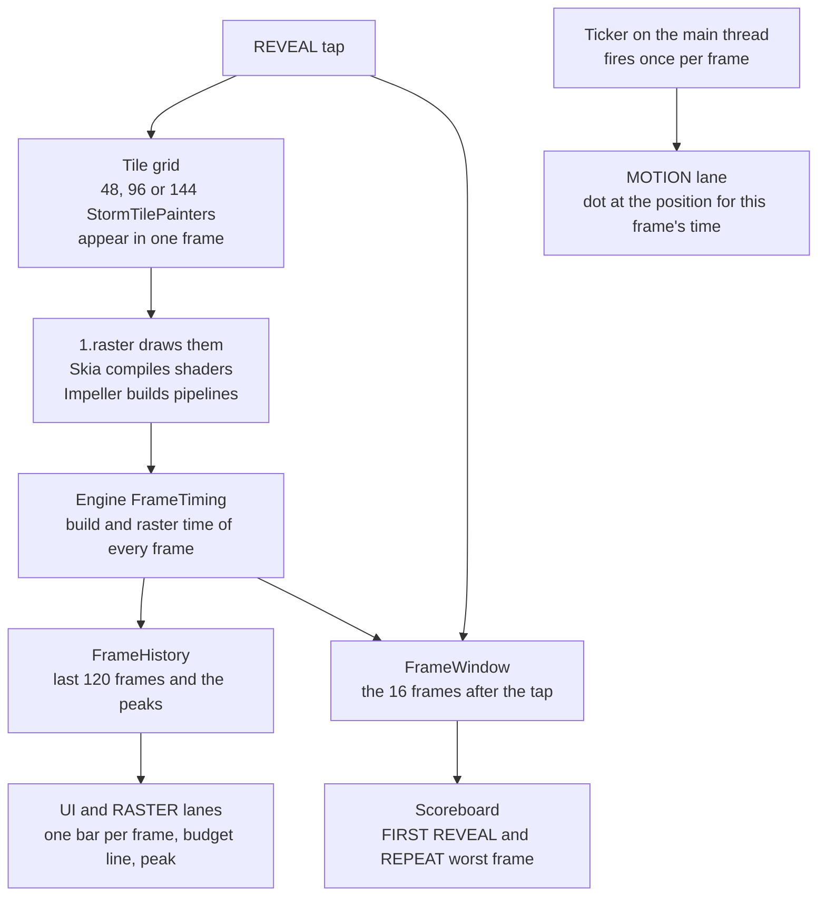
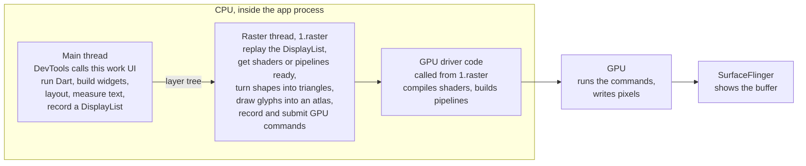
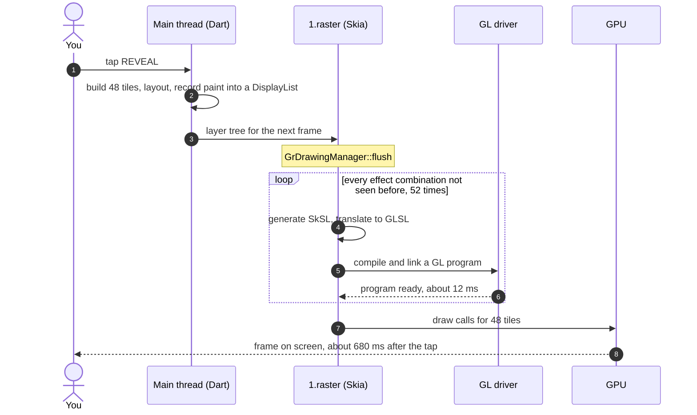
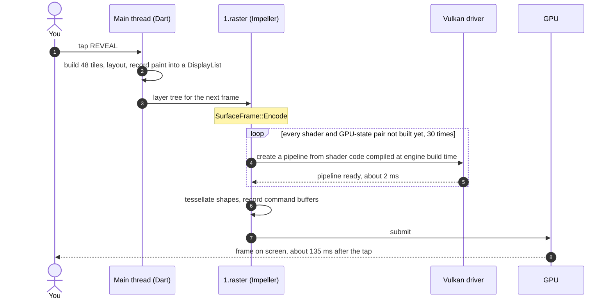
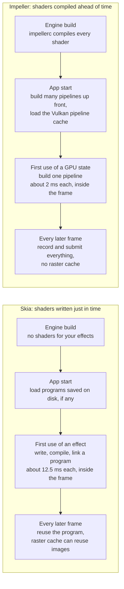

# 09 · Shader Storm: what we measured

What the Shader Storm screen shows, what happens on each thread when you press **REVEAL**,
and what the measurements on a real phone proved about Skia (JIT) and Impeller (AOT).
Read [01 · How Flutter runs](01-how-flutter-runs.md) first if threads are new to you.

Every number here is **measured** on one device unless marked otherwise: Infinix X6873,
Mali GPU, Android 16 (API 36), Flutter 3.47.8 (engine `cf636b1dfb`), profile builds of the
`skia` and `impeller` flavors, tracing off unless stated.

## The short version

1. **Skia pays for every new effect, in the frame.** The first time it meets a new
   combination of paint settings it writes a shader, the GPU driver compiles it, and the
   frame waits. About **12.5 ms per effect**, so the freeze grows with your UI:
   **0.68 s** for 48 new effects, **1.3 s** for 96, **1.86 s** for 144.
2. **Impeller pays much less, and the bill barely grows.** Its shaders were compiled when the
   engine was built. On first use it only builds **pipelines** from them, about **2 ms each**.
   **127 ms** for 48 effects, **145 ms** for 144. Not zero, but 13× less at 144.
3. **Both happen on the raster thread, inside the frame.** Not on the UI (main) thread, and
   not on the GPU.
4. **Both engines cache.** Once warm, they are close (~60 ms on relaunch at 48 effects;
   at 144, Skia 102 ms and Impeller 73 ms, because Skia still loads one program per effect). Skia's cache is
   keyed to the engine version, so every Flutter upgrade makes users cold again.
5. **Impeller is not faster at everything.** Redrawing the same tiles in the same session,
   Skia was faster here (18 ms vs 45 ms worst frame).

## The screen, top to bottom



| Panel | What it shows | Where the data comes from |
|---|---|---|
| Header | Renderer badge, refresh rate, frame budget (8.3 ms at 120 Hz) | Android flavor; `display.refreshRate` |
| Note under the title | One sentence on how this engine gets its shaders | `KilnRuntime.shaderNote` |
| **MOTION** | A dot that steps forward every frame. A missing frame makes it jump; a jump longer than 50 ms is painted red and stays 4 s; a freeze longer than one loop (1.6 s) paints the whole lane | [`heartbeat_lane.dart`](../../packages/shader_lab/lib/src/widgets/heartbeat_lane.dart) |
| **UI · Dart on the main thread** | One bar per frame: time spent in Dart (build, layout, paint recording) | `FrameTiming.buildDuration` |
| **RASTER · engine on 1.raster** | One bar per frame: time the raster thread spent turning the frame into GPU work | `FrameTiming.rasterDuration` |
| Bar colours | Green under budget, red over, white cap if taller than 4× budget | [`frame_strip.dart`](../../packages/shader_lab/lib/src/widgets/frame_strip.dart) |
| `peak … ms` | Slowest bar on that lane since the last REVEAL; survives the bar scrolling off | `FrameHistory.peakBuild` / `peakRaster` |
| **FIRST REVEAL / REPEAT** | Worst frame in the 16 frames after the tap, and how many were over budget | [`frame_window.dart`](../../packages/shader_lab/lib/src/logic/frame_window.dart) |
| Grid and **48 / 96 / 144** | The tiles; the size can only be chosen before the first reveal of the process | [`storm_grid.dart`](../../packages/shader_lab/lib/src/widgets/storm_grid.dart) |

The lanes are fed by the engine's own timings, not by a stopwatch in Dart. The engine
reports them in batches, so bars arrive a little after the frame. MOTION reacts on the
very next frame, so it is the first thing that shows a freeze.

## What the tiles are

Each tile is one `StormTileSpec` from
[`storm_tiles.dart`](../../packages/shader_lab/lib/src/logic/storm_tiles.dart): a
combination of eight paint settings, painted over a two-tone background in one draw call.

| Setting | Options | Why it is there |
|---|---|---|
| Fill | linear, radial, sweep gradient, solid | Each gradient type is different shader code |
| Stops | 2, 3, 5 colours | Skia generates different code for different stop counts |
| Tile mode | clamp, repeated, mirror, decal | What the gradient does past its end; more shader variants |
| Blend mode | srcOver, plus, srcATop | How the tile mixes with the background |
| Blur | none, normal, outer, inner (at most 12 tiles) | Mask blur; capped because each is an extra pass on Impeller every frame |
| Colour filter | none, sepia matrix, cyan tint | Extra stage at the end of the shader |
| Shape | rect, rounded rect, circle, star | Different geometry code; the star is a path |
| Stroke | filled or outline | Different geometry code again |

No two tiles share a recipe, and the list is the same on every run, so runs are comparable.
Some options were removed after testing: `modulate` with a blur drew black boxes on Impeller,
and `screen`/`multiply` added per-frame work on Impeller that hid the first-use story.

### What the screen does **not** show

- **Which recipe a tile uses.** The tiles show the result, not their settings.
- **Shaders compiling as it happens.** There is no progress bar, and there cannot be: the
  thread that would draw a progress bar is the raster thread, and that is the thread busy
  compiling. The screen stays on the previous frame until the work is done. That frozen
  screen *is* the evidence. Counts of compiled programs and pipelines come from a system
  trace afterwards (below).

## Who does what in one frame



Three things people often get wrong:

- **The raster thread is not the GPU.** It is a CPU thread. Shader compilation is CPU work done
  by the GPU driver, called from the raster thread, *before* the GPU can draw anything.
- **There is no separate UI thread.** Since Flutter 3.29, Dart runs on Android's main thread. In
  the trace, the frame's Dart work (`Animator::BeginFrame`) runs on the thread named after the
  app, `fluttercon.kiln`. "UI" is DevTools' name for that work.
- **Nothing is compiled on the main thread.** Profile and release Dart is compiled ahead of
  time. The main thread *builds* widgets; it does not compile them. Text is split: measuring
  and line breaking happen on the main thread during layout, while turning letters into pixels
  happens on the raster thread (`CreateGlyphAtlas` in the Impeller trace).

## A cold reveal on Skia



Measured in the system trace of a cold 48-tile reveal: **52** `GrGLProgramBuilder::finalize`
(each one a GL program), **121** `SkSL::Compiler::convertProgram`, **648 ms** of program
building in total, all on **`1.raster`**. The reveal frame took **677 ms**:
`GPURasterizer::Draw → SurfaceFrame::Submit → GrDrawingManager::flush → shader_compile →
GrGLProgramBuilder::finalize`. On the repeat reveal: **0** programs built.

## A cold reveal on Impeller



Measured in the system trace of a cold 48-tile reveal: **30** `PipelineVK::Create`,
**58 ms** in total, all on **`1.raster`**, all in the reveal frame. On the repeat: **0**.
The rest of that 132 ms frame: the raster thread was running for 71 ms, sleeping for 45 ms
(waiting, most likely on the driver), and ready-but-not-scheduled for 16 ms. For most of
the frame it sat on a core clocked at **700 MHz out of 3.2 GHz**, because the phone had
been idle (see [Measurement traps](#measurement-traps)).

## The freeze on a timeline

Shape taken from the Skia trace; times rounded.

```mermaid
gantt
    title Skia cold reveal of 48 tiles, ms after the tap
    dateFormat x
    axisFormat %L
    section Main thread
    Build reveal frame              :m1, 0, 4
    Build next frame then wait      :m2, 8, 12
    Waiting for the raster thread   :crit, m3, 12, 680
    section 1.raster
    Compile 52 programs and draw    :crit, r1, 4, 681
    Normal frames again             :r2, 681, 720
    section Screen
    Still showing the old frame     :crit, s1, 4, 685
```



The main thread finishes its part in a few milliseconds. It can build one frame ahead, then
has nothing to do until the raster thread hands back. That is why the **UI lane stays
green while the RASTER lane spikes**: your Dart code was fine; the engine stopped to compile.

## Where each engine pays



Skia's first-use bill scales with **how many different effects your UI uses**. Impeller's
scales with **how many different GPU states those effects need**, which is a much smaller,
bounded set. That is the architectural difference behind the numbers.

## Results

Run on 2026-10-31 with `storm_bench.sh 3 "48 96 144"`, screen fixed at 120 Hz, same
Flutter build as above. An earlier run on the same build gave Skia 681 / 1,305 / 1,860 ms
and Impeller 135 / 161 / 166 ms: Skia reproduced within 1%, Impeller came in 6–21 ms lower.

**Cold first reveal**, data cleared before each run. Median of 3 runs, range in brackets.

| Tiles | Skia, OpenGL ES | Impeller, Vulkan | Ratio |
|---|---|---|---|
| 48 | 687 ms (671–690) | 127 ms (122–129) | 5× |
| 96 | 1,310 ms (1,293–1,324) | 145 ms (143–149) | 9× |
| 144 | 1,863 ms (1,809–1,864) | 145 ms (145–162) | 13× |

**Every grid size, every situation.** Median of 3 runs, worst frame.

| Situation | Tiles | Skia | Impeller | What it means |
|---|---|---|---|---|
| Cold, first reveal | 48 / 96 / 144 | 687 / 1,310 / 1,863 ms | 127 / 145 / 145 ms | First install, new screen, or first launch after a Flutter upgrade |
| Repeat in the same session | 48 / 96 / 144 | 18 / 19 / 23 ms | 45 / 43 / 48 ms | Nothing new to compile; this is drawing cost. Skia wins here |
| Relaunch, disk cache kept | 48 / 96 / 144 | 58 / 81 / 102 ms | 66 / 73 / 73 ms | Both reload what they saved. Skia's reload grows with the number of programs; Impeller's barely moves |

**144-tile traces**, one cold reveal each, tracing on (so slower than the table):

| | Skia | Impeller |
|---|---|---|
| Slowest raster frame | 1,820 ms | 167 ms |
| First-use work in that frame | 118 programs built, 1,714 ms (139 in the whole trace) | 40 × `PipelineVK::Create`, 87 ms |
| Per item | 14.6 ms | 2.2 ms |
| Thread | `1.raster` | `1.raster` |
| `1.raster` in that frame | running 1,038 ms, sleeping 670 ms, runnable 110 ms | running 88 ms, sleeping 66 ms, runnable 12 ms |

Going from 48 to 144 effects, Skia's programs went from 52 to 118 in the reveal frame;
Impeller's pipelines went from 30 to 40. That is the "bounded set of GPU states" below,
measured.

**What each engine keeps on disk.**

| | Skia | Impeller |
|---|---|---|
| Location | `code_cache/flutter_engine/cf636b1dfb…/skia/` | `code_cache/flutter.impeller.vkcache` |
| Contents | 62 compiled programs | One 200 KB Vulkan pipeline cache |
| Lost when | App data is cleared, or the **Flutter engine version changes** (the folder is named after it) | App data is cleared |

## Conclusions

1. The JIT vs AOT difference is real and large on first use: **5× at 48 effects, 13× at 144**.
2. AOT does **not** mean zero first-use cost. Impeller still builds pipelines inside the frame.
   It is cheaper per item (2 ms vs 12.5 ms) and needs far fewer items.
3. Skia's cost is proportional to UI variety. Every new gradient, filter or shape combination
   is a new program. Impeller's is close to flat.
4. Both costs land on **`1.raster`**. The main thread's lane stays green. When you see the
   RASTER lane spike on a first visit, think shaders or pipelines before you blame your code.
5. Caches hide the problem in development and testing. The cold case is what real users get
   after installing or updating, so measure it deliberately (`pm clear`).
6. Impeller is **predictable**, not always faster. In-session redraws were faster on Skia here.

## Measurement traps

Each of these changed a number during this work.

| Trap | What happened | What to do |
|---|---|---|
| Tracing slows every frame | With Skia tracing on, every frame went over budget and the repeat read 40 ms instead of 23 ms | Take numbers with tracing off; take traces separately |
| The CPU was clocked down | Impeller's reveal ran on a core at 700 MHz out of 3.2 GHz; one cold run read 237 ms instead of ~135 ms | Run each case 3 times and use the median |
| The screen changed refresh rate | The phone switched between 120 Hz and 90 Hz, so the budget changed | Fix the refresh rate in Android settings before measuring |
| Two different timestamps | Dart gets a frame's vsync *target* time; `FrameTiming` records its *start*. The timer skipped the reveal frame and reported 68 ms instead of 677 ms | Fixed in `FrameWindow`, with a test |
| The meter caused jank | Drawing 120 bars as one `Path` made Skia go over budget a few times a second | Bars are now one `drawVertices` call |
| Warm caches look like fast engines | Without `pm clear`, Skia's "first" reveal was 53 ms | Clear app data before every cold run |
| An effect rendered differently | `modulate` plus a mask blur drew black boxes on Impeller | Removed from the tile mix |

## Reproduce it

With both flavors installed and one phone connected (see
[`tool/benchmark/README.md`](../../tool/benchmark/README.md)):

```text
# Medians for every grid size: cold, repeat and relaunch, 3 rounds, tracing off
tool/benchmark/storm_bench.sh 3 "48 96 144" storm.csv

# One cold reveal with engine events, summarised
tool/benchmark/storm_trace.sh skia 144 skia-144.txt
tool/benchmark/storm_trace.sh impeller 144 impeller-144.txt
```

`storm_trace.sh` prints what [`trace_summary.py`](../../tool/benchmark/trace_summary.py)
finds: the slowest raster frame, Skia programs or Impeller pipelines built, the thread they
ran on, and how `1.raster` spent the slowest frame. Open the same file in
[Perfetto UI](https://ui.perfetto.dev) and search for `GrGLProgramBuilder::finalize` (Skia)
or `PipelineVK::Create` (Impeller) on `1.raster` to see it.

## Sources

[Impeller rendering engine](https://docs.flutter.dev/perf/impeller) ·
[FrameTiming](https://api.flutter.dev/flutter/dart-ui/FrameTiming-class.html) ·
[What's new in Flutter 3.29](https://flutter.dev/blog/whats-new-in-flutter-3-29) ·
Engine frame timestamps: `engine/src/flutter/shell/common/animator.cc` in the Flutter SDK
