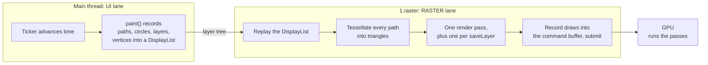
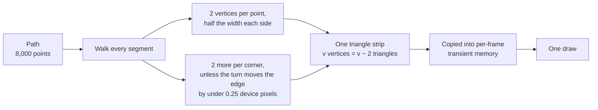
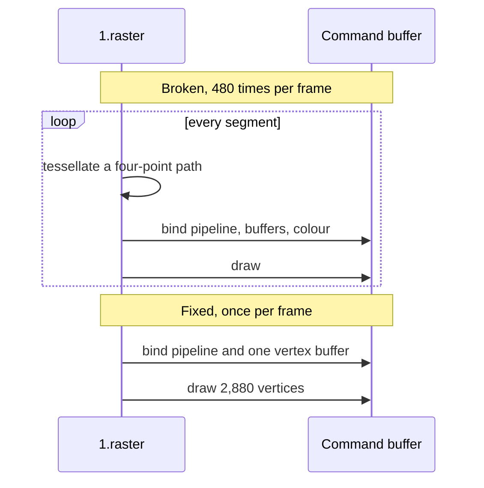
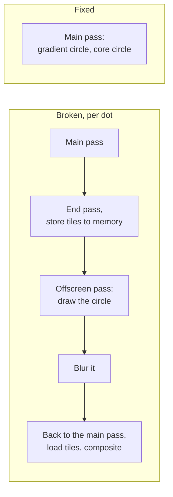
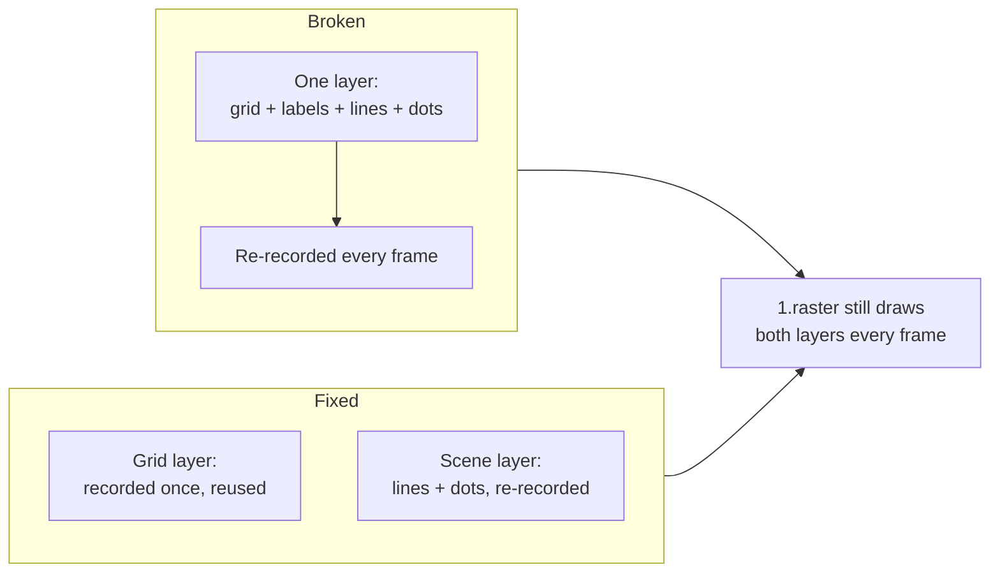

# 10 · Canvas Thrash: what still costs on Impeller

Shader Storm ([note 09](09-shader-storm-findings.md)) shows that Impeller removed most of
the first-use shader cost. Canvas Thrash answers the next question: **if compiling shaders
is no longer the problem, what is?** It thrashes a live canvas until frames go red, then
fixes it one cause at a time.

Read [01 · How Flutter runs](01-how-flutter-runs.md),
[03 · Impeller internals](03-impeller-internals.md) and
[04 · Vulkan primer](04-vulkan-primer.md) first if the terms below are new.

Every number here was **measured** on the stage phone (Infinix X6873, Mali-G615 MC6,
Vulkan 1.3, Android 16, 120 Hz) with profile builds, tracing off unless stated. Each fix
section gives the hypothesis written before measuring, then what the phone showed. Full
tables: [Results](#results).

## The screen, top to bottom

```text
┌──────────────────────────────────┐
│ Canvas Thrash          Impeller  │  header: refresh rate, budget, renderer
├──────────────────────────────────┤
│   live canvas, always animating  │  price lines scroll left, dots ride
│   price lines, glowing dots,     │  on them, the heat strip ripples
│   heat strip, grid and axes      │
├──────────────────────────────────┤
│ UI      ▁▁▂▁▁▁▂▁     peak 3.1 ms │  the same lanes as Shader Storm
│ RASTER  ▅▇█▇▆█▇█    peak 24.0 ms │
├──────────────────────────────────┤
│ THRASH   [1×] [2×] [4×] [8×]     │  the dial
│ ○ Simplify paths       raster    │  four fixes, each with the lane
│ ○ Batch draws          raster    │  it is meant to relieve
│ ○ Glow without layers  raster    │
│ ○ Isolate repaints     UI        │
│ ○ X-ray                model     │  the tessellation lens
├──────────────────────────────────┤
│ draws · layers · path points ·   │  live counters, four times a second
│ grid repaints/s · line triangles │
└──────────────────────────────────┘
```

The canvas is drawn from made-up market data generated in the app
([`thrash_scene.dart`](../../packages/shader_lab/lib/src/logic/thrash_scene.dart)): seeded,
so every run draws the same thing, and offline, so conference Wi-Fi cannot affect it.

## The thrash dial

Every workload grows with the dial:

| | 1× | 2× | 4× | 8× |
|---|---|---|---|---|
| Price lines | 2 | 4 | 8 | 16 |
| Points per line | 1,000 | 2,000 | 4,000 | 8,000 |
| Glowing dots | 8 | 16 | 32 | 64 |
| Heat strip segments | 60 | 120 | 240 | 480 |

At 1× the lanes should stay green. At 8× with every fix off, the raster lane should go red
and the canvas should visibly stutter: the abstract's *"intentionally thrash a real-time
graphics canvas"*. The script turns fixes on one at a time and watches which lane drops.

## Where the work happens



Each fix removes work from one of those boxes.

## Fix 1 · Simplify paths

| | What the code does |
|---|---|
| Broken | Every frame, builds a new `Path` through all 8,000 points of each line |
| Fixed | Keeps at most two points per pixel column (the lowest and highest, in order), builds each path once per size, and scrolls it with a translation |

**What the engine does with a stroked path, every frame, on `1.raster`.** From
`StrokePathSegmentReceiver` in
`engine/src/flutter/impeller/entity/geometry/stroke_path_geometry.cc`:



There is no cache between frames: a path drawn 120 times a second is tessellated 120 times
a second. Simplifying cuts the points the tessellator walks. A line 330 logical pixels wide keeps
at most about 660 points; the other 7,000 or so never change what you see and are pure
cost.

**Expected:** raster drops, because there is less tessellation. UI drops a little, because
Dart no longer builds 128,000 `lineTo` calls per frame.

**Measured:** both drop, and UI far more than "a little". Alone: UI 15.9 → 6.3 ms, raster
29.7 → 18.6 ms. Path points 129,920 → 12,032 (632 per line on this screen). Building an
8,000-point path in Dart every frame was most of the UI lane.

## Fix 2 · Batch draws

| | What the code does |
|---|---|
| Broken | The heat strip is one `drawPath`, with its own `Paint`, per segment: 480 at 8× |
| Fixed | All segments as two triangles each, in one `drawVertices` call with a colour per vertex |



On Vulkan the cost is volume: each draw is several small commands. No single one is slow;
hundreds of them per frame are. See
[04 · Vulkan primer](04-vulkan-primer.md#one-frame-in-vulkan-terms).

**Expected:** raster drops.

**Measured:** the smallest win. Alone it does almost nothing (raster 29.7 → 28.6 ms: the
paths dominate). After Simplify paths: raster 18.6 → 13.7 ms and UI 6.3 → 4.9 ms, with
overlapping ranges across rounds. Draws 640 → 161. On this phone, 480 small draws are a cost
but not the main one.

## Fix 3 · Glow without layers

| | What the code does |
|---|---|
| Broken | Each dot's glow is `saveLayer` with a blur image filter, then a circle, then `restore`: 64 layers at 8× |
| Fixed | One circle filled with a radial gradient that fades to transparent: the same soft edge, drawn in the main pass |



On a tile-based mobile GPU, every render-pass boundary can write the tiles out to main
memory and read them back. Sixty-four of them per frame is sixty-four round trips.
See [04 · Vulkan primer](04-vulkan-primer.md#tile-based-gpus-the-key-to-mobile-performance).

**Expected:** raster drops, possibly the most of the four fixes. If the raster thread is
waiting on the GPU, a Perfetto trace shows `1.raster` sleeping rather than running.

**Measured:** the biggest raster win. After Simplify paths and Batch draws: raster
13.7 → 6.6 ms. Alone: 29.7 → 21.2 ms. In the system trace, the 64 layers mean 64
`Canvas::saveLayer` per frame and **two** `QueueSubmit` per frame instead of one.

The sleeping test came out the other way: `1.raster` was **running** for 12.9 of its
14.1 ms with layers on, and sleeping for 0.3 ms. The layers cost raster-thread CPU time to
set up the offscreen passes, the blur and the composite (about 9 ms per frame here). The
raster thread never waited on the GPU, so the GPU-side cost of the extra passes, the tile
stores and loads above, was not the limit on this phone, and this phone's driver does not
expose GPU render stages to measure it directly.

## Fix 4 · Isolate repaints

| | What the code does |
|---|---|
| Broken | The static grid and price labels are painted by the same painter as the moving lines, so they are recorded again, and the labels laid out again, every frame |
| Fixed | The grid has its own `CustomPaint` behind a `RepaintBoundary` and never repaints; the counter drops from one paint per frame (about 120 a second at 120 Hz) to 0 |



This fix teaches the most important distinction for engineers coming from Skia: **on
Impeller, a `RepaintBoundary` saves Dart work, not GPU work.** Impeller has no raster cache,
so the raster thread still draws the grid every frame. What disappears is the main thread
re-recording it and laying out its text.

**Expected:** the UI lane drops; the raster lane barely moves. That non-result is the point.

**Measured:** as predicted, once the rest is fixed: UI 4.4 → 3.4 ms, raster 6.6 → 6.5 ms,
grid repaints to 0. In the Dart timeline the `KILN::Thrash::grid` span is gone. **Alone, at
8× broken, it does not help** (UI 16.9 ms, raster 25.2 ms, within noise of no fixes): a
grid is nothing next to 130,000 path points. Isolate repaints is worth doing when the
expensive work is already gone.

## X-ray mode

X-ray magnifies the middle of the plot and draws the triangle strips the price lines turn
into, with a counter of triangles per frame and per second.

```text
 Normal view                     X-ray view
 ──────────────                  ─────────────────────────
    ╱╲    ╱╲                       ╱╲╱╲╱╲    ╱╲╱╲╱╲
 __╱  ╲__╱  ╲__                 __╱╲╱╲╱╲╱╲__╱╲╱╲╱╲╱╲__
 a smooth price line             the same line as the strip
                                 of triangles the CPU builds
```

At 8× with full-detail lines, the lens is a solid mass of triangles. Turn on **Simplify
paths** and the mesh thins out into strips you can count.

| X-ray is | X-ray is not |
|---|---|
| A model of Impeller's stroke tessellation, following the engine source rule for rule (vertices per point, bevel joins, the 0.25-pixel threshold, zero-length segments) | The engine's own output: Impeller does not hand its triangles back to Dart |
| Fed with exactly the points the canvas draws this frame | A model of fills, circles or the heat strip; it covers the stroked price lines |
| Counted over whole paths, including parts the clip hides, because the engine tessellates whole paths too | Free: the lens adds raster work and the counter adds Dart work four times a second |

On stage, say: *"This is a model of what Impeller's tessellator does on the CPU, built from
the exact paths we send it."* Turn X-ray on to explain, off to measure.

The model and its tests:
[`stroke_tessellation.dart`](../../packages/shader_lab/lib/src/logic/stroke_tessellation.dart).

## The counters

| Counter | Meaning | Source |
|---|---|---|
| draws | Draw calls the scene painter recorded in its last paint (not counting the grid) | [`ThrashLedger`](../../packages/shader_lab/lib/src/logic/thrash_ledger.dart), counted while painting |
| layers | `saveLayer` calls in the last paint | `ThrashLedger` |
| path points | Points handed to the engine in paths in the last paint | `ThrashLedger` |
| grid repaints | How often the grid was painted in the last quarter second, per second | `ThrashLedger` |
| line triangles | Triangles the model builds for the price lines, per frame and per second (X-ray only) | `countLineTriangles` |

These count what the app **asks** the engine to do. The engine may split or merge work,
so treat them as inputs to the raster thread, not as GPU command counts.

## Measuring it

Every settings change leaves a `KILN::Thrash::config` marker in DevTools and Perfetto, and
the painters wrap their work in `KILN::Thrash::grid`, `::strip`, `::lines` and `::dots`
spans. Once the frame history holds only frames drawn with the current settings, the
screen writes one logcat line a second:

```text
KILN::Thrash::sample level=8 fixes=simplifyPaths,batchDraws xray=false uiP90Ms=3.1 rasterP90Ms=9.8 frames=120
```

[`thrash_bench.sh`](../../tool/benchmark/thrash_bench.sh) steps through the fixes at 8×
and reads these lines; [`thrash_trace.sh`](../../tool/benchmark/thrash_trace.sh) records a
system trace at any setting. See the [benchmark README](../../tool/benchmark/README.md).

## Results

**Fixes added top to bottom, as on stage.** Impeller, 8×, frame p90, median of 3 rounds
(range).

| Fixes on | UI | Raster |
|---|---|---|
| none | 15.9 ms (15.6–16.3) | 29.7 ms (22.8–30.9) |
| + Simplify paths | 6.3 (5.1–6.9) | 18.6 (13.5–18.7) |
| + Batch draws | 4.9 (3.5–5.5) | 13.7 (13.1–18.1) |
| + Glow without layers | 4.4 (4.2–4.5) | 6.6 (6.6–6.8) |
| + Isolate repaints | 3.4 (3.3–3.4) | 6.5 (6.2–6.7) |

**Each fix alone:** Simplify paths 6.3 / 18.6 · Batch draws 14.7 / 28.6 · Glow without
layers 14.8 / 21.2 · Isolate repaints 16.9 / 25.2 (UI / raster, ms).

**System traces at 8×, 5 s each.**

| | Raster frame p50 | `SurfaceFrame::Encode` p50 | `1.raster` running / frame | `saveLayer` / frame | `QueueSubmit` / frame | Frames in 5 s |
|---|---|---|---|---|---|---|
| No fixes | 27.9 ms | 27.1 ms | 24.3 of 28.1 ms | 64 | 2 | 179 |
| Simplify + Batch | 13.8 ms | 12.9 ms | 12.9 of 14.1 ms | 64 | 2 | 355 |
| All fixes | 4.8 ms | 3.7 ms | 4.5 of 4.9 ms | 0 | 1 | 604 (120 fps) |

Almost the whole raster frame is `SurfaceFrame::Encode`: Impeller turning the DisplayList
into tessellated geometry and command buffers on the CPU. The raster thread is CPU-bound
throughout; it does not sit waiting on the GPU.

**Same bench on Skia.** No fixes: UI 21.8 ms, raster **188.4 ms**. Each fix alone, and
Simplify + Batch together, leave raster at 184–202 ms. Adding Glow without layers: 61.5 ms.
All fixes: **57.7 ms**, against Impeller's 6.5. In a Skia trace with all fixes, 47 of the
53 ms raster frame is inside the 32 `SkCanvas::drawPath` calls for the price lines, with
about 31 `GrGpu::writePixels` per frame: consistent with Skia drawing each anti-aliased
stroke into a mask on the CPU and uploading it, where Impeller tessellates it into
triangles.

**What was not measured.** GPU execution: when each render pass ran on the Mali GPU and
for how long. This phone's driver offers Perfetto only GPU memory, not render stages or
counters. The render-pass costs in Fix 3 are explained from the Vulkan model, not traced.
Captures: `fluttercon-captures/2026-10-31-infinix-x6873/` (videos, traces, CSVs).

## Sources

Impeller stroke tessellation: `engine/src/flutter/impeller/entity/geometry/stroke_path_geometry.cc`
in the Flutter SDK ·
[Impeller README](https://github.com/flutter/flutter/blob/main/engine/src/flutter/impeller/README.md) ·
[flutter#193399 (draw volume on Vulkan)](https://github.com/flutter/flutter/issues/193399) ·
[flutter#142550 (no raster cache)](https://github.com/flutter/flutter/issues/142550)
