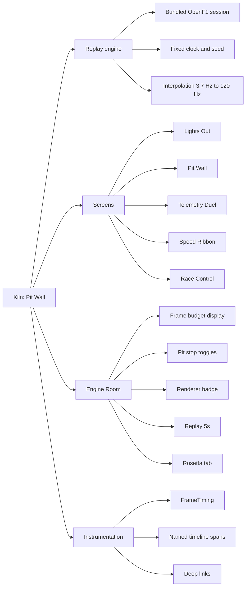
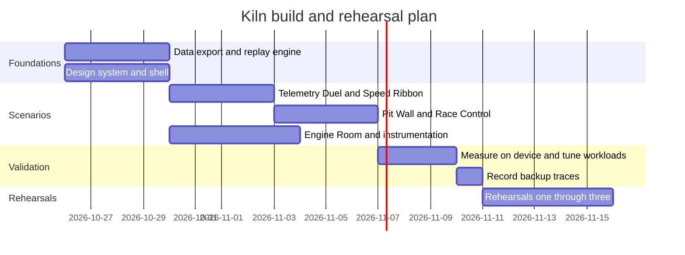

# Product Requirements Document — Kiln: Pit Wall

| | |
|---|---|
| **Product** | Kiln: Pit Wall (live demo app) |
| **Talk** | Beyond Skia: Deep-Dive GPU Scheduling and Profiling with Impeller on Android 10+ |
| **Event** | Droidcon / FlutterCon KE 2026 |
| **Slot** | 40 minutes, including Q&A |
| **Status** | Draft v1 |
| **Related** | [TRD](../technical/TRD.md) · [Screens](../design/screens.md) · [Demo script](../talk/demo-script.md) |

---

## 1. Summary

Kiln is an F1 race-replay dashboard. It replays real historical telemetry (from OpenF1)
on a 120 Hz Android device. It looks like a premium product, but each component hides
one realistic rendering anti-pattern. During the talk the speaker profiles each problem
live with Flutter DevTools and Perfetto, explains what Impeller and Vulkan are doing, and
applies a fix with a "pit stop" toggle until the app holds the 8.33 ms frame budget.

> **Opening line:** OpenF1 car data arrives about 3.7 times per second. The screen
> refreshes 120 times per second. That is about 32 frames between data points, and every
> frame has 8.33 ms.

## 2. Problem

Flutter now defaults to Impeller (Vulkan on capable Android 10+ devices), which removes
runtime shader compilation stutter. Many engineers assume this means rendering
performance is solved. It is not: Impeller made performance **predictable**, not free.
Path complexity, draw-call volume, offscreen passes and UI-thread work still miss frames,
especially at 120 Hz where the budget halves.

Talks on this topic usually show slides of traces. Very few diagnose a real dropped frame
live, explain the engine behaviour behind it, and prove the fix with numbers.

## 3. Audience

| Persona | What they already know | What they need from the demo |
|---|---|---|
| Senior Flutter engineer | Widgets, DevTools basics | Engine-level reasoning, Impeller-specific fixes |
| Android / Kotlin engineer | Compose, RenderThread, Perfetto, frame timeline | How Flutter's pipeline maps onto tools they know |
| iOS engineer | UIKit / SwiftUI, Core Animation, Instruments, Metal | Offscreen rendering and AOT shader parallels |
| Engineering lead | Shipping and quality trade-offs | Confidence that the fixes are measurable and repeatable |

## 4. Goals and non-goals

### Goals

- **G1.** Show, live and on a real device, how Impeller turns paint calls into GPU work on Vulkan.
- **G2.** Teach a repeatable diagnosis method: which thread is over budget, which event, which code.
- **G3.** Demonstrate four to six surgical fixes, each with a visible before/after.
- **G4.** Make the content useful to Kotlin and iOS engineers, not only Flutter engineers.
- **G5.** Look world-class: premium design that stands up on a projector.

### Non-goals

- Not a production F1 app, and not affiliated with Formula 1, the FIA or any team.
- No live network data during the talk.
- No iOS build for the stage demo (iOS is covered through comparison, not a second device).
- No custom engine build required to run the demo (optional for the speaker's own research).

## 5. Scope

## 6. Functional requirements

| ID | Requirement | Priority |
|---|---|---|
| FR-1 | Replay one bundled historical race session for up to 20 cars, offline. | Must |
| FR-2 | Interpolate car position and telemetry so motion is smooth at 120 Hz. | Must |
| FR-3 | Provide the five screens described in [Screens](../design/screens.md). | Must |
| FR-4 | Each anti-pattern has a broken and a fixed implementation, switchable at runtime without restarting. | Must |
| FR-5 | Engine Room shows live UI and raster time, each against a 4.17 ms target tick and an 8.33 ms limit, plus total frame time, jank count and p90/p99. | Must |
| FR-6 | Engine Room shows the active renderer (Impeller on Vulkan, or Impeller on OpenGL ES) and refresh rate. | Must |
| FR-7 | "Replay 5s" re-runs an identical five-second workload for comparable traces. | Must |
| FR-8 | Every scenario emits a named timeline span (`KILN::<Scenario>::<phase>`) visible in DevTools and Perfetto. | Must |
| FR-9 | Scenarios and pit stops can be switched from the laptop via `adb` deep links. | Should |
| FR-10 | Rosetta tab maps Flutter concepts to Android and iOS equivalents. | Should |
| FR-11 | A "Box all" control applies every fix at once for the finale. | Should |
| FR-12 | Lights Out start sequence creates a clean "frame zero" marker in the trace. | Could |
| FR-13 | A **Thrash** control (1×, 2×, 4×, 8×) multiplies Speed Ribbon work live, and is also settable with `kiln://thrash/<n>`, so the audience watches the canvas being stressed. | Must |

## 7. Non-functional requirements

| ID | Requirement |
|---|---|
| NFR-1 | With all fixes applied and Thrash at 4×, the target device holds 120 Hz: p90 UI and raster times under 8.33 ms, with a target of about 4 ms each, during the 5 s replay (measured in profile mode). |
| NFR-2 | With all anti-patterns active, jank is clearly visible: red frames in DevTools and on the Engine Room display. |
| NFR-3 | Fully offline. No network calls at runtime. |
| NFR-4 | Deterministic. The same replay produces comparable traces run to run. |
| NFR-5 | The Engine Room display costs less than 0.5 ms per frame and is itself isolated from repaints. |
| NFR-6 | Readable on a projector: no text under 16 sp on presented screens, contrast at least 4.5:1. |
| NFR-7 | Runs on Android 10+ (API 29+). The demo device must use the Vulkan backend. |
| NFR-8 | Cold start to Pit Wall under 3 s on the demo device. |

## 8. The anti-pattern catalogue

Each "lap" of the talk is one row. Details in [Screens](../design/screens.md).

| Lap | Screen | Anti-pattern | Thread hit | Pit stop (fix) |
|---|---|---|---|---|
| 1 | Telemetry Duel | Rebuilding thousands of `Path` segments every frame | Raster | Reduce to screen resolution, build once, separate cursor layer |
| 2 | Speed Ribbon (thrashed) | Thousands of separate `drawPath` calls, multiplied by the Thrash dial | Raster | One `drawVertices` call, then a build-time fragment shader for colour and glow in the same draw |
| 3a | Pit Wall · Car glow | `canvas.saveLayer` with a blur per car inside a `CustomPainter` | Raster | Radial-gradient circles, no layer |
| 3b | Pit Wall · Tower | Group `Opacity` and save-layer clips | Raster | Fade leaf colours, rounded decoration instead of a clip |
| 3c | Pit Wall · Track map | Static circuit repaints with every car-dot move | UI and raster | Separate static layer, `RepaintBoundary`, correct `shouldRepaint` |
| 3d | Pit Wall · KPI cards | One `BackdropFilter` per card | Raster | `BackdropGroup` + `BackdropFilter.grouped` |
| 4 | Race Control | JSON decoded inside `build()` | UI | `Isolate.run` |

## 9. Success metrics

| Metric | Target |
|---|---|
| Fixed-state p90 raster time on the demo device (Thrash 4×) | < 8.33 ms, target ≈ 4 ms |
| Fixed-state p90 UI time | < 8.33 ms, target ≈ 4 ms |
| Every promise in the registered abstract delivered on stage ([Abstract alignment](../talk/abstract-alignment.md)) | 100% |
| Broken-state jank visible within 3 s of opening each scenario | 100% of scenarios |
| Live demo segments completed without falling back to recorded traces | ≥ 4 of 5 |
| Rehearsals completed end-to-end on the stage setup | ≥ 3 |
| Talk runs within 40 minutes including Q&A | Yes |

## 10. Milestones

Adjust dates to the confirmed talk date.

## 11. Risks

| Risk | Impact | Mitigation |
|---|---|---|
| Venue Wi-Fi or USB fails | Live profiling impossible | Pre-exported DevTools and Perfetto traces for every lap |
| Device falls back to OpenGL ES | Vulkan story breaks | Renderer badge checked in rehearsal; spare device |
| Fixed state still janks on the device | Finale fails | Tune workloads during measurement week; keep fixes conservative |
| Screen mirroring adds load | Numbers shift on stage | Rehearse with the exact mirroring setup; camera as fallback |
| F1 trademark concerns | Legal / organiser objection | No F1, FIA or team logos; credit OpenF1; non-commercial use |
| Thermal throttling during the talk | Raster times creep up | Keep the device cool, short replays, airplane mode |

## 12. Open questions

1. Real driver names and codes from the data, or fictional codes?
2. Which race session to bundle (a visually interesting circuit and a close finish)?
3. Is the fragment-shader variant of the Speed Ribbon worth the extra build time?
4. Exact device model, for the slide and for reproducibility notes.
