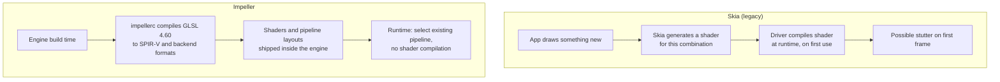
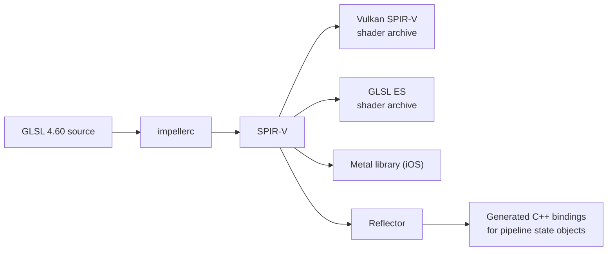
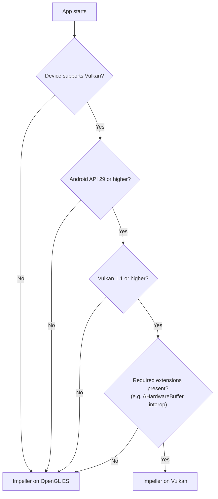
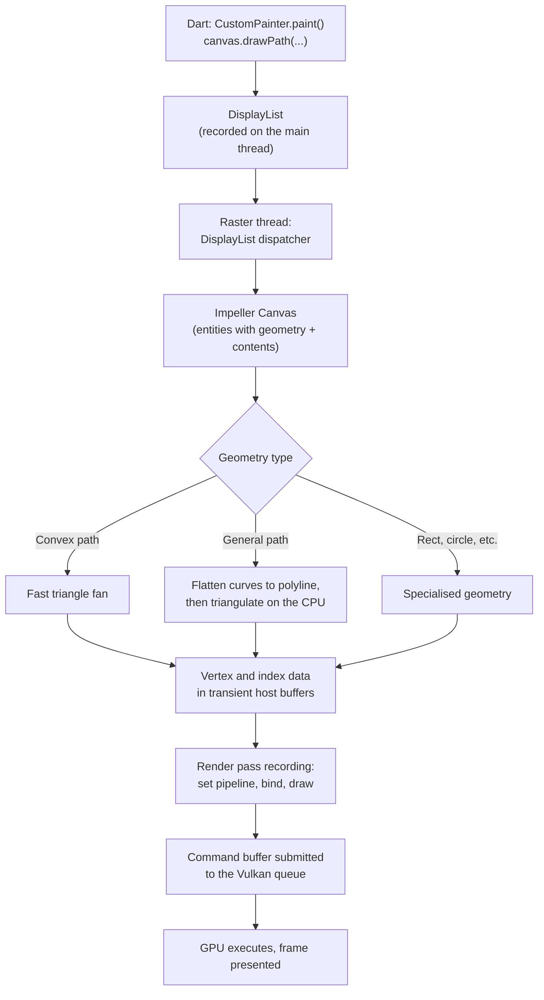

# Research 01 — Impeller architecture on Android

What Impeller does, how it differs from Skia, and how a Flutter paint call becomes
Vulkan work. Sources are listed in [Sources](../reference/sources.md).

## Key facts

- Impeller has been the **default renderer on Android API 29+ since Flutter 3.27**.
- On Android it **prefers Vulkan** and falls back to **Impeller's own OpenGL ES backend** when the
  device is unsupported. Since Flutter 3.29 that fallback is Impeller, not Skia, and some SoC
  families (MediaTek and PowerVR in 3.29) are deliberately kept on OpenGL ES. Check the renderer
  badge on the demo device.
- Shaders are compiled **at engine build time**, not while the app runs. Pipeline state objects are built up front.
- Impeller has **no raster cache** like Skia had, and there are no plans to add one.
- Since Flutter 3.29, Dart code on Android and iOS runs on the platform **main thread**; Impeller runs on the **raster thread**.

## Skia vs Impeller: where shader work happens

**Message for the talk:** Impeller removes a whole class of unpredictable stutter. It does
not remove the cost of the work you ask it to do.

## Offline shader pipeline

Custom app shaders (`.frag` files declared in `pubspec.yaml`) go through the same
`impellerc` step when the app is built. That is why a fragment shader is the most
"Impeller-native" fix in the demo.

## Backend selection on Android

Android 10 (API 29) is required for Vulkan because of efficient `HardwareBuffer`
support, which platform views depend on.

## From paint call to GPU

### About "tessellation"

In Impeller this means **CPU path tessellation**: curves are flattened into line
segments (more segments at larger scale), then triangulated. It is **not** Vulkan's
hardware tessellation shader stage. Use the precise wording on stage; experts will notice.

Practical consequences:

- Complex, changing paths cost CPU time on the raster thread every frame.
- Scaling a path up increases the number of segments.
- Many small paths mean many draw calls, each with pipeline and binding work.

## Where the cost goes on Vulkan

An engine investigation in 2026 ([flutter#193399](https://github.com/flutter/flutter/issues/193399))
added trace events to Impeller's Vulkan encode and submit path. In one scene the cost was
spread across roughly 1,800 small calls per frame (`SetPipeline`, `SetVertexBuffer`,
`BindResource`, `Draw`), not one slow function. The lesson for the talk:

> On Vulkan, frame cost is often **volume**: how many draws and bindings you ask for.

This directly motivates the Speed Ribbon lap: 5,000 `drawPath` calls versus one
`drawVertices`.

## Offscreen work: `saveLayer`, opacity, clips, blur

`saveLayer` allocates an offscreen render target and forces a render-target switch.
On mobile tile-based GPUs this is especially disruptive. Common hidden sources:

- `Opacity` around groups of widgets
- `ShaderMask`, `ColorFilter`
- `Clip.antiAliasWithSaveLayer`
- `BackdropFilter` (blur reads back what is behind it)

`BackdropGroup` with `BackdropFilter.grouped` lets the engine share one backdrop pass,
but only for filters with **identical properties** that **do not overlap**.

## `RepaintBoundary` on Impeller

- It still isolates repaints: a dirty child does not repaint its siblings.
- It does **not** guarantee a cached texture on Impeller (no raster cache).
- For expensive static content during a short animation, use `SnapshotWidget` deliberately.

## Honest limits to mention

- Impeller is not faster than Skia in every case; some backdrop-filter cases were measured
  slower ([flutter#174984](https://github.com/flutter/flutter/issues/174984)).
- Vulkan per-draw costs are not visible in stock DevTools traces.
- Hybrid-composition platform views merge the raster thread with the platform thread.
