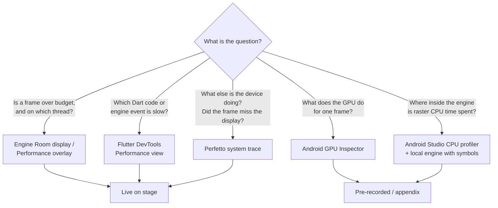
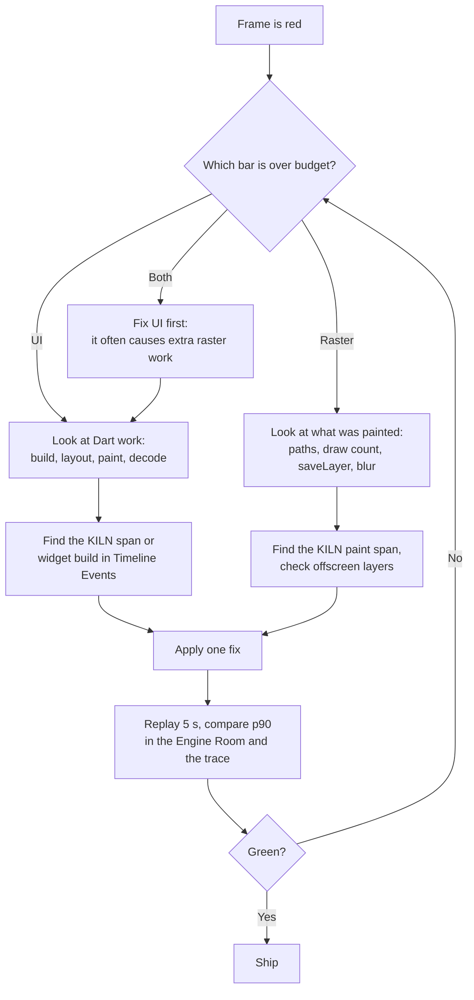

# Research 02 — Profiling toolchain

Which tool answers which question, and how to use each one live.

## The frame budget

| Refresh rate | Budget per frame |
|---|---|
| 60 Hz | 16.67 ms |
| 90 Hz | 11.11 ms |
| 120 Hz | **8.33 ms** |

`FrameTiming` gives three numbers per frame. All three matter:

| Field | Meaning | At 120 Hz |
|---|---|---|
| `buildDuration` | Dart work: animate, build, layout, paint (DevTools "UI") | ≤ 8.33 ms |
| `rasterDuration` | Raster thread: Impeller turning the frame into GPU commands | ≤ 8.33 ms |
| `totalSpan` | Vsync start to raster finish (latency) | ≤ 8.33 ms for lowest latency |

The two threads are pipelined, so each can use most of the budget. A "4 ms + 4 ms" split
is a useful mental model for lowest latency, not a hard rule.

## Tool map

## Shader Lab: run both flavor APKs for Skia vs Impeller

Same Binance book in `packages/shader_lab`; compare raster cost on **Draw depth** with DevTools,
Perfetto, and the on-phone recovery time. Both APKs come from `apps/kiln` and use the same
Flutter SDK, source, assets and profile build mode.

| Flavor | Directory | Command |
|---|---|---|
| Kiln Impeller | `apps/kiln` | `flutter run --profile --trace-systrace --flavor impeller` → Home → Shader Lab, or `kiln://scenario/shaderlab` |
| Kiln Skia | `apps/kiln` | `flutter run --profile --trace-systrace --flavor skia` |

Before a candidate Skia **cold-run** demo: `adb shell pm clear dev.fluttercon.kiln.skia`.
Verify the reset protocol on the target GPU; vendor driver caches may survive app-data clears.

DevTools attaches to the app started by **`flutter run`**. To compare renderers, stop one run
and start the other, or use exported snapshots / a second laptop.

Step-by-step: [TRD §11.0](../technical/TRD.md#110-how-to-run-so-devtools-and-perfetto-see-everything).

## 1. Flutter DevTools — Performance view

Run: `flutter run --profile --trace-systrace` on a physical device (never debug mode for
measurement). For Shader Lab, use the monorepo commands in the table above.

- **Naming:** DevTools **UI** is `buildDuration` for Dart frame work executing on the
  platform main thread. DevTools **Raster** is `rasterDuration` on the separate
  **`1.raster`** engine CPU thread. The GPU is downstream and needs Perfetto GPU tracks or
  AGI for direct inspection.
- **Flutter frames chart:** one bar pair per frame; red means over budget.
- **Frame analysis:** hints for the selected frame (for example expensive `saveLayer`).
- **Timeline events:** the full trace for the selected frame, including our `KILN::` spans.
- **Enhance tracing:** Track widget builds, layouts and paints (adds overhead; turn on only when needed).
- **Offscreen layers:** the checkerboard option highlights layers that use `saveLayer`.
- **Export:** snapshots can be exported and re-imported — this is our backup plan.

## 2. Perfetto — system trace

Run the app with `flutter run --profile --trace-systrace` so Flutter's events go to the
Android trace buffer.

Recording options:

| Method | Notes |
|---|---|
| `record_android_trace` script (from the Perfetto project) | **Recommended.** Uses `adb`, so it coexists with `flutter run`. Opens the trace in the Perfetto UI. |
| Perfetto web UI recording over WebUSB | Requires stopping the `adb` server, which **disconnects `flutter run`**. Avoid on stage. |
| On-device System Tracing (Developer options) | Good fallback; pull the file afterwards. |

What to show the room:

- The app's **main thread** (Dart work since Flutter 3.29) and the **`1.raster`** thread.
- `KILN::` spans next to engine events.
- Android's **Expected vs Actual frame timeline** tracks (Android 12+) — Kotlin engineers know this view.
- Optional GPU data sources (`gpu.renderstages`, vendor counters) when the device supports them.

## 3. Android GPU Inspector (AGI) — appendix only

- Frame profiler for **Vulkan**: every API call, render passes, draw calls, textures and pipelines for one frame.
- System profiler: CPU and GPU timeline with GPU counters.
- Requires a debuggable app. Use it during preparation to capture screenshots for the Q&A appendix.

## 4. Android Studio CPU profiler with a local engine — appendix only

For flame graphs inside Impeller on the raster thread:

1. Build the engine with symbols (`--no-stripped`).
2. Keep native symbols in the app (`doNotStrip "**/*.so"`).
3. Run with `--local-engine` in profile mode.
4. Record "Callstack Sample Recording" and select the raster thread.

Too slow for stage; good for one appendix slide showing where tessellation time goes.

## Diagnosis method taught in the talk

## Known blind spots

- Impeller's Vulkan encode/submit path has few trace events in stock builds
  ([flutter#193399](https://github.com/flutter/flutter/issues/193399)).
- Screen mirroring and enhanced tracing both add load; measure with them off for final numbers.
- Thermal throttling changes raster times over a long session.
