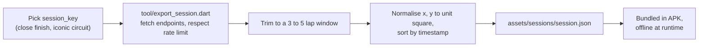

# Research 03 — OpenF1 telemetry data

## What OpenF1 is

[OpenF1](https://openf1.org) is an independent, open-source API for Formula 1 timing and
telemetry. It is **not** affiliated with Formula 1, the FIA or Formula One Management.

| Property | Value |
|---|---|
| Historical data | Free, no authentication, from the 2023 season onwards |
| Live data | Paid subscription (not needed for Kiln) |
| Formats | JSON (default), CSV |
| Rate limits (free) | 3 requests/second, 30 requests/minute |
| Intended use | Educational, personal, research, non-commercial fan projects |
| Repository licence | CC BY-NC-SA 4.0 |
| Credit | Not required, but appreciated — we credit it on a slide |

## Endpoints Kiln uses

| Endpoint | Fields used | Sample rate | Used by |
|---|---|---|---|
| `car_data` | speed, throttle, brake, rpm, n_gear, drs | ~3.7 Hz | Telemetry Duel, Speed Ribbon, KPI cards |
| `location` | x, y, z | ~3.7 Hz | Track map, Speed Ribbon geometry |
| `laps` | lap number, lap duration, sector times | per lap | Tower, fastest lap KPI |
| `position` | position per driver | on change | Tower |
| `intervals` | gap to leader, interval | ~4 s | Tower |
| `race_control` | flags, messages | on event | Race Control |
| `drivers` | number, name acronym, team colour | per session | Labels (see naming decision) |

Example (from the OpenF1 docs):

```text
https://api.openf1.org/v1/car_data?driver_number=55&session_key=9159&speed>=315
https://api.openf1.org/v1/location?session_key=9161&driver_number=81&date>2023-09-16T13:03:35.200&date<2023-09-16T13:03:35.800
```

## Limits that shape the design

- **3.7 Hz vs 120 Hz:** about 32 rendered frames per sample, so interpolation is required.
  This is the opening hook of the talk.
- **Location has no lateral precision:** it shows progress around the lap, not which side
  of the track a car is on. Good enough for a dashboard map.
- **Arbitrary origin:** coordinates must be normalised per circuit.

## Export plan



## Branding and legal guardrails

- No Formula 1, FIA or team logos, wordmarks or liveries in the app or slides.
- Product name is Kiln; "F1" appears only descriptively ("F1 telemetry").
- Driver naming is an open decision: real acronyms from the data, or fictional codes.
- A slide credits OpenF1 and states the app is a non-commercial demo.
