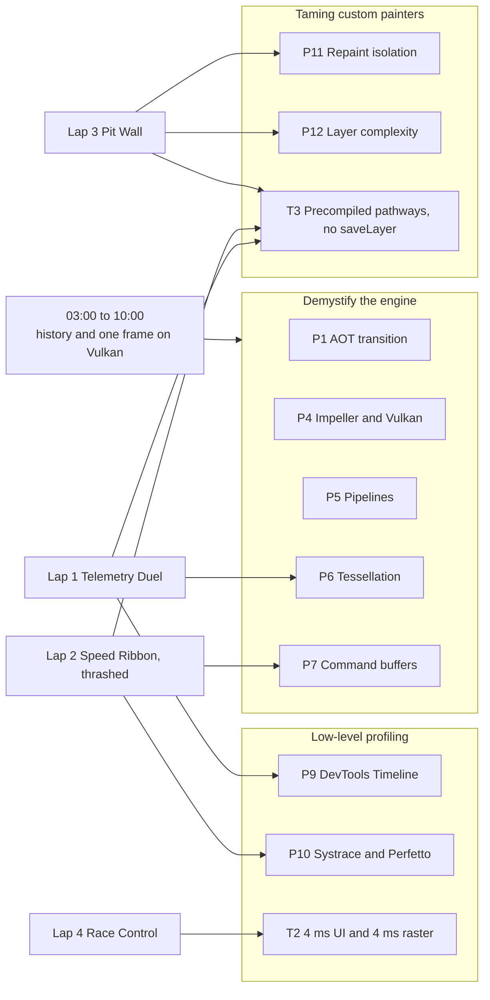

# Abstract alignment

The registered abstract is a promise to the audience. Terminology is aligned in
[Talk vocabulary](vocabulary.md). This page maps every promise to the
exact moment in the demo where it is delivered, and to the evidence on screen. If a row
has no line number, the talk does not deliver it.

## The registered abstract

> **Beyond Skia: Deep-Dive GPU Scheduling and Profiling with Impeller on Android 10+**
>
> With Flutter's definitive transition to the Impeller rendering engine, the ecosystem has
> achieved a predictable, ahead-of-time (AOT) shader-compiled execution model. However,
> hitting a rock-solid, fluid 120fps on modern high-refresh-rate Android devices requires
> engineers to shift how they diagnose, isolate, and fix rendering bottlenecks.
>
> This session bypasses high-level UI paradigms to dissect exactly how Impeller interacts
> with the modern Vulkan graphics API on Android 10+ (API 29+). We will dive into how
> Impeller schedules GPU pipelines, uses modern tessellation to break vector paths into
> fast-rendering triangles, and manages explicit command buffers to prevent frame drops
> under heavy stress loads.
>
> We will intentionally thrash a real-time graphics canvas and step through deep-dive
> profiling.
>
> Attendees will learn how to parse advanced Flutter DevTools Timeline traces, interpret
> Android Systrace/Perfetto metrics, and engineer surgical UI optimizations—such as precise
> repaint boundary isolation and layer complexity reduction—to confidently ship
> enterprise-grade mobile experiences.
>
> **Key takeaways**
> - **Demystifying the Engine:** Understand the architectural differences between Skia's
>   JIT shader compilation and Impeller's AOT pipeline mechanics on Vulkan.
> - **Low-Level Profiling:** Master advanced Flutter DevTools and Android Systrace to read
>   frame-budget allocations (~4ms UI / ~4ms Raster thread).
> - **Taming Custom Painters:** Learn code patterns that maximize Impeller's pre-compiled
>   rendering pathways, avoiding expensive canvas operations like saveLayer().

## Promise → delivery map

Line numbers refer to the [Demo script](demo-script.md).

| # | Promise in the abstract | Delivered at | Evidence the audience sees | Background doc |
|---|---|---|---|---|
| P1 | Definitive transition to Impeller, AOT shader compilation | 03:00, lines 11–19 (live Shader Lab 15a–15e) | Concept video, timeline, live Skia vs Impeller worst-frame comparison | [Rendering engine history](../history/01-rendering-engine.md), [Media README](media/README.md) |
| P2 | Rock-solid 120 fps on high-refresh Android | 01:30 lines 5–10; 33:00 lines 66–67 | Engine Room at 120 Hz, renderer badge, finale inside budget | [Frame scheduling](../notes/05-frame-scheduling.md) |
| P3 | Diagnose, isolate, fix | Every lap, method slide line 29 | Same three-question method in each lap | [Profiling toolchain](../research/02-profiling-toolchain.md) |
| P4 | How Impeller interacts with Vulkan on Android 10+ | 05:30 lines 19–25; line 6 | Pipeline and command-buffer slides, badge "Impeller · Vulkan" | [Vulkan primer](../notes/04-vulkan-primer.md), [Graphics APIs history](../history/02-graphics-apis.md) |
| P5 | How Impeller schedules GPU pipelines | Line 20 | Slide 6: precompiled shaders → pipelines → pick per draw | [Impeller internals](../notes/03-impeller-internals.md) |
| P6 | Tessellation of vector paths into triangles | Line 22; Lap 1 lines 37–41 | `KILN::TelemetryDuel` span shrinks after decimation | [Impeller internals](../notes/03-impeller-internals.md) |
| P7 | Explicit command buffers, preventing drops under stress | Lines 23–24; Lap 2 lines 48–50 | Slide 7 record/submit/execute lanes; raster slices shrink at Thrash 8× | [Vulkan primer](../notes/04-vulkan-primer.md) |
| P8 | Intentionally thrash a real-time canvas | Lap 2 lines 43–44; finale line 66 | Thrash dial 1× → 8×, raster bar climbs into red live | [Screens](../design/screens.md#3--speed-ribbon) |
| P9 | Parse DevTools Timeline traces | Lap 1 lines 35–36; Lap 4 line 63 | Frames chart, Timeline Events, `KILN::` spans | [Profiling playbook](../notes/06-profiling-playbook.md) |
| P10 | Interpret Systrace / Perfetto metrics | Line 28; Lap 2 lines 45–47 | Main and raster thread slices, Expected vs Actual frame timeline | [Profiling tools history](../history/03-profiling-tools.md) |
| P11 | Precise repaint boundary isolation | Lap 3 line 58 | Track Paints: circuit paint events disappear, only cars repaint | [Optimisation patterns](../notes/07-optimization-patterns.md) |
| P12 | Layer complexity reduction | Lap 3 lines 55–59 | Offscreen-layer checkerboard disappears | [Optimisation patterns](../notes/07-optimization-patterns.md) |
| P13 | Confidence to apply the method in production | Every lap; rehearsal and fallback workflow | Deterministic replay, before/after evidence, repeatable diagnosis method and exported backup traces | [Stage runbook](stage-runbook.md), [Profiling playbook](../notes/06-profiling-playbook.md) |
| T1 | Skia JIT vs Impeller AOT pipeline mechanics on Vulkan | Lines 14, 15a–15e, 21, 69 | Live Shader Lab (two renderer flavors from one build setup), pipeline slide | [Skia era](../notes/02-skia-era.md) |
| T2 | Read ~4 ms UI / ~4 ms raster allocations | Lines 8–9, 26, 35, 46, 64, 70 | Engine Room bars with a 4.17 ms tick per thread | [Frame scheduling](../notes/05-frame-scheduling.md) |
| T3 | Custom painter patterns using precompiled pathways, avoiding `saveLayer()` | Lap 1 line 38; Lap 2 lines 49–52; Lap 3 line 56 | `drawVertices`, build-time fragment shader, gradient glow instead of `canvas.saveLayer` | [Optimisation patterns](../notes/07-optimization-patterns.md) |

## Delivery contract

This map is the talk's acceptance contract, not a claim that every feature is implemented.
The current first version proves Shader Lab and its timing model; the full talk is not
demo-ready until every gate below passes on the stage phone:

| Submission promise | Required proof before rehearsal sign-off |
|---|---|
| Thrash a real-time canvas | Move Speed Ribbon from 1× to 8× live; `KILN::Thrash::level` appears in the trace and broken raster frames turn red within 3 seconds |
| Advanced DevTools Timeline | Select a red frame, identify UI or raster, find the relevant `KILN::` span, apply one fix and show the before/after frame |
| Systrace / Perfetto metrics | Show main and `1.raster` slices plus Expected vs Actual frame timeline around the same workload; keep an exported trace as backup |
| Skia JIT vs Impeller AOT | Run the identical Shader Lab workload from same-SDK Skia and Impeller flavors; show verified Skia cold vs repeat and Impeller first-entry measurements |
| ~4 ms UI / ~4 ms raster | Engine Room shows a 4.17 ms target tick and 8.33 ms deadline; narration explains pipelining and the finale reports p90 for both threads |
| Precise repaint isolation | With Track Paints enabled, the circuit paint event is present before `map-layers` and absent after it while car dots continue moving |
| Layer complexity reduction | Offscreen-layer checkerboarding visibly decreases after tower, glass and car-glow fixes |
| Tame CustomPainters / avoid `saveLayer()` | Show explicit `canvas.saveLayer` plus blur inside the broken car painter, then a radial-gradient fixed painter with no layer |
| Precompiled rendering pathway | Show `ribbon-shader` declared as a Flutter shader, compiled during the app build and used in the one-draw fixed ribbon |
| Enterprise-grade confidence | Three deterministic rehearsals, measured before/after evidence for every lap, and offline DevTools/Perfetto/video fallbacks |

## Gaps found and how they were closed

| Gap in the earlier plan | Fix | Where it is specified |
|---|---|---|
| Nothing was visibly "thrashed" on stage | **Thrash dial** (1×, 2×, 4×, 8×) on Speed Ribbon, also `kiln://thrash/<n>` | PRD FR-13, TRD pit-stop table and deep links, Screens §3 |
| Budget shown only as 8.33 ms total | Per-thread bars with a **4.17 ms tick** and an 8.33 ms limit | PRD FR-5, TRD §9.1, Screens §5 |
| Pipelines and command buffers only mentioned in passing | Segment "One frame on Vulkan" with a command-buffer slide | Demo script lines 19–25, Talk outline slide 7 |
| Fragment shader fix was optional | `ribbon-shader` is now a stage step | PRD §8, TRD pit-stop table |
| No `canvas.saveLayer()` inside a custom painter | New pit stop **`car-glow`** on the track map | PRD §8, TRD pit-stop table, Screens §1 |
| Repaint isolation was claimed, not shown | Track Paints on during `map-layers` so the circuit's paint events visibly disappear | Demo script line 58 |

## Wording guardrails for the abstract's claims

The abstract uses some shorthand. These are the precise versions to say on stage.

| Abstract says | Say on stage | Why |
|---|---|---|
| "~4ms UI / ~4ms Raster" | "UI means Dart frame work on the platform main thread; Raster means Impeller work on `1.raster`. Target about 4 ms each so the frame lands within one refresh. Each can stretch to 8.33 ms without dropping, but you lose latency and headroom." | DevTools labels phases as UI/Raster; main and raster are the actual CPU threads, and consecutive frames pipeline ([Frame scheduling](../notes/05-frame-scheduling.md)) |
| "Skia's JIT shader compilation" | "Skia generated and compiled shaders just in time, during frames" | Skia generated SkSL at runtime; the driver compiled it on first use |
| "Impeller's AOT pipeline mechanics" | "Shaders compiled at engine build time; pipelines built from them mostly at startup" | The driver still creates pipeline objects at runtime, outside the frame |
| "Skia JIT versus Impeller AOT on Vulkan" | "The Skia comparison demonstrates first-use generation on OpenGL ES; the following segment explains Impeller's AOT pipeline mechanics on Vulkan" | Do not imply that both comparison APKs use the same graphics backend |
| "Prevent frame drops under heavy stress" | "Keep the recorded work small enough that the raster thread finishes inside its budget" | Command buffers don't prevent drops by themselves; less recorded work does |
| "Android Systrace" | "Systrace, now Perfetto" | Perfetto replaced Systrace in Android 10 and opens Systrace files |
| "Precise repaint boundary isolation" | "Isolate what repaints; Impeller still rasterizes the frame" | Impeller has no raster cache |
| "Maximize pre-compiled rendering pathways" | "Use offline-compiled shaders where they replace many draws or layers, but still measure geometry, draw count and render passes" | Precompiled shaders remove runtime shader generation; they do not make expensive canvas work free |
