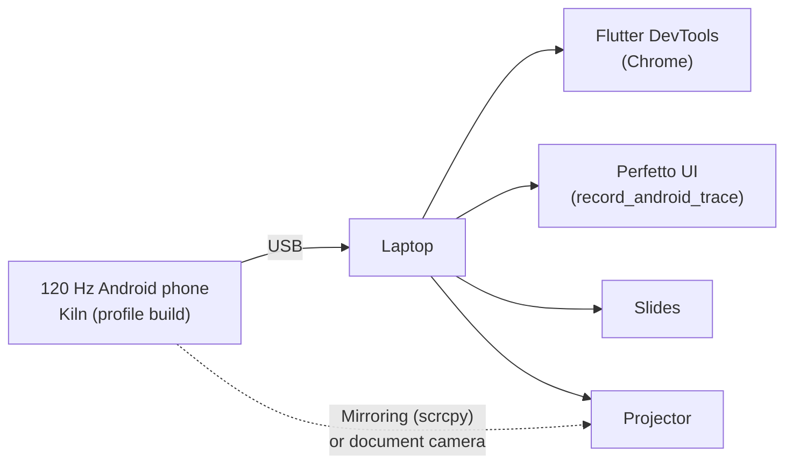
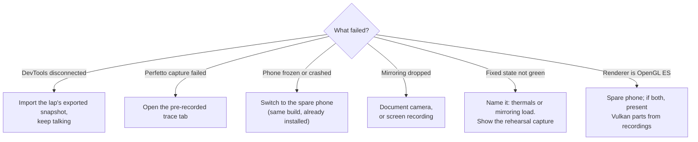

# Stage runbook

Setup, rehearsal and recovery for the live demo.

## Stage topology



## Equipment checklist

- [ ] Demo phone, fully charged, plus a spare phone with the same build
- [ ] Two USB data cables (tested), USB-C adapter for the laptop
- [ ] Laptop charger, HDMI / USB-C display adapter
- [ ] Document camera or phone stand (mirroring fallback)
- [ ] Offline copies: slides, exported DevTools snapshots, Perfetto traces, concept video (`docs/talk/media/skia-to-impeller-concept.mp4`), device Skia comparison recording

## Phone preparation

- [ ] Airplane mode on, Bluetooth off, Do Not Disturb on
- [ ] Display set to 120 Hz (or adaptive with the app forcing high refresh)
- [ ] Brightness fixed, auto-brightness off, battery saver off
- [ ] Developer options: USB debugging on, stay awake on
- [ ] Device cool before the talk (no charging or heavy use in the last 10 minutes)
- [ ] Renderer badge shows **Impeller · Vulkan**
- [ ] Both current-SDK flavor APKs installed: **Kiln Impeller** (`dev.fluttercon.kiln`) and **Kiln Skia** (`dev.fluttercon.kiln.skia`)
- [ ] Badges and `adb logcat` agree: **Impeller · Vulkan** and **Skia · OpenGL ES**
- [ ] Shader Lab reset command ready and cold behavior verified: `adb shell pm clear dev.fluttercon.kiln.skia`

## Laptop preparation

### How to run (DevTools + Perfetto)

Physical device, USB debugging, **`adb` on PATH**. Always **profile** + **`--trace-systrace`**
(never debug for numbers). Full detail: [TRD §11.0](../technical/TRD.md#110-how-to-run-so-devtools-and-perfetto-see-everything).

**Kiln Impeller** — from `apps/kiln`:

```text
cd apps/kiln
flutter run --profile --trace-systrace --flavor impeller \
  --dart-define='KILN_RENDERER=Impeller · Vulkan'
```

Open Shader Lab: **Home → Shader Lab**, or
`adb shell am start -a android.intent.action.VIEW -d "kiln://scenario/shaderlab"`.

**Kiln Skia** — from the same directory and Flutter SDK:

```text
cd apps/kiln
flutter run --profile --trace-systrace --flavor skia \
  --dart-define='KILN_RENDERER=Skia · OpenGL ES'
```

Before a candidate **cold** demo: `adb shell pm clear dev.fluttercon.kiln.skia`. Confirm
during rehearsal that this produces the expected cold/warm gap on the target GPU; use a
reinstall or fresh package ID for the recording if the driver cache survives `pm clear`.

**DevTools** attaches to whichever app **`flutter run`** started. Switch apps = stop one run
and start the other (or use two laptops / recorded DevTools and Perfetto backups).

- [ ] Both flavor builds use the same recorded Flutter version, JDK, dependencies and profile mode
- [ ] DevTools open on the Performance page, frames chart visible
- [ ] Perfetto `record_android_trace` script tested with the phone (do **not** use WebUSB recording — it stops `adb` and disconnects `flutter run`)
- [ ] Hidden browser tabs: one exported DevTools snapshot and one Perfetto trace per lap
- [ ] Terminal with the deep-link commands pasted and ready
- [ ] Notifications off, presenter mode tested, font size enlarged in the terminal

## Rehearsal checklist (run at least three times)

- [ ] Full 40-minute run with a timer
- [ ] Each lap: broken state visibly red within 3 seconds
- [ ] Shader Lab lap time / stall / worst frame — Skia first run ___ s / ___ ms / ___ ms; Skia repeat ___ s / ___ ms / ___ ms; Impeller first ___ s / ___ ms / ___ ms
- [ ] Shader Lab lap time matches the same interval in DevTools (within one frame)
- [ ] Each lap's pit stop shows "Recovered in … s" within 5 s (Speed Ribbon at Thrash 8×: ___ s)
- [ ] Shader Lab gap is readable from the back of the room; if not, plan to use the Slide 6 recording
- [ ] Thrash: each step (1×, 2×, 4×, 8×) visibly raises the raster bar; 8× does not freeze the phone
- [ ] Thrash trace contains `KILN::Thrash::level`; fixed one-draw ribbon recovers under the identical 8× replay
- [ ] DevTools teaching path rehearsed aloud: red frame → UI/raster → `KILN::` span → source → fix → comparison
- [ ] Perfetto teaching path rehearsed aloud: main thread → `1.raster` → Expected vs Actual → same `KILN::` marker
- [ ] Track Paints proves the static circuit stops repainting after `map-layers`
- [ ] Offscreen-layer checkerboarding decreases after tower, glass and car-glow fixes
- [ ] Broken car painter visibly contains `canvas.saveLayer`; fixed painter uses a radial gradient with no layer
- [ ] Verbose build proof for `ribbon-shader` saved offline, including the `impellerc` step
- [ ] Finale at Thrash 4× with all pit stops on: both thread bars near their 4 ms ticks and zero missed frames in the measured 5 s replay after one warm-up
- [ ] Every row of [Abstract alignment](abstract-alignment.md) delivered in the run
- [ ] Each lap: fixed state measurably better; finale green or purple
- [ ] Measure with mirroring on and off; note the difference
- [ ] Simulate failures: unplug USB mid-lap and recover with backups
- [ ] One rehearsal on a projector, checking colours and text size from the back of the room
- [ ] 10-minute soak test to see thermal drift

## Recording backups

For every lap, capture both states on the demo device:

| Lap | DevTools snapshot (broken / fixed) | Perfetto trace (broken / fixed) | Screen recording |
|---|---|---|---|
| Shader Lab (Skia first / Skia second / Impeller first) | ☐ / ☐ / ☐ | — | ☐ side-by-side |
| 1 Telemetry Duel | ☐ / ☐ | ☐ / ☐ | ☐ |
| 2 Speed Ribbon (Thrash 8×) | ☐ / ☐ | ☐ / ☐ | ☐ |
| 3 Pit Wall | ☐ / ☐ | ☐ / ☐ | ☐ |
| 4 Race Control | ☐ / ☐ | ☐ / ☐ | ☐ |
| Finale | ☐ / ☐ | ☐ / ☐ | ☐ |

## Failure recovery



**Rule:** never debug live for more than 20 seconds. Switch to the backup and keep the story moving.
