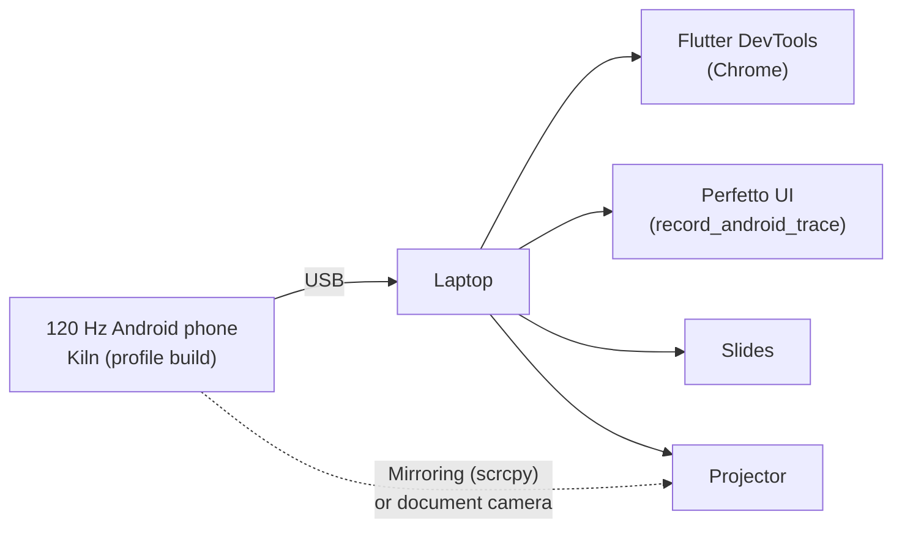
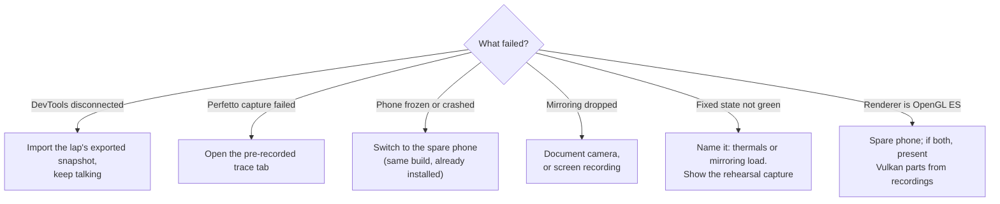

# Stage runbook

Setup, rehearsal and recovery for the live demo.

## Stage topology



## Equipment checklist

- [ ] Demo phone, fully charged, plus a spare phone with the same build
- [ ] Two USB data cables (tested), USB-C adapter for the laptop
- [ ] Laptop charger, HDMI / USB-C display adapter
- [ ] Document camera or phone stand (mirroring fallback)
- [ ] Offline copies: slides, exported DevTools snapshots, Perfetto traces, Skia comparison video

## Phone preparation

- [ ] Airplane mode on, Bluetooth off, Do Not Disturb on
- [ ] Display set to 120 Hz (or adaptive with the app forcing high refresh)
- [ ] Brightness fixed, auto-brightness off, battery saver off
- [ ] Developer options: USB debugging on, stay awake on
- [ ] Device cool before the talk (no charging or heavy use in the last 10 minutes)
- [ ] Renderer badge shows **Impeller · Vulkan**

## Laptop preparation

```text
flutter run --profile --trace-systrace
```

- [ ] DevTools open on the Performance page, frames chart visible
- [ ] Perfetto `record_android_trace` script tested with the phone (do **not** use WebUSB recording — it stops `adb` and disconnects `flutter run`)
- [ ] Hidden browser tabs: one exported DevTools snapshot and one Perfetto trace per lap
- [ ] Terminal with the deep-link commands pasted and ready
- [ ] Notifications off, presenter mode tested, font size enlarged in the terminal

## Rehearsal checklist (run at least three times)

- [ ] Full 40-minute run with a timer
- [ ] Each lap: broken state visibly red within 3 seconds
- [ ] Thrash: each step (1×, 2×, 4×, 8×) visibly raises the raster bar; 8× does not freeze the phone
- [ ] Finale at Thrash 4× with all pit stops on: both thread bars near their 4 ms ticks
- [ ] Every row of [Abstract alignment](abstract-alignment.md) delivered in the run
- [ ] Each lap: fixed state measurably better; finale green or purple
- [ ] Measure with mirroring on and off; note the difference
- [ ] Simulate failures: unplug USB mid-lap and recover with backups
- [ ] One rehearsal on a projector, checking colours and text size from the back of the room
- [ ] 10-minute soak test to see thermal drift

## Recording backups

For every lap, capture both states on the demo device:

| Lap | DevTools snapshot (broken / fixed) | Perfetto trace (broken / fixed) | Screen recording |
|---|---|---|---|
| 1 Telemetry Duel | ☐ / ☐ | ☐ / ☐ | ☐ |
| 2 Speed Ribbon (Thrash 8×) | ☐ / ☐ | ☐ / ☐ | ☐ |
| 3 Pit Wall | ☐ / ☐ | ☐ / ☐ | ☐ |
| 4 Race Control | ☐ / ☐ | ☐ / ☐ | ☐ |
| Finale | ☐ / ☐ | ☐ / ☐ | ☐ |

## Failure recovery



**Rule:** never debug live for more than 20 seconds. Switch to the backup and keep the story moving.
