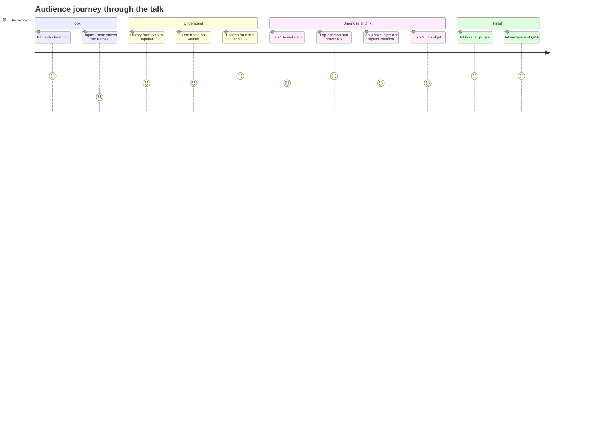
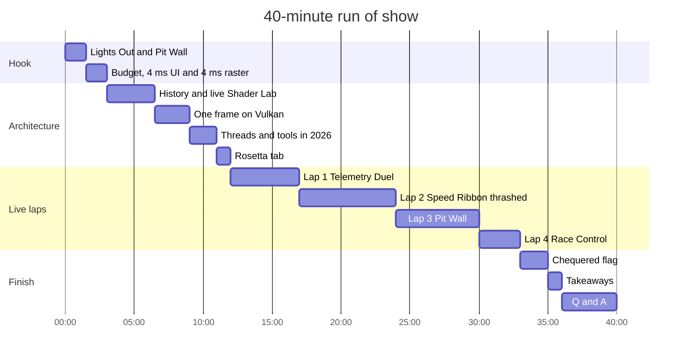

# Talk outline

**Beyond Skia: Deep-Dive GPU Scheduling and Profiling with Impeller on Android 10+**
40 minutes · live demo on a 120 Hz Android device · mixed Flutter, Kotlin and iOS audience

## Core message

> Impeller made performance **predictable**. It didn't make overdraw free.

## Three takeaways (as registered)

These match the registered abstract word for word in their titles. Every promise in the
abstract is traced to a demo line in [Abstract alignment](abstract-alignment.md).

1. **Demystifying the Engine.** Skia compiled shaders just in time, during frames. Impeller
   compiles them ahead of time, builds Vulkan pipelines from them, tessellates paths into
   triangles on the CPU and records explicit command buffers.
2. **Low-Level Profiling.** Read the frame budget as about 4 ms UI and 4 ms raster at
   120 Hz. Which thread is over? Which event? Which code? DevTools Timeline for the frame,
   Systrace/Perfetto for the system.
3. **Taming Custom Painters.** Use the precompiled pathways (one `drawVertices`, build-time
   fragment shaders), isolate repaints precisely, reduce layer complexity, and avoid
   `saveLayer()`. Prove every fix with numbers.

## Narrative arc

## Time plan

If time runs short, cut Lap 4 first, then shorten the Rosetta segment.

## Slide list

| # | Slide | Notes |
|---|---|---|
| 1 | Title | Name, handle, event |
| 2 | (Live) Kiln on the phone | No slide content; let the app run |
| 3 | The budget | 3.7 Hz vs 120 Hz; 8.33 ms split as ~4 ms UI and ~4 ms raster |
| 4 | Skia → Impeller concept video | Full-screen [`skia-to-impeller-concept.mp4`](media/skia-to-impeller-concept.mp4); metaphor hook ([media README](media/README.md)) |
| 5 | How we got here, 2018 to 2025 | Timeline from [History overview](../history/README.md): Flutter 1.0 on Skia, SkSL warm-up 2020, Impeller iOS 2023, Android 2024, 3.29 in 2025 |
| 6 | Shader Lab backup (hidden) | Pre-recorded side-by-side of the live Shader Lab runs; shown only if the live comparison fails (see [Demo script](demo-script.md#note-on-shader-lab)) |
| 7 | Shaders to pipelines to triangles | Build-time shaders, pipelines built mostly at startup, DisplayList, CPU tessellation |
| 8 | Explicit command buffers | Three lanes: raster thread records, Vulkan queue submits with a fence, GPU executes while the next frame records; no raster cache |
| 9 | Threads in 2026 | DevTools UI = Dart work on main; Raster = Impeller on `1.raster`; GPU is downstream; the two 4 ms targets; Vulkan as Android's modern low-level graphics API |
| 10 | Tools then and now | Systrace to Perfetto, Observatory to DevTools, and DevTools embedding a Perfetto trace viewer ([Profiling tools history](../history/03-profiling-tools.md)) |
| 11 | Diagnosis method | Flowchart from [Profiling toolchain](../research/02-profiling-toolchain.md) |
| 12–14 | Lap title cards | Laps 1 to 3: symptom, thread, fix (Lap 4 runs without a card) |
| 15 | Before / after | Side-by-side Perfetto screenshots |
| 16 | Honest limits (Q&A backup) | No raster cache, Vulkan trace gaps, blur caveats, OpenGL ES devices |
| 17 | Takeaways | The three registered takeaways |
| 18 | Closing and credits | Core message, OpenF1 credit, repo link, sources |
| A1–A3 | Appendix | AGI frame capture, engine flame graph, extra data |

## Questions to expect

| Question | Short answer |
|---|---|
| "Is 4 ms UI / 4 ms raster a hard rule?" | No. The threads pipeline, so each can reach 8.33 ms at 120 Hz without dropping. Four and four keeps the frame within one refresh and leaves headroom. |
| "Are these different Flutter versions?" | No. They are two Android flavors of the same current-SDK app: identical Dart code, assets and profile mode; only renderer configuration and app identity differ. |
| "Does Impeller compile anything at runtime?" | No new shaders. The Vulkan driver still builds pipeline objects from the precompiled shaders, mostly at startup and outside the frame. |
| "Is Impeller always faster than Skia?" | No. It is more predictable. Some effects (certain blurs) measured slower; fixes are in progress upstream. |
| "Does RepaintBoundary cache on Impeller?" | It isolates repaints but there is no raster cache. Use `SnapshotWidget` deliberately. |
| "Why not show the GPU timing directly?" | Stock traces have limited Vulkan submit events; AGI shows it — appendix. |
| "What happens on devices without Vulkan?" | Since 3.29, Impeller falls back to its own OpenGL ES backend, not to Skia; check the badge. |
| "How does this compare to Compose?" | Rosetta tab: same ideas — offscreen layers, main-thread work, render thread. |
| "Do these numbers hold on low-end devices?" | The method holds; the numbers do not. Profile on the slowest device you support. |
