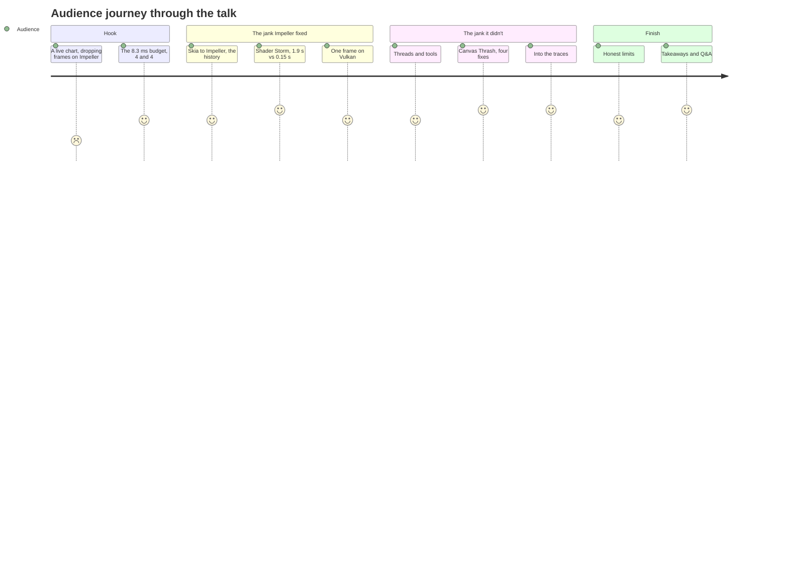
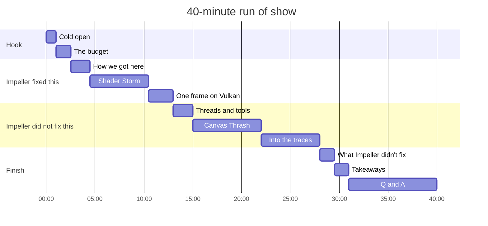

# Talk outline

**Beyond Skia: Deep-Dive GPU Scheduling and Profiling with Impeller on Android 10+**
40 minutes · recorded demos from a 120 Hz Android phone, real traces · mixed Flutter, Kotlin and iOS audience

## Core message

> Impeller made performance **predictable**. It didn't make overdraw free.

## Three takeaways (as registered)

These match the registered abstract word for word in their titles. Every promise in the
abstract is traced to a demo line in [Abstract alignment](abstract-alignment.md).

1. **Demystifying the Engine.** Skia compiled shaders just in time, during frames. Impeller
   compiles them ahead of time, builds Vulkan pipelines from them, tessellates paths into
   triangles on the CPU and records explicit command buffers.
2. **Low-Level Profiling.** Read the frame budget as about 4 ms UI and 4 ms raster at
   120 Hz. Which thread is over? Which event? Which code? DevTools Timeline for the frame,
   Systrace/Perfetto for the system.
3. **Taming Custom Painters.** Use the precompiled pathways (one `drawVertices`, a gradient
   fill instead of a blurred layer), isolate repaints precisely, reduce layer complexity, and avoid
   `saveLayer()`. Prove every fix with numbers.

## Narrative arc

## Time plan

The line-by-line version is the [Demo script](demo-script.md). If time runs short, cut the
fixed-trace tab in "Into the traces", then shorten Q&A.

## Slide list

| # | Slide | Notes |
|---|---|---|
| 1 | Title | Name, handle, event |
| 2 | The budget | 120 Hz, 8.3 ms, split as ~4 ms UI and ~4 ms raster; screenshot of the two lanes |
| 3 | Skia → Impeller concept video | [`skia-to-impeller-concept.mp4`](media/skia-to-impeller-concept.mp4) |
| 4 | How we got here, 2018 to 2025 | Flutter 1.0 on Skia, SkSL warm-up 2020, Impeller iOS 2023, Android 2024, 3.29 in 2025 |
| 5 | Renderer evidence | The two engine log lines: "Using the Impeller rendering backend (Vulkan)" / "opted out of Impeller"; Mali-G615 MC6, Vulkan 1.3 |
| 6 | Skia trace of the reveal frame | 118 `GrGLProgramBuilder::finalize` in one 1.8 s frame on `1.raster` |
| 7 | Impeller trace of the reveal frame | 40 `PipelineVK::Create`, 87 ms, 2.2 ms each |
| 8 | Shader Storm scoreboard | Medians: 1,863 vs 145 ms at 144; repeat 18 vs 45 ms (Skia wins); relaunch |
| 9 | Shaders → pipelines → triangles | Build-time shaders, pipelines at startup or first use, DisplayList, CPU tessellation |
| 10 | Explicit command buffers | Raster thread records, queue submit, GPU executes while the next frame records; no raster cache |
| 11 | Threads in 2026 | UI = Dart on main; Raster = Impeller on `1.raster`; GPU downstream |
| 12 | Tools then and now | Systrace → Perfetto; DevTools embeds a Perfetto viewer |
| 13 | Diagnosis method | Thread → event → code → fix → measure |
| 14 | Canvas Thrash scoreboard | The five-row medians table; 36 → 120 fps |
| 15 | Canvas Thrash trace: broken vs fixed | `Encode` 27 → 3.7 ms; `saveLayer` 64 → 0; `QueueSubmit` 2 → 1; `1.raster` running, not waiting |
| 16 | Honest limits | Isolate alone didn't help; GPU side not traced; Skia 188 / 58 ms |
| 17 | Takeaways | The three registered takeaways |
| 18 | Closing | Core message, repo link, sources |
| B1–B4 | Backup screenshots | One per Perfetto tab in "Into the traces", in case the browser fails |

## Questions to expect

| Question | Short answer |
|---|---|
| "Is 4 ms UI / 4 ms raster a hard rule?" | No. The threads pipeline, so each can reach 8.33 ms at 120 Hz without dropping. Four and four keeps the frame within one refresh and leaves headroom. |
| "Are these different Flutter versions?" | No. They are two Android flavors of the same current-SDK app: identical Dart code, assets and profile mode; only renderer configuration and app identity differ. |
| "Does Impeller compile anything at runtime?" | No new shaders. It builds pipeline objects from the precompiled shaders, mostly at startup; the rest on first use, inside the frame: 40 of them, about 2 ms each, in the Shader Storm reveal. |
| "Is Impeller always faster than Skia?" | No. It is more predictable. Some effects (certain blurs) measured slower; fixes are in progress upstream. |
| "Does RepaintBoundary cache on Impeller?" | It isolates repaints, so Dart stops re-recording that subtree (grid repaints → 0, UI 4.4 → 3.4 ms). There is no raster cache: raster barely moved (6.6 → 6.5 ms). Use `SnapshotWidget` deliberately. |
| "Why not show the GPU timing directly?" | This phone's driver exposes only GPU memory to Perfetto, no render stages. The raster thread was CPU-bound anyway (running 90%+ of each frame). AGI or a Pixel with GPU render stages would show it. |
| "What happens on devices without Vulkan?" | Since 3.29, Impeller falls back to its own OpenGL ES backend, not to Skia; check the badge. |
| "How does this compare to Compose?" | Same ideas: offscreen layers, main-thread work, a render thread. See [Rosetta](../reference/rosetta.md). |
| "Do these numbers hold on low-end devices?" | The method holds; the numbers do not. Profile on the slowest device you support. |
