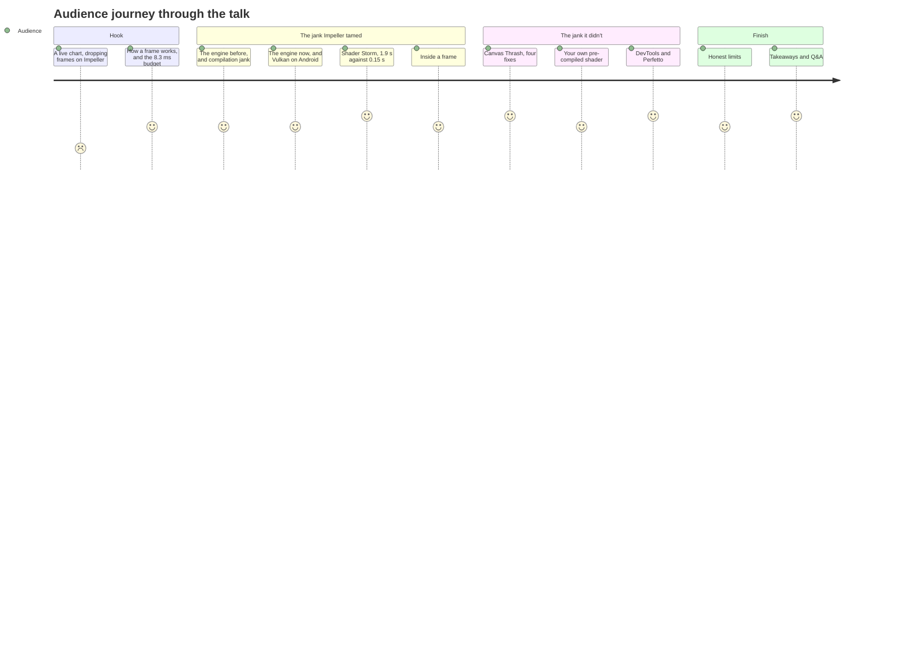
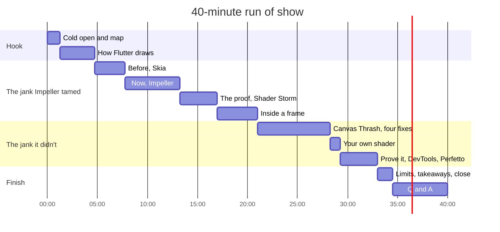

# Talk outline

**Beyond Skia: Deep-Dive GPU Scheduling and Profiling with Impeller on Android 10+**
40 minutes · demos on a mirrored 120 Hz Android phone, with recordings as fallback, real traces · mixed Flutter, Kotlin and iOS audience

## Core message

> Impeller made performance **predictable**. It didn't make expensive work free.

## Three takeaways (as registered)

These match the registered abstract word for word in their titles. Every promise in the
abstract is traced to a demo line in [Abstract alignment](abstract-alignment.md).

1. **Demystifying the Engine.** Skia compiled shaders just in time, during frames. Impeller
   compiles them ahead of time, builds Vulkan pipelines from them, tessellates paths into
   triangles on the CPU and records explicit command buffers.
2. **Low-Level Profiling.** Read the frame budget as about 4 ms UI and 4 ms raster at
   120 Hz. Which thread is over? Which event? Which code? DevTools Timeline for the frame,
   Systrace/Perfetto for the system.
3. **Taming Custom Painters.** Use the precompiled pathways (one `drawVertices`, a gradient
   fill instead of a blurred layer), isolate repaints precisely, reduce layer complexity, and avoid
   `saveLayer()`. Prove every fix with numbers.

## Narrative arc

## Time plan

Estimates from the [Demo script](demo-script.md#run-of-show). Check them in a rehearsal.

The line-by-line version is the [Demo script](demo-script.md). If time runs short, follow the cuts in the [Stage runbook](stage-runbook.md#timing-cues).

## Slide list

| # | Slide | Point | Demo |
|---|---|---|---|
| 1 | Beyond Skia | Cover | Live: chart at 8× |
| 2 | Impeller tamed one kind of jank. | The map: compilation jank and drawing cost |  |
| 3 | Dart and the engine are different things. | Framework, engine, embedder |  |
| 4 | One frame, from vsync to pixels. | Main thread records, `1.raster` prepares, GPU executes |  |
| 5 | Every frame gets 8.3 ms. | About 4 + 4 ms target, 8.3 ms per thread limit, real broken frames | Concept video after |
| 6 | Android before: Skia on OpenGL ES. | The old engine, with nothing compiled ahead |  |
| 7 | Compilation jank. | 118 shaders in one 1.8 s frame, to scale |  |
| 8 | Android now: Impeller on Vulkan. | Same picture: `impellerc`, Vulkan, tessellate |  |
| 9 | Skia compiles late. Impeller compiles early. | JIT against AOT, across the build-to-frame timeline |  |
| 10 | Impeller arrived one platform at a time. | iOS on Metal, Android, desktop |  |
| 11 | On Android, Vulkan isn't guaranteed. | Android 10 is the minimum; the device checks; read the log |  |
| 12 | A trade, not a free upgrade. | Before and now, on Android |  |
| 13 | Same app. Same phone. Two renderers. | 1,863 against 145 ms; 23 against 48 ms | Live: Shader Storm; vote |
| 14 | Skia's freeze grows. Impeller's barely does. | 13× shorter at 144 effects |  |
| 15 | The cost shrank and moved. It didn't vanish. | 118 shaders against 40 pipelines, to scale |  |
| 16 | Tessellation: how a path becomes triangles. | Path, points, vertices, triangles; at least 256,000 vertices at 8× |  |
| 17 | The CPU records. The GPU executes. | Command buffers, queue, fence: GPU scheduling |  |
| 18 | Why a layer costs more than a draw. | Render passes on tile-based GPUs; measured CPU side only |  |
| 19 | What Impeller didn't fix. | Turning point | Live: dial 1× to 8× |
| 20 | Nothing is compiling. This is pure drawing cost. | 129,920 points, 624 draws, 64 layers |  |
| 21 | Which fix helps most, on its own? | Simplify paths wins | Vote; live: X-ray, Simplify |
| 22 | Fix 1: Simplify paths. | Two points per pixel column |  |
| 23 | Fixes 2 and 3: fewer draws, no layers. | `drawVertices`; a gradient instead of `saveLayer` | Live: both toggles |
| 24 | Fix 4: A RepaintBoundary, on its own? | Saves Dart work, not GPU work | Vote; live: toggle |
| 25 | Four fixes. From 36 fps to 120. | Raster 29.7 to 6.5 ms |  |
| 26 | Your effects can be pre-compiled too. | `.frag`, `pubspec.yaml`, `FragmentProgram`; not timed |  |
| 27 | DevTools: which thread, then which code. | The method; frames chart from an emulator |  |
| 28 | Systrace, now Perfetto: 100 ms on the phone. | Real frames; running 24 of 28 ms | Vote |
| 29 | Read the budget from the trace. | The slowest thread sets the rate |  |
| 30 | Three honest limits. | Order matters, CPU side only, Skia copes worse |  |
| 31 | Take this home. | The three registered takeaways |  |
| 32 | Impeller made performance predictable. It didn't make expensive work free. | Close, with QR code to the repo |  |
| 33 | Backup: Shader Storm medians | Q&A |  |
| 34 | Backup: Canvas Thrash medians at 8× | Q&A |  |

## Questions to expect

| Question | Short answer |
|---|---|
| "Is 4 ms UI / 4 ms raster a hard rule?" | No. The threads pipeline, so each can reach 8.33 ms at 120 Hz without dropping. Four and four keeps the frame within one refresh and leaves headroom. |
| "Are these different Flutter versions?" | No. They are two Android flavors of the same current-SDK app: identical Dart code, assets and profile mode; only renderer configuration and app identity differ. |
| "Does Impeller compile anything at runtime?" | No new shader source. The shaders are compiled ahead of time. On Vulkan, the driver still finishes compiling when a pipeline is built, mostly at startup and the rest on first use: 40 of them, about 2 ms each, in the Shader Storm reveal. Impeller saves those to disk. |
| "Is Impeller always faster than Skia?" | No. It is more predictable. In the same session, Skia's second reveal was faster: 23 ms against 48 ms. |
| "Does RepaintBoundary cache on Impeller?" | It isolates repaints, so Dart stops re-recording that subtree (grid repaints → 0, UI 4.4 → 3.4 ms). There is no raster cache: raster barely moved (6.6 → 6.5 ms). Use `SnapshotWidget` deliberately. |
| "Why not show the GPU timing directly?" | This phone's driver exposes only GPU memory to Perfetto, no render stages. The raster thread was CPU-bound anyway (running 24 of 28 ms on the median frame). AGI or a Pixel with GPU render stages would show it. |
| "What happens on devices without Vulkan?" | Below API 29: Skia on OpenGL ES. From API 29: Impeller on OpenGL ES. A phone with Vulkan can land there too, if a device check fails. Read the engine log. See [Fact check](fact-check.md#which-backend-an-android-phone-gets). |
| "What about iOS?" | Impeller is the only renderer there, on Metal. This talk measures Android. |
| "Is 8,000 points realistic?" | It's my demo's stress setting, not a Flutter limit. The method is what carries over. |
| "How does this compare to Compose?" | Same ideas: offscreen layers, main-thread work, a render thread. See [Rosetta](../reference/rosetta.md). |
| "Do these numbers hold on low-end devices?" | The method holds; the numbers do not. Profile on the slowest device you support. |
