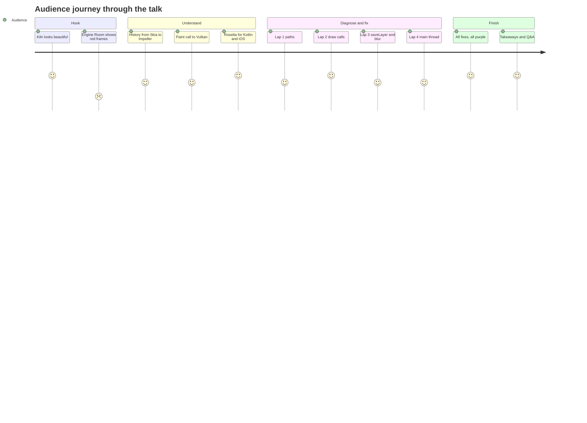
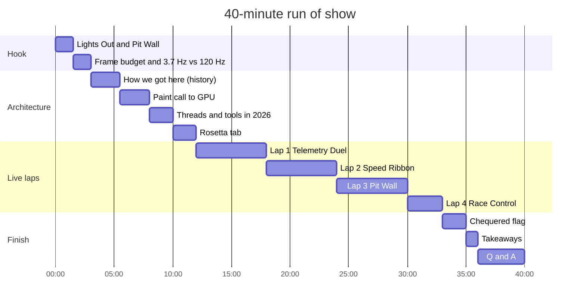

# Talk outline

**Beyond Skia: Deep-Dive GPU Scheduling and Profiling with Impeller on Android 10+**
40 minutes · live demo on a 120 Hz Android device · mixed Flutter, Kotlin and iOS audience

## Core message

> Impeller made performance **predictable**. It didn't make overdraw free.

## Three takeaways

1. **Know the engine.** Skia compiled shaders while your app ran; Impeller compiles them at
   build time and turns your paint calls into CPU-tessellated triangles and Vulkan command buffers.
2. **Diagnose before you fix.** Which thread is over budget? Which event? Which code?
   DevTools for Flutter, Perfetto for the system.
3. **Fix surgically.** Reuse geometry, cut draw calls, avoid hidden `saveLayer`, group blurs,
   isolate repaints, move work off the main thread — and prove it with numbers.

## Narrative arc

## Time plan

If time runs short, cut Lap 4 first, then shorten the Rosetta segment.

## Slide list

| # | Slide | Notes |
|---|---|---|
| 1 | Title | Name, handle, event |
| 2 | (Live) Kiln on the phone | No slide content; let the app run |
| 3 | 3.7 Hz vs 120 Hz, 8.33 ms | One big number per line |
| 4 | How we got here, 2018 to 2025 | Timeline from [History overview](../history/README.md): Flutter 1.0 on Skia, SkSL warm-up 2020, Impeller iOS 2023, Android 2024, 3.29 in 2025 |
| 5 | 30-second Skia clip | Recorded first-run shader stutter (see the note at the end of the [Demo script](demo-script.md)) |
| 6 | Paint call to GPU | Pipeline diagram; "tessellation means CPU triangulation"; no raster cache |
| 7 | Threads in 2026 | Dart on the main thread since 3.29; raster thread for Impeller; Vulkan official on Android since 2025 |
| 8 | Tools then and now | Systrace to Perfetto, Observatory to DevTools, DevTools timeline is Perfetto since 2023 ([Profiling tools history](../history/03-profiling-tools.md)) |
| 9 | Diagnosis method | Flowchart from [Profiling toolchain](../research/02-profiling-toolchain.md) |
| 10–12 | Lap title cards | Laps 1 to 3: symptom, thread, fix (Lap 4 runs without a card) |
| 13 | Before / after | Side-by-side Perfetto screenshots |
| 14 | Honest limits (Q&A backup) | No raster cache, Vulkan trace gaps, blur caveats, OpenGL ES devices |
| 15 | Takeaways | The three above |
| 16 | Closing and credits | Core message, OpenF1 credit, repo link, sources |
| A1–A3 | Appendix | AGI frame capture, engine flame graph, extra data |

## Questions to expect

| Question | Short answer |
|---|---|
| "Is Impeller always faster than Skia?" | No. It is more predictable. Some effects (certain blurs) measured slower; fixes are in progress upstream. |
| "Does RepaintBoundary cache on Impeller?" | It isolates repaints but there is no raster cache. Use `SnapshotWidget` deliberately. |
| "Why not show the GPU timing directly?" | Stock traces have limited Vulkan submit events; AGI shows it — appendix. |
| "What happens on devices without Vulkan?" | Since 3.29, Impeller falls back to its own OpenGL ES backend, not to Skia; check the badge. |
| "How does this compare to Compose?" | Rosetta tab: same ideas — offscreen layers, main-thread work, render thread. |
| "Do these numbers hold on low-end devices?" | The method holds; the numbers do not. Profile on the slowest device you support. |
