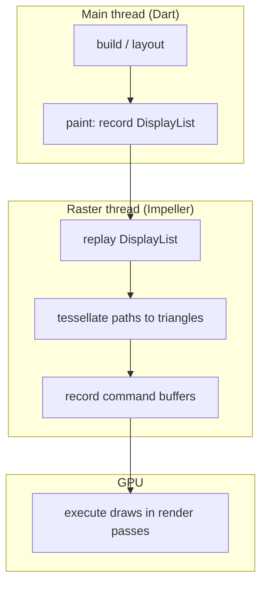

# Talk vocabulary — aligned meanings

One shared language for the talk, the docs and the demo. Each term below matches how we
use it in the [Demo script](demo-script.md) and [Abstract alignment](abstract-alignment.md).
For a short A–Z index, see the [Glossary](../notes/08-glossary.md). For Kotlin and iOS
equivalents, see [Rosetta](../reference/rosetta.md).

---

## One naming rule for the whole talk

> **UI = the Dart frame phase shown by DevTools. Main = the actual platform thread that
> runs that phase in current Flutter. Raster = the separate `1.raster` engine CPU thread.
> GPU = hardware, not a Flutter thread.**

Use **“Dart UI work on the main thread”** when both viewpoints matter. Never introduce a
current “UI thread” as a third thread beside main and raster. A separate `1.ui` thread is
historical, before Flutter 3.29.

## Frame pipeline (say these in order)

| Term | Aligned meaning | In Kiln / on stage |
|---|---|---|
| **Vsync** | The display's refresh tick (every 8.33 ms at 120 Hz). Each tick is a chance to show one new frame. | "Every vsync, we get one shot at 8.33 milliseconds." |
| **Build** | Dart runs your widgets: `build()`, then **layout** (sizes and positions). Measured as `buildDuration` in `FrameTiming`. | Race Control broken mode: JSON decode here blows the **UI** bar. |
| **Paint** | Dart **records** what to draw into a **DisplayList**. It does **not** touch the GPU yet. | "Paint is a shopping list, not the cooking." |
| **Composite** | Flutter builds the **layer tree** (which pieces go on top of which). Still mostly on the main thread. | Offscreen layers and `RepaintBoundary` show up here as separate layers. |
| **Rasterize / raster** | On the **raster thread**, Impeller **replays** the DisplayList, tessellates paths, records **command buffers**, and submits to the GPU. Measured as `rasterDuration`. | Red **Raster** bar = Impeller/GPU-side work, not Dart slowness. |
| **Present** | The finished buffer is handed to **SurfaceFlinger** for the next vsync. | Perfetto **Expected vs Actual** shows if we made it. |
| **Frame budget** | 8.33 ms at 120 Hz for the whole frame. We also talk about **~4 ms UI** and **~4 ms raster** as a single-frame latency target (threads can pipeline; see [Frame scheduling](../notes/05-frame-scheduling.md)). | Engine Room bars and ticks. |
| **Jank** | A frame that **missed the deadline** the user expected. Visible stutter, not just a high number in DevTools. | "Red frame in DevTools; Actual late in Perfetto." |

---

## Draw, path, and custom painters

| Term | Aligned meaning | In Kiln / on stage |
|---|---|---|
| **Draw** (colloquial) | Often overloaded. Be explicit: **record** in Dart (`paint()`), **tessellate + draw** on the raster thread, or **GPU draw** (one entry in a command buffer). | "Five thousand **draw calls**" = Lap 2, raster thread, Vulkan volume. |
| **`Canvas` / `paint()`** | API on the main thread that **appends** operations to the current DisplayList (paths, text, images, layers). | Custom painters in Telemetry Duel and Speed Ribbon. |
| **Path** | A vector shape (lines, curves, fills). Stored as geometry; Impeller **flattens curves** and **triangulates** it on the **CPU** each time that path is rasterized. | Broken duel: huge paths every frame. Fix: **decimate** to screen resolution. |
| **Custom painter** | A widget (`CustomPainter`) whose `paint(Canvas, Size)` runs during the paint phase. Can be driven by `repaint:` so only the painter repaints, not the whole subtree. | Duel cursor in a separate painter; car glow in track map painter. |
| **`drawPath`** | One DisplayList op that becomes tessellation + at least one GPU **draw** (often more internal work). Thousands of them = Lap 2 problem. | Broken ribbon: one `drawPath` per segment. |
| **`drawVertices`** | One DisplayList op: draw a pre-built triangle mesh (positions + colours). One logical **draw call** on the GPU side. | Fixed ribbon pit stop. |
| **Decimation** | Reducing path complexity (e.g. min/max **two points per pixel column**) before tessellation. | `duel-paths` pit stop. Not the same as caching. |

---

## Shaders and compilation

| Term | Aligned meaning | In Kiln / on stage |
|---|---|---|
| **Shader** | A small program that runs on the GPU (vertex + fragment stages). Defines how pixels are coloured, lit, blurred, etc. | Speed ribbon **fragment shader** pit stop. |
| **Shader compilation jank** | Stutter when a **new** shader is **compiled during a frame** (Skia era: generate SkSL, driver compiles GLSL/SPIR-V). Happens on first use, often once per install. | Device Skia clip + concept video metaphor. **Not** "compilation junk." |
| **JIT (shaders)** | Skia: shaders created and compiled **when the app runs**, on first encounter. | "Just in time, mid-race." |
| **AOT (shaders)** | Impeller: shaders compiled by **`impellerc` at engine build time**; app ships SPIR-V/Metal/GLSL ES archives. | Concept video kiln; pipeline slide. |
| **`impellerc`** | Offline compiler: GLSL 4.60 → SPIR-V and backend formats. Same path for engine and app `.frag` files in `pubspec.yaml`. | `ribbon-shader` pit stop. |
| **Pipeline (PSO)** | **Pipeline state object**: shader + fixed GPU state (blend, depth, formats). Impeller selects a **pre-built** pipeline per draw type. Vulkan may still **create** the PSO on first use, but **no new shader source** mid-frame. | Slide 7; say "pick a pipeline," not "compile a shader in the frame." |
| **Runtime compilation (careful)** | Do **not** claim zero driver work. Do claim: **no Skia-style shader generation during `paint()`**. | See [Say it precisely](demo-script.md#say-it-precisely). |
| **Custom fragment shader lifecycle** | Flutter compiles a declared `.frag` asset during the app build. Retain its `FragmentShader` and change only uniforms per frame. Skia can still compile the platform shader while loading, so preload before animation. | Precompiled removes shader generation; it does **not** make extra draws, geometry, layers, blur or asset loading free. |

---

## Layers, `saveLayer`, and repaint isolation

| Term | Aligned meaning | In Kiln / on stage |
|---|---|---|
| **Layer (compositing)** | A slice of the scene tree with its own transform and opacity. Flutter composites layers into the final picture. | Layer tree sent to the raster thread each frame. |
| **`saveLayer()`** | Canvas API: render a group of operations into an **offscreen texture** (new **render pass**), then composite the result. Used internally by `Opacity`, blurs, masks, and explicit painter code. | Checkerboard in DevTools; tower, glass, **car glow** in Kiln. |
| **Offscreen pass / render target** | Drawing into memory that is **not** the screen. On tile-based GPUs: **store** tile memory, **switch** pass, **reload** — expensive. | "Every checkerboard is an offscreen target." |
| **Layer complexity** | How many layers, passes, and fullscreen effects (blur, group opacity) the frame needs. Abstract takeaway: **reduce** it. | Lap 3: tower, glass, map, glow. |
| **`RepaintBoundary`** | Widget that gives its subtree a **separate layer** so when something repaints, Flutter can limit **which** DisplayLists are rebuilt and sent to raster. | `map-layers`: circuit vs cars. |
| **Repaint isolation** | **Precise** use: only the moving part repaints; static content does not. | Track Paints: circuit events disappear after fix. |
| **Not a cache** | On Impeller, `RepaintBoundary` does **not** skip rasterizing that layer forever. It limits **invalidation**. No **raster cache** like Skia. | Line 60 demo script; Q&A. |
| **`Opacity` widget** | Often creates an **opacity layer** (`saveLayer`). Fading a **group** is expensive. | Broken tower rows. |
| **Opacity peephole** | Engine optimisation: apply opacity **per draw** when children do not overlap, avoiding a layer. Kiln tower fix goes further: **fade leaf colours** instead. | `tower-fade` pit stop. |
| **`BackdropFilter`** | Blurs (or filters) **what is already drawn behind** the widget. Each one can trigger reading back the scene and a blur pass. | Broken KPI cards. |
| **`BackdropGroup` / `BackdropFilter.grouped`** | Share **one** backdrop sampling pass for several filters. Requires **identical** filter and **non-overlapping** regions. | `glass-group` pit stop. |

---

## Impeller and Vulkan (GPU scheduling)

| Term | Aligned meaning | In Kiln / on stage |
|---|---|---|
| **DisplayList** | Serialized list of draw ops from Dart `paint()`. Replayed on the raster thread. | Between paint and tessellation on the diagram above. |
| **Tessellation (Impeller)** | **CPU** work: paths → triangles. **Not** GPU tessellation shaders. | Lap 1 narrative. |
| **Command buffer** | Recorded list of Vulkan commands (begin pass, bind pipeline, bind buffers, draw, end). Built on the **raster thread**, submitted to the **queue**. | Slide 8; Lap 2 Perfetto. |
| **Render pass** | A bounded stretch of drawing to specific attachments (colour, depth, MSAA). Each `saveLayer` and backdrop blur tends to add passes. | Tile GPU store/load story in Lap 3. |
| **Draw call** | One `draw` command with current pipeline and geometry. **Volume** matters on Vulkan. | ~5k broken ribbon; 1 fixed. |
| **Raster thread** | Engine thread `1.raster`. Runs Impeller on the **CPU**; submits work to the **GPU**. DevTools label **Raster**. | Red bar = here. |
| **Main thread** | Actual platform main thread (the OS UI thread); Dart runs here since 3.29. DevTools labels its Dart frame work **UI**. | Lap 4 JSON decode. |
| **Thrash** | Demo control: multiply canvas workload (ribbon segments + car trails) to **stress** the raster path under Impeller. | Lap 2; finale at 4×. |
| **Pit stop** | Toggle one broken → fixed implementation for a scenario. One change, then replay 5 s. | Engine Room switches. |

---

## Profiling vocabulary

| Term | Aligned meaning | In Kiln / on stage |
|---|---|---|
| **DevTools Timeline** | Frame-scoped events; embedded **Perfetto** viewer for deep zoom. Search `KILN::` spans. | Every lap. |
| **Systrace** | Legacy Android trace format. **Perfetto** supersedes it on Android 10+; still opens old files. | "Systrace became Perfetto." |
| **Perfetto** | System trace: threads, scheduling, **frame timeline**, GPU stages when available. | Lap 2; finale slide. |
| **`KILN::<Scenario>::<phase>`** | Custom timeline spans from `dart:developer` `Timeline`. | e.g. `KILN::TelemetryDuel::paint`. |
| **Expected / Actual timeline** | SurfaceFlinger's view of whether the app frame landed on time. | Lap 2 line 47. |
| **UI bar / Raster bar** | DevTools frame chart metrics, not two generic OS names. UI = `buildDuration` for Dart work on main; Raster = `rasterDuration` on `1.raster`. | "Read the bars first." |
| **Lap time (time to smooth)** | From the trigger frame until the last over-budget frame finished; 0 if nothing went over. Measured from engine `FrameTiming` timestamps, not an on-screen stopwatch. | Shader Lab, lines 15b–15e. |
| **Stall time** | Total time frames spent over budget in that window: how long the user actually saw stutter. | Shader Lab, under the lap time. |
| **Recovery time** | Lap time after turning a pit stop on: how fast frames got back on budget. | Engine Room, line 49. |

---

## Say it this way (aligned phrases)

| Prefer | Avoid | Why |
|---|---|---|
| Shader **compilation jank** | "Compilation junk", "compile lag" | Standard Flutter/engine wording |
| **Record** in `paint()`, **rasterize** on the raster thread | "The GPU paints in Dart" | Dart never runs on the GPU |
| **Tessellate on the CPU** | "GPU tessellation" | Impeller's path → triangles is CPU-side |
| **Repaint isolation** | "RepaintBoundary caches the layer" | No raster cache on Impeller |
| **Offscreen pass / `saveLayer`** | "Extra layer" (vague) | Ties to render-pass cost |
| **Ahead-of-time shaders** | "Zero compilation ever" | Driver still builds PSOs from shipped SPIR-V |
| **~4 ms UI and ~4 ms raster** (target) | "Must be under 4 ms or you drop frames" | Threads pipeline; see frame scheduling note |
| **Impeller on Vulkan** / **OpenGL ES backend** | "Fallback to Skia" | Skia is not the Android fallback since 3.29 |
| **Main thread** (Dart since 3.29) | "UI thread" as a second thread | Threads merged; DevTools keeps the label "UI" |

---

## Where each term appears in the demo

| Term | Best moment |
|---|---|
| Shader compilation jank | Concept video, then live Shader Lab lap times: Skia first run vs repeat run vs Impeller (lines 11–15e) |
| AOT / pipeline | One frame on Vulkan (lines 20–24) |
| Tessellation / path | Lap 1 (lines 37–41) |
| Command buffer / draw volume | Lap 2 thrash + Perfetto (lines 44–52) |
| Precompiled fragment shader | `ribbon-shader` (line 51) |
| `saveLayer` / layer complexity | Lap 3 checkerboard (lines 55–59) |
| Repaint isolation | `map-layers` + Track Paints (line 58) |
| UI budget / main thread | Lap 4 (lines 62–65) |

When you add a new term to the talk, add a row here and a line in the [Glossary](../notes/08-glossary.md) so docs stay aligned.
