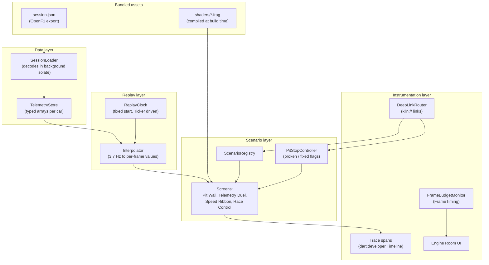
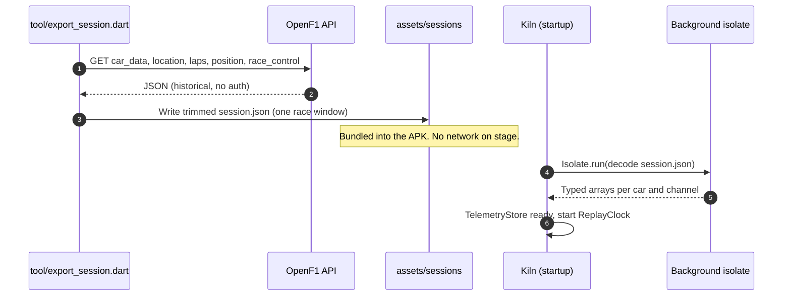
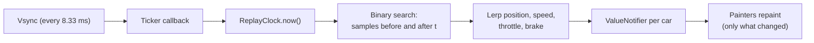
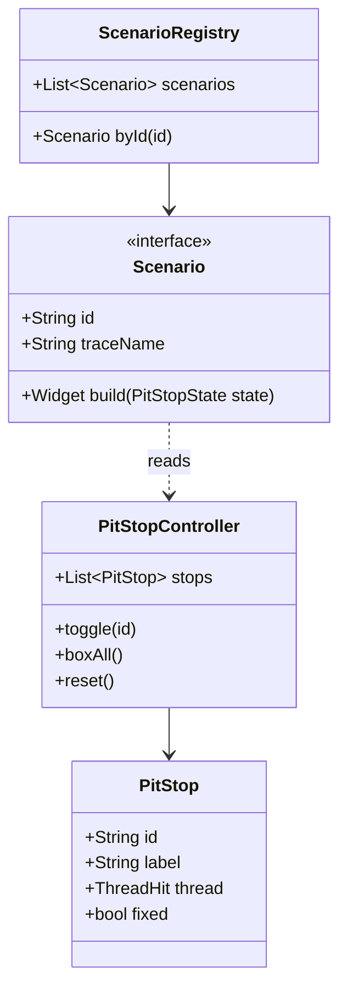
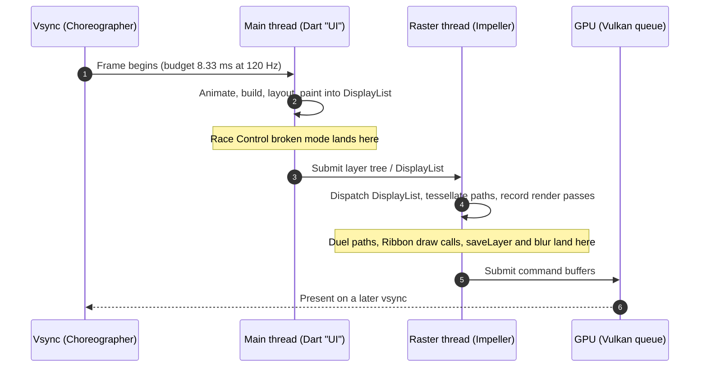

# Technical Requirements Document — Kiln: Pit Wall

| | |
|---|---|
| **Status** | Draft v1 |
| **Toolchain** | Flutter 3.47 stable · Dart 3.13 · DevTools 2.60 |
| **Target** | Android 10+ (API 29+), Impeller on Vulkan, 120 Hz device |
| **Related** | [PRD](../product/PRD.md) · [Impeller architecture](../research/01-impeller-architecture.md) · [Profiling toolchain](../research/02-profiling-toolchain.md) |

---

## 1. Purpose

This document describes how Kiln is built so that every anti-pattern is **realistic,
isolated, switchable and measurable**. The app is an instrument first and a product second:
every architectural decision favours clean, repeatable traces.

## 2. Architecture overview



## 3. Technical requirements

| ID | Requirement |
|---|---|
| TR-1 | No third-party state management. Use `ValueNotifier` / `ChangeNotifier` / `Listenable` so the framework overhead in traces is minimal and recognisable. |
| TR-2 | Telemetry stored in typed arrays (`Float32List`, `Int32List`) per car and channel, not lists of objects. |
| TR-3 | Session JSON decoded once at startup on a background isolate (`Isolate.run`). Only the Race Control scenario decodes on the UI thread, and only in its broken mode. |
| TR-4 | The replay clock is driven by a `Ticker` and a fixed start offset, so every replay renders the same timestamps. |
| TR-5 | Every scenario has exactly two implementations (`broken`, `fixed`) behind one interface; the toggle swaps the implementation, nothing else. |
| TR-6 | Each scenario paint is wrapped in a `Timeline` span named `KILN::<Scenario>::<Phase>`. |
| TR-7 | The Engine Room display is its own `RepaintBoundary` with a single `CustomPainter`; text readouts update at most 4 times per second. |
| TR-8 | Deep links via the `kiln://` scheme using Flutter's built-in deep linking and the Router API. |
| TR-9 | Fragment shaders declared under `flutter: shaders:` in `pubspec.yaml` and loaded with `FragmentProgram.fromAsset`. |
| TR-10 | Builds for the stage use `--profile`; DevTools and `--trace-systrace` are supported in that mode. |
| TR-11 | Minimum SDK 29; the manifest must not disable Impeller. |
| TR-12 | No network permission requirement at runtime for the demo flavour. |
| TR-13 | The repo is a **monorepo**: main app `apps/kiln`, Skia helper app `apps/kiln_skia`, and shared `packages/shader_lab`. Shader Lab UI and shaders live only in `shader_lab`; both apps depend on it via path. |
| TR-14 | `packages/shader_lab` must compile on **Flutter 3.24** (Skia build) and current stable (Impeller build). No APIs or packages newer than 3.24 inside that package. |

## 4. Repository layout (monorepo)

Two installable APKs share one Shader Lab implementation. Only the main app carries the
full Pit Wall demo; the Skia app exists because one Flutter SDK cannot produce both
renderers on current Android.

```text
apps/
  kiln/                      # Main demo — package dev.fluttercon.kiln
    lib/
      main.dart
      app/                   # Shell, theme, router (kiln:// deep links)
      core/
        design/              # Tokens (see design-system.md)
        data/                # SessionLoader, TelemetryStore
        replay/              # ReplayClock, Interpolator
        instrumentation/     # FrameBudgetMonitor, spans, deep links
      features/
        lights_out/
        pit_wall/            # track_map, tower, kpi_cards (broken + fixed)
        telemetry_duel/
        speed_ribbon/
        race_control/
        engine_room/         # Budget display, pit stops, Rosetta
        shader_lab/          # Thin route: imports packages/shader_lab only
    assets/sessions/         # Bundled OpenF1 export
    shaders/                 # Lap shaders (.frag); not used by Shader Lab package
    android/                 # Impeller on (default); do not disable
    pubspec.yaml             # path: ../../packages/shader_lab

  kiln_skia/                 # Shader Lab only — package dev.fluttercon.kiln.skia
    lib/
      main.dart              # Single route: Shader Lab + minimal budget chrome
    android/                 # Impeller disabled in manifest (Skia on OpenGL ES)
    pubspec.yaml             # path: ../../packages/shader_lab
    .fvmrc                   # Pins 3.24.x for this app only (FVM)

packages/
  shader_lab/                # Shared Shader Lab screen (both APKs)
    lib/
      shader_lab_screen.dart
      lights_on_scene.dart   # Gradients, BackdropFilter, masks, speed_ramp.frag
      budget_readout.dart    # Worst raster frame since entry
    shaders/
      speed_ramp.frag
    pubspec.yaml             # SDK constraint compatible with 3.24 and current stable

docs/                        # PRD, TRD, talk, design (unchanged)
samples/                     # Reference broken/fixed widgets for notes 06–07
tool/
  export_session.dart        # One-off OpenF1 export before bundling session.json
```

### 4.1 Why split apps instead of one repo root

| Concern | Approach |
|---|---|
| Impeller vs Skia on Android 10+ | `apps/kiln` uses current stable; `apps/kiln_skia` uses FVM-pinned 3.24 with Skia |
| Same pixels on stage | One `packages/shader_lab`; both apps show identical Shader Lab UI |
| Avoid dragging 3.24 into the main app | Main app never pins an old SDK; only `kiln_skia` carries `.fvmrc` |
| Lap shaders vs Shader Lab shader | Lap `.frag` files stay under `apps/kiln/shaders/`; Shader Lab's `speed_ramp.frag` lives in the package so Skia can compile it too |

### 4.2 Build entry points

| App | Working directory | Typical command |
|---|---|---|
| Kiln (Impeller) | `apps/kiln` | `flutter run --profile --trace-systrace` |
| Kiln Skia | `apps/kiln_skia` | `fvm flutter pub get` then `fvm flutter run --profile --trace-systrace` |

Install both APKs on the demo phone before rehearsal. They coexist because package IDs
differ (`dev.fluttercon.kiln` vs `dev.fluttercon.kiln.skia`).

## 5. Data pipeline



- Export a **window** of the race (for example 3–5 laps) to keep the asset small.
- Normalise location `x, y` into a unit square once, at export time.
- Pre-sort samples by timestamp per car so the interpolator can binary-search.

See [OpenF1 data](../research/03-openf1-data.md) for endpoints and limits.

## 6. Replay and interpolation

OpenF1 samples arrive at about 3.7 Hz; the display needs a value every 8.33 ms.



- Position uses linear interpolation; optional Catmull-Rom smoothing for the track map.
- Interpolation is cheap by design so it never appears as the bottleneck — the anti-patterns must be the story.

## 7. Scenario and pit-stop model



| Pit stop ID | Scenario | Broken implementation | Fixed implementation |
|---|---|---|---|
| `duel-paths` | Telemetry Duel | Full-resolution curves rebuilt for every trace every frame | Min/max decimation to ≤ 2 samples per pixel, path built once per size, cursor in a separate painter |
| `ribbon-vertices` | Speed Ribbon | One `drawPath` per track segment (~5,000) | One `Canvas.drawVertices` with per-vertex colours |
| `ribbon-shader` | Speed Ribbon | `ribbon-vertices` fixed state, without glow | Fragment shader (compiled by `impellerc` at build time) adds speed colour and glow in the same single draw |
| `car-glow` | Pit Wall | `canvas.saveLayer` with `ImageFilter.blur` per car inside the cars `CustomPainter` | Each glow drawn as a circle with a `RadialGradient` shader; no layer |
| `tower-fade` | Pit Wall | `Opacity` around row groups, `Clip.antiAliasWithSaveLayer` | Fade leaf colours (no `Opacity`), rounded `BoxDecoration` instead of a clip |
| `glass-group` | Pit Wall | One `BackdropFilter` per KPI card | `BackdropGroup` + `BackdropFilter.grouped` (identical filters, non-overlapping cards) |
| `map-layers` | Pit Wall | Circuit and cars in one painter, `shouldRepaint` always true | Static circuit painter behind `RepaintBoundary`; cars in a separate light painter |
| `feed-isolate` | Race Control | `jsonDecode` of the message batch inside `build()` | `Isolate.run`, results cached in a notifier |

## 8. Frame lifecycle and where each anti-pattern hits

Since Flutter 3.29, Dart code on Android and iOS runs on the platform **main thread**; there
is no separate UI thread. DevTools still labels this work "UI". The raster thread is
unchanged and is where Impeller runs.



## 9. Instrumentation

### 9.1 Frame budget monitor

- Source: `SchedulerBinding.instance.addTimingsCallback`.
- Per frame: `buildDuration` (UI), `rasterDuration` (raster), `totalSpan` (vsync to raster finish).
- Rolling window of 240 frames (2 s at 120 Hz) for p50, p90, p99 and jank count.
- Colour rule for the total (F1 timing colours): purple ≤ 6.0 ms, green ≤ 8.33 ms, yellow ≤ 12 ms, red above.
- Per-thread bars (UI and raster): a tick at **4.17 ms** (half the frame, the single-frame-latency
  target from the abstract) and a limit line at 8.33 ms. Green up to the tick, yellow up to the
  limit (still 120 Hz thanks to pipelining, but one frame of extra latency), red above.

### 9.1a Thrash control

- Levels 1×, 2×, 4×, 8×. Multiplies Speed Ribbon segment density and adds a speed trail per
  car, so the recorded draw work scales with the level.
- Set from the Engine Room or with `kiln://thrash/<n>`. Emits a `KILN::Thrash::level` instant
  event on change so the step is visible in traces.
- Deterministic: the same level and replay produce comparable traces.

### 9.2 Trace spans

```text
KILN::TelemetryDuel::paint
KILN::SpeedRibbon::paint
KILN::PitWall::trackMap
KILN::PitWall::carGlow
KILN::PitWall::tower
KILN::PitWall::glass
KILN::RaceControl::decode
KILN::Replay::tick
```

Spans appear in DevTools Timeline Events, and in Perfetto when the app runs with
`--trace-systrace`. On stage: "search for KILN".

### 9.3 Renderer badge

Shows "Impeller · Vulkan" or "Impeller · OpenGL ES" so the audience can trust the
backend. Detection approach to confirm during build (for example engine log line at
startup, or a platform-channel query); if unreliable, verify in rehearsal with
`adb logcat` and show a static badge.

## 10. Deep links (laptop control)

| Action | Command |
|---|---|
| Open a scenario | `adb shell am start -a android.intent.action.VIEW -d "kiln://scenario/duel"` |
| Toggle a pit stop | `adb shell am start -a android.intent.action.VIEW -d "kiln://pitstop/duel-paths/on"` |
| Apply every fix | `adb shell am start -a android.intent.action.VIEW -d "kiln://pitstop/all/on"` |
| Reset to broken | `adb shell am start -a android.intent.action.VIEW -d "kiln://pitstop/all/off"` |
| Replay 5 s | `adb shell am start -a android.intent.action.VIEW -d "kiln://replay"` |
| Set Thrash level | `adb shell am start -a android.intent.action.VIEW -d "kiln://thrash/8"` |
| Open Shader Lab (Impeller) | `adb shell am start -a android.intent.action.VIEW -d "kiln://scenario/shaderlab"` |

## 11. Build and run modes

| Purpose | Command |
|---|---|
| Stage run, Kiln (Impeller) | `cd apps/kiln` then `flutter run --profile --trace-systrace` |
| Stage run, Kiln Skia | `cd apps/kiln_skia` then `fvm flutter run --profile --trace-systrace` |
| Release sanity check | Same directories; `flutter run --release` / `fvm flutter run --release` |

Debug mode is never used for measurement: it runs JIT-compiled Dart and extra checks.

### 11.1 Shader Lab: two APKs, two renderers

Skia can no longer be selected on Android 10+ with current Flutter: the opt-out was
deprecated in August 2025 ([flutter#173375](https://github.com/flutter/flutter/pull/173375))
and is reported removed for Android 10+ from 3.44. The Skia side of the comparison is
therefore a **separate build with a pinned older SDK**.

| Build | SDK | Package ID | Renderer | Launcher label |
|---|---|---|---|---|
| Main Kiln app | Current stable (3.47) | `dev.fluttercon.kiln` | Impeller on Vulkan | Kiln |
| Shader Lab, Impeller | Current stable (3.47) | `dev.fluttercon.kiln` (same app, `kiln://scenario/shaderlab`) | Impeller on Vulkan | Kiln |
| Shader Lab, Skia | Pinned **3.24.x** via FVM, built with `--no-enable-impeller` baked into the manifest | `dev.fluttercon.kiln.skia` | Skia on OpenGL ES | Kiln Skia |

- The Skia build is **`apps/kiln_skia`**: Shader Lab plus the shared budget readout from
  `packages/shader_lab`. It does not bundle Pit Wall, laps or session data.
- Shader Lab UI lives in **`packages/shader_lab`** (TR-13, TR-14). The main app's
  `features/shader_lab/` route is a thin wrapper for deep links and navigation only.
- Both builds run in **profile** mode for comparable numbers.
- Before every run, reset caches so the "first use" is real:

| Action | Command |
|---|---|
| Reset Skia build (clears its persistent shader cache) | `adb shell pm clear dev.fluttercon.kiln.skia` |
| Launch Skia Shader Lab | `adb shell am start -n dev.fluttercon.kiln.skia/.MainActivity` |
| Open Impeller Shader Lab | `adb shell am start -a android.intent.action.VIEW -d "kiln://scenario/shaderlab"` |

Clearing the main Kiln app's data is **not** needed for the comparison and would reset
stage state; Impeller has no runtime shader generation to reset. Measure Impeller's first
entry after a fresh launch anyway, so the number shown is honest.

### 11.2 Shader Lab screen

- One button, **"Lights on"**, that transitions into a scene using many effects for the
  first time at once: linear, radial and sweep gradients, `BackdropFilter` blur,
  `ShaderMask`, `ColorFilter` blend modes, anti-aliased clips, and the custom
  `speed_ramp.frag` fragment shader.
- Engine Room shows **worst raster frame since entry** (ms) in large type, plus the usual
  bars. Reset when the screen is opened.
- Emits `KILN::ShaderLab::enter` and `KILN::ShaderLab::firstFrame` spans so the spike is easy
  to find in DevTools and Perfetto.
- Success criterion (measured in rehearsal on the demo phone): the Skia build's first entry
  shows a visibly worse worst-frame than its second entry and than the Impeller build. If
  the gap is too small on the flagship phone to read from the stage, use the pre-recorded
  backup instead and say so.

## 12. Testing and validation

| Check | Method |
|---|---|
| Each broken mode produces red frames | Manual, on device, Engine Room + DevTools |
| Each fixed mode improves the expected thread | Exported DevTools snapshots, before and after |
| Fixed state meets NFR-1 | 5 s replay, p90 from FrameBudgetMonitor, confirmed in Perfetto |
| Determinism | Three replays, p90 within ±10% |
| Engine Room overhead | Compare with the display hidden |
| Backend | Renderer badge plus `adb logcat` during rehearsal |
| Thermal stability | 10-minute soak run; note raster drift |

## 13. Risks and constraints

- Impeller's Vulkan backend has limited timeline events in its encode and submit path
  (see [flutter#193399](https://github.com/flutter/flutter/issues/193399)), so per-draw
  Vulkan cost is not visible in DevTools without a custom engine build. The talk states
  this openly.
- Impeller has no Skia-style raster cache; `RepaintBoundary` isolates repaints but does not
  guarantee a cached texture. `SnapshotWidget` is the explicit alternative.
- Backdrop blur on Impeller can cost more than on Skia in some cases; the grouped fix
  only helps when filters are identical and non-overlapping.
- Shader Lab depends on a pinned old SDK for the Skia build. On a fast flagship phone, Skia's
  first-use compile spike may be small; it must be measured before the talk. Impeller can
  also show a small first-entry cost while the driver creates pipeline objects from the
  precompiled shaders; report it as measured.
