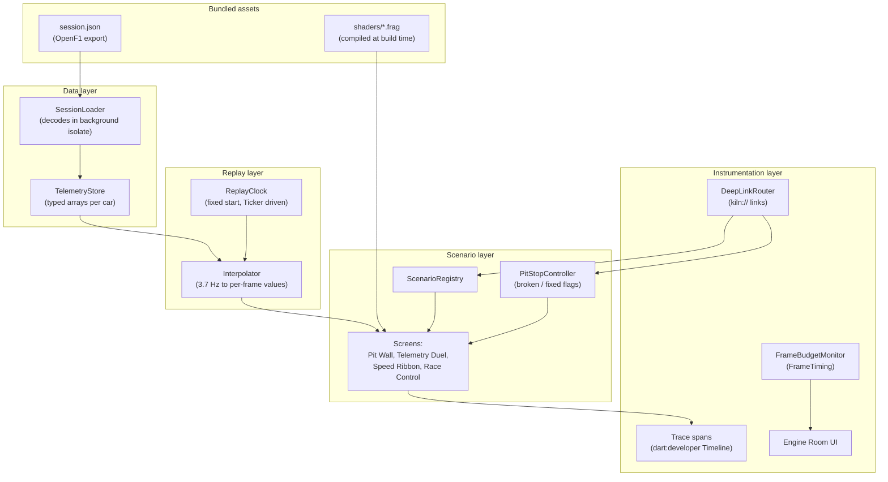
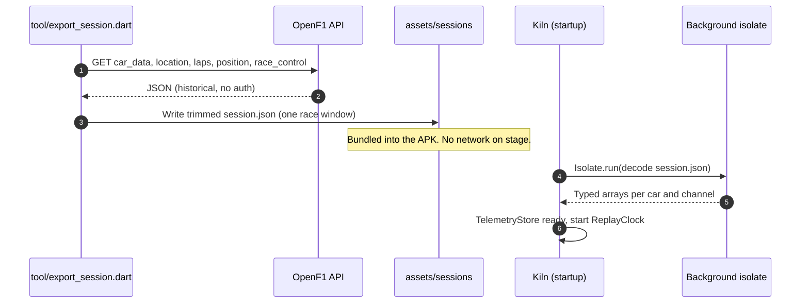
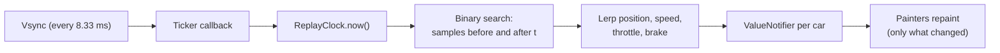
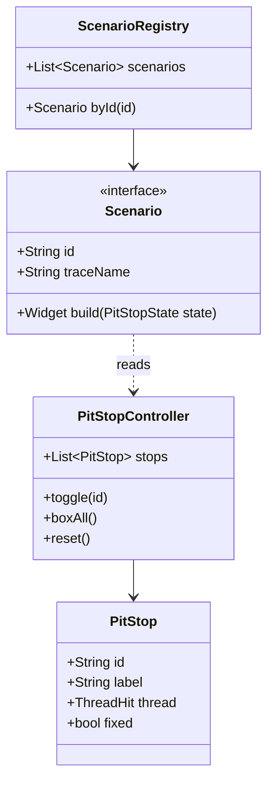
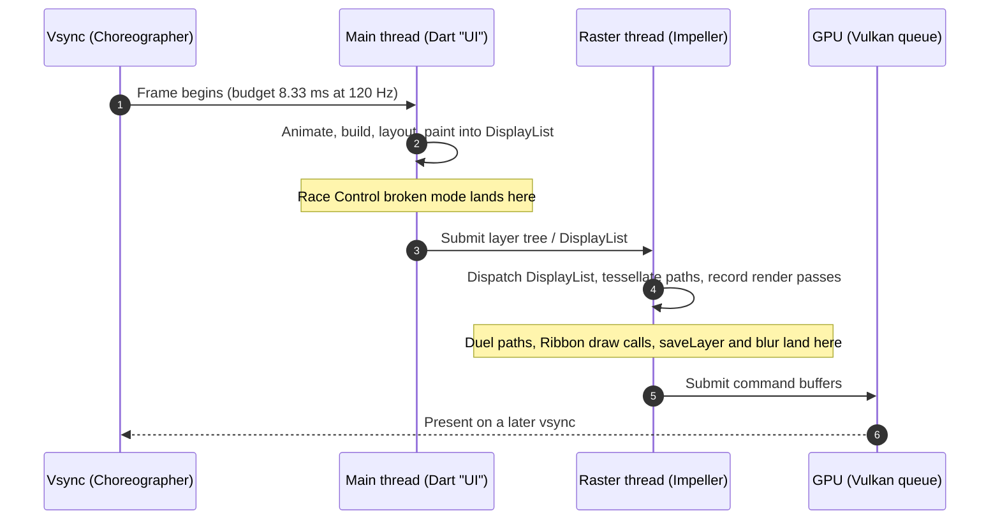

# Technical Requirements Document — Kiln: Pit Wall

| | |
|---|---|
| **Status** | Draft v1 |
| **Toolchain** | Flutter 3.47 stable · Dart 3.13 · DevTools 2.60 |
| **Target** | Android 10+ (API 29+), Impeller on Vulkan, 120 Hz device |
| **Related** | [PRD](../product/PRD.md) · [Impeller architecture](../research/01-impeller-architecture.md) · [Profiling toolchain](../research/02-profiling-toolchain.md) |

---

## 1. Purpose

This document describes how Kiln is built so that every anti-pattern is **realistic,
isolated, switchable and measurable**. The app is an instrument first and a product second:
every architectural decision favours clean, repeatable traces.

## 2. Architecture overview



## 3. Technical requirements

| ID | Requirement |
|---|---|
| TR-1 | No third-party state management. Use `ValueNotifier` / `ChangeNotifier` / `Listenable` so the framework overhead in traces is minimal and recognisable. |
| TR-2 | Telemetry stored in typed arrays (`Float32List`, `Int32List`) per car and channel, not lists of objects. |
| TR-3 | Session JSON decoded once at startup on a background isolate (`Isolate.run`). Only the Race Control scenario decodes during Dart UI work on the platform main thread, and only in its broken mode. |
| TR-4 | The replay clock is driven by a `Ticker` and a fixed start offset, so every replay renders the same timestamps. |
| TR-5 | Every scenario has exactly two implementations (`broken`, `fixed`) behind one interface; the toggle swaps the implementation, nothing else. |
| TR-6 | Each scenario paint is wrapped in a `Timeline` span named `KILN::<Scenario>::<Phase>`. |
| TR-7 | The Engine Room display is its own `RepaintBoundary` with a single `CustomPainter`; text readouts update at most 4 times per second. |
| TR-8 | Deep links via the `kiln://` scheme using Flutter's built-in deep linking and the Router API. |
| TR-9 | Fragment shaders declared under `flutter: shaders:` in `pubspec.yaml` and loaded with `FragmentProgram.fromAsset`. |
| TR-10 | Builds for the stage use `--profile`; DevTools and `--trace-systrace` are supported in that mode. |
| TR-11 | Minimum SDK 29. The `impeller` flavor explicitly enables Impeller; the `skia` flavor disables it only for the controlled Shader Lab comparison. |
| TR-12 | No network permission requirement at runtime for the demo flavour. |
| TR-13 | The repo is a **monorepo** with one Flutter application, `apps/kiln`, and shared `packages/shader_lab`. Android product flavors `impeller` and `skia` produce two installable APKs from the same Dart code and current Flutter SDK. |
| TR-14 | Renderer comparison builds must hold Flutter SDK, Dart code, assets, build mode and workload constant. Flavor-specific configuration is limited to package ID, launcher label, deep-link ownership, renderer metadata and the matching display label. |

## 4. Repository layout (monorepo)

One Flutter application produces two installable APKs from Android product flavors. Both
carry the same Dart code and Shader Lab workload. The Impeller flavor owns the full stage
deep links; the Skia flavor exists only as the comparison launcher.

```text
apps/
  kiln/                      # Main demo — package dev.fluttercon.kiln
    lib/
      main.dart
      app/                   # Shell, theme, router (kiln:// deep links)
      core/
        design/              # Tokens (see design-system.md)
        data/                # SessionLoader, TelemetryStore
        replay/              # ReplayClock, Interpolator
        instrumentation/     # FrameBudgetMonitor, spans, deep links
      features/
        lights_out/
        pit_wall/            # track_map, tower, kpi_cards (broken + fixed)
        telemetry_duel/
        speed_ribbon/
        race_control/
        engine_room/         # Budget display, pit stops, Rosetta
        markets/             # Binance watchlist, book, and Draw depth timing
    assets/sessions/         # Bundled OpenF1 export
    shaders/                 # Lap shaders (.frag); not used by Shader Lab package
    android/
      app/src/main/          # Shared activity and Android configuration
      app/src/impeller/      # EnableImpeller=true; owns kiln:// deep links
      app/src/skia/          # EnableImpeller=false
      app/build.gradle.kts   # renderer dimension; impeller + skia flavors
    pubspec.yaml             # path: ../../packages/shader_lab

packages/
  shader_lab/                # Shared Shader Lab screen (both APKs)
    lib/
      shader_lab.dart        # Public exports
      src/
        shader_lab_screen.dart
        lights_on_scene.dart # 16 blend modes, 3 gradient types, AA clips, blurs, ShaderMask, speed_ramp.frag
        budget_readout.dart  # Recovery time, overrun, slowest frame, first-repeat gap
        run_board.dart       # Last 5 Draw depth runs (model)
        run_board_view.dart
        frame_window.dart    # Timer window logic (§9.2a); also used by Kiln pit-stop recovery
        frame_timer.dart     # Feeds engine FrameTiming into a FrameWindow
        lab_button.dart      # No ink splash (Material's sparkle is a runtime shader)
        lab_tokens.dart
    shaders/
      speed_ramp.frag
    test/                    # Window logic, run board, screen smoke test
    pubspec.yaml             # Uses the same current SDK constraints as apps/kiln

docs/                        # PRD, TRD, talk, design (unchanged)
samples/                     # Reference broken/fixed widgets for notes 06–07
tool/
  export_session.dart        # One-off OpenF1 export before bundling session.json
```

### 4.1 Why two flavors in one Flutter app

| Concern | Approach |
|---|---|
| Isolate the renderer variable | Both flavors use the same Flutter 3.47+ SDK, Dart source, assets and profile mode |
| Fast stage switching | Distinct package IDs allow both APKs to remain installed |
| Prevent deep-link chooser prompts | Only the `impeller` flavor registers the `kiln://` scheme |
| Keep labels honest | Each flavor exposes its renderer family to Dart. The display refresh rate sets the budget separately. `adb logcat` confirms whether Impeller selected Vulkan or OpenGL ES |
| Lap shaders vs Shader Lab shader | Lap `.frag` files stay under `apps/kiln/shaders/`; Shader Lab's `speed_ramp.frag` stays in the package |

### 4.2 Build entry points

| Flavor | Working directory | Typical command |
|---|---|---|
| Kiln Impeller | `apps/kiln` | `flutter run --profile --trace-systrace --flavor impeller` |
| Kiln Skia | `apps/kiln` | `flutter run --profile --trace-systrace --flavor skia` |

Install both APKs on the demo phone before rehearsal. They coexist because package IDs
differ (`dev.fluttercon.kiln` vs `dev.fluttercon.kiln.skia`).

## 5. Data pipeline



- Export a **window** of the race (for example 3–5 laps) to keep the asset small.
- Normalise location `x, y` into a unit square once, at export time.
- Pre-sort samples by timestamp per car so the interpolator can binary-search.

See [OpenF1 data](../research/03-openf1-data.md) for endpoints and limits.

## 6. Replay and interpolation

OpenF1 samples arrive at about 3.7 Hz; the display needs a value every 8.33 ms.



- Position uses linear interpolation; optional Catmull-Rom smoothing for the track map.
- Interpolation is cheap by design so it never appears as the bottleneck — the anti-patterns must be the story.

## 7. Scenario and pit-stop model



| Pit stop ID | Scenario | Broken implementation | Fixed implementation |
|---|---|---|---|
| `duel-paths` | Telemetry Duel | Full-resolution curves rebuilt for every trace every frame | Min/max decimation to ≤ 2 samples per pixel, path built once per size, cursor in a separate painter |
| `ribbon-vertices` | Speed Ribbon | One `drawPath` per track segment (~5,000) | One `Canvas.drawVertices` with per-vertex colours |
| `ribbon-shader` | Speed Ribbon | `ribbon-vertices` fixed state, without glow | Fragment shader (compiled by `impellerc` at build time) adds speed colour and glow in the same single draw |
| `car-glow` | Pit Wall | `canvas.saveLayer` with `ImageFilter.blur` per car inside the cars `CustomPainter` | Each glow drawn as a circle with a `RadialGradient` shader; no layer |
| `tower-fade` | Pit Wall | `Opacity` around row groups, `Clip.antiAliasWithSaveLayer` | Fade leaf colours (no `Opacity`), rounded `BoxDecoration` instead of a clip |
| `glass-group` | Pit Wall | One `BackdropFilter` per KPI card | `BackdropGroup` + `BackdropFilter.grouped` (identical filters, non-overlapping cards) |
| `map-layers` | Pit Wall | Circuit and cars in one painter, `shouldRepaint` always true | Static circuit painter behind `RepaintBoundary`; cars in a separate light painter |
| `feed-isolate` | Race Control | `jsonDecode` of the message batch inside `build()` | `Isolate.run`, results cached in a notifier |

## 8. Frame lifecycle and where each anti-pattern hits

Since Flutter 3.29, Dart code on Android and iOS runs on the platform **main thread**; there
is no separate UI thread. DevTools still labels this work "UI". The raster thread is
unchanged and is where Impeller runs.

Terminology in this document:

- **Main thread** = actual platform thread; it runs Dart animation, build, layout, paint and
  compositing in current Flutter.
- **UI** = DevTools / `FrameTiming` label for that Dart frame work (`buildDuration`), not a
  third current thread.
- **Raster thread** = actual engine CPU thread `1.raster`; Impeller prepares and submits GPU
  work here (`rasterDuration`).
- **GPU** = asynchronous hardware downstream of the raster thread, not a Flutter thread.



## 9. Instrumentation

### 9.1 Frame budget monitor

- Source: `SchedulerBinding.instance.addTimingsCallback`.
- Per frame: `buildDuration` (DevTools UI metric; Dart on main), `rasterDuration`
  (`1.raster`), `totalSpan` (vsync to raster finish; not a thread).
- Rolling window of 240 frames (2 s at 120 Hz) for p50, p90, p99 and jank count.
- Colour rule for the total (F1 timing colours): purple ≤ 6.0 ms, green ≤ 8.33 ms, yellow ≤ 12 ms, red above.
- Per-thread bars (UI and raster): a tick at **4.17 ms** (half the frame, the single-frame-latency
  target from the abstract) and a limit line at 8.33 ms. Green up to the tick, yellow up to the
  limit (still 120 Hz thanks to pipelining, but one frame of extra latency), red above.

### 9.1a Thrash control

- Levels 1×, 2×, 4×, 8×. Multiplies Speed Ribbon segment density and adds a speed trail per
  car, so the recorded draw work scales with the level.
- Set from the Engine Room or with `kiln://thrash/<n>`. Emits a `KILN::Thrash::level` instant
  event on change so the step is visible in traces.
- Deterministic: the same level and replay produce comparable traces.

### 9.2 Trace spans

```text
KILN::TelemetryDuel::paint
KILN::SpeedRibbon::paint
KILN::PitWall::trackMap
KILN::PitWall::carGlow
KILN::PitWall::tower
KILN::PitWall::glass
KILN::RaceControl::decode
KILN::Replay::tick
```

Spans appear in DevTools Timeline Events, and in Perfetto when the app runs with
`--trace-systrace`. On stage: "search for KILN".

### 9.2a Timers (Shader Lab and pit-stop recovery)

Every timer is computed from **`FrameTiming` timestamps** (`vsyncStart`, `rasterFinish`), never
from a `Stopwatch` drawn on screen: an on-screen stopwatch freezes during the stall it is
trying to measure. The readout is updated after the measurement window closes.

Shared definitions (budget = `1000 / refreshRate` ms, 8.33 ms at 120 Hz):

| Term | Definition |
|---|---|
| **Over-budget frame** | `max(buildDuration, rasterDuration)` > budget |
| **Window** | Starts at `vsyncStart` of the first frame after the trigger (tap or pit-stop toggle). Closes after 12 consecutive on-budget frames (~100 ms at 120 Hz) or a 5 s timeout. |
| **Recovery time** | `rasterFinish` of the last over-budget frame in the window minus window start. **0.000 s** if no frame went over budget. Shown on screen as **Recovery time**. |
| **Accumulated overrun** | Sum of `max(buildDuration, rasterDuration) − budget` over every over-budget frame in the window. |
| **Slowest frame** | Largest `max(buildDuration, rasterDuration)` in the window. |
| **First − repeat** | The process's first recovery time minus the latest repeat recovery time. |

**Shader Lab recovery measurement (both flavor APKs, in `packages/shader_lab`):**

- Trigger: the **Draw depth** tap. Shows **recovery time** in large type
  (`0.912`), with **accumulated overrun**, **slowest frame**, and **first − repeat** underneath.
- The budget comes from the connected display's refresh rate: 8.33 ms at 120 Hz and 16.67 ms at 60 Hz.
- Colours: purple if time to smooth is 0, green ≤ 0.100 s, yellow ≤ 0.500 s, red above.
- **Run board:** the last 5 runs in this app process, newest first:
  `Run # · Recovery s · Overrun ms · Slowest ms · FIRST or REPEAT`. The renderer is the app's badge,
  so it is not repeated per row. "First" means the first
  Draw depth since the process started. A **Clear** button empties it. Not persisted:
  `pm clear` and app restarts start a fresh board. This resets the measurement label and
  app-owned state; vendor GPU-driver cache behavior must be verified separately.
- Spans: `KILN::Markets::drawDepth` (instant, at tap) and `KILN::Markets::smooth`
  (instant, when the window closes) so the same interval can be found in DevTools and Perfetto.

**Pit-stop recovery timer (Kiln only, Engine Room):**

- Trigger: turning a pit stop **on** (single toggle or Box all).
- Shows "Recovered in 0.42 s" (time to smooth), or "Not recovered" if the 5 s window
  times out with frames still over budget. Keeps the last result per pit stop ID.
- Event: `KILN::PitStop::recovered` with the pit stop ID and the time.
- Turning a pit stop **off** does not start a timer; the broken state is meant to stay red.

### 9.3 Renderer badge

Shows "Impeller · Vulkan" or "Impeller · OpenGL ES" so the audience can trust the
backend. Detection approach to confirm during build (for example engine log line at
startup, or a platform-channel query); if unreliable, verify in rehearsal with
`adb logcat` and show a static badge.

## 10. Deep links (laptop control)

| Action | Command |
|---|---|
| Open a scenario | `adb shell am start -a android.intent.action.VIEW -d "kiln://scenario/duel"` |
| Toggle a pit stop | `adb shell am start -a android.intent.action.VIEW -d "kiln://pitstop/duel-paths/on"` |
| Apply every fix | `adb shell am start -a android.intent.action.VIEW -d "kiln://pitstop/all/on"` |
| Reset to broken | `adb shell am start -a android.intent.action.VIEW -d "kiln://pitstop/all/off"` |
| Replay 5 s | `adb shell am start -a android.intent.action.VIEW -d "kiln://replay"` |
| Set Thrash level | `adb shell am start -a android.intent.action.VIEW -d "kiln://thrash/8"` |
| Open Shader Lab (Impeller) | `adb shell am start -a android.intent.action.VIEW -d "kiln://scenario/shaderlab"` |

## 11. Build and run modes

| Purpose | Command |
|---|---|
| Stage run, Kiln Impeller | `cd apps/kiln` then `flutter run --profile --trace-systrace --flavor impeller` |
| Stage run, Kiln Skia | `cd apps/kiln` then `flutter run --profile --trace-systrace --flavor skia` |
| Release sanity check | Same directory and flavors; replace `--profile` with `--release` |

Debug mode is never used for measurement: it runs JIT-compiled Dart and extra checks.

### 11.0 How to run (so DevTools and Perfetto see everything)

Use **profile** mode and **`--trace-systrace`** on a **physical device** over USB. Debug
mode is not valid for measurement. **`adb`** must be on PATH (Android SDK `platform-tools`).

**Kiln Impeller** — from `apps/kiln`:

```text
cd apps/kiln
flutter run --profile --trace-systrace --flavor impeller
```

Then open Shader Lab: **Home → Shader Lab**, or
`adb shell am start -a android.intent.action.VIEW -d "kiln://scenario/shaderlab"` (cold-start
routing from that link is wired in the manifest; confirm in rehearsal).

**Kiln Skia** — from the same directory and Flutter SDK:

```text
cd apps/kiln
flutter run --profile --trace-systrace --flavor skia
```

Before a candidate **cold** Shader Lab demo:

```text
adb shell pm clear dev.fluttercon.kiln.skia
```

`pm clear` resets app-owned state. It does not prove that every vendor GPU-driver cache was
discarded, so verify the first-use spike on the target phone during rehearsal. If the cache
survives, uninstall/reinstall the flavor or use a fresh package ID for the recorded proof.

**DevTools** attaches to whichever app **`flutter run`** started. To compare Skia and
Impeller in DevTools, stop one run and start the other (or use a second laptop / exported
snapshots). Open DevTools from the terminal link → **Performance** → Flutter frames chart and
Timeline; search **`KILN::ShaderLab::`**.

**Perfetto:** keep `--trace-systrace` running and capture with the **`record_android_trace`**
script over **adb** (not WebUSB on stage — WebUSB can stop `adb` and disconnect
`flutter run`). Compare **main thread** vs **`1.raster`** around **Draw depth**; correlate
with the on-phone **recovery time**.

See [Profiling toolchain](../research/02-profiling-toolchain.md) and
[Stage runbook](../talk/stage-runbook.md).

### 11.1 Shader Lab: one project, two flavor APKs

[Current Flutter supports disabling Impeller on Android](https://docs.flutter.dev/perf/impeller#android)
for debugging and deployment. Kiln uses that opt-out only for this controlled comparison.
Both APKs come from `apps/kiln` and the same current SDK, making the renderer the meaningful
variable.

| Flavor | SDK | Package ID | Renderer | Launcher label |
|---|---|---|---|---|
| `impeller` | Current stable (3.47+) | `dev.fluttercon.kiln` | Impeller; Vulkan when valid, otherwise OpenGL ES | Kiln Impeller |
| `skia` | Same current stable SDK | `dev.fluttercon.kiln.skia` | Skia on OpenGL ES | Kiln Skia |

- Renderer metadata lives in `android/app/src/impeller/AndroidManifest.xml` and
  `android/app/src/skia/AndroidManifest.xml`.
- Shader Lab UI lives in **`packages/shader_lab`** (TR-13, TR-14). The app's
  `features/shader_lab/` route is a thin wrapper for deep links and navigation only.
- Both builds run in **profile** mode for comparable numbers.
- The flavor tells Dart whether this process is Impeller or Skia. The display refresh rate is read live and sets the budget. Confirm Impeller's Vulkan or OpenGL ES choice with `adb logcat` before recording.
- Before every comparison, reset and verify the candidate cold state:

| Action | Command |
|---|---|
| Reset Skia app-owned state | `adb shell pm clear dev.fluttercon.kiln.skia` |
| Launch Skia Shader Lab | `adb shell am start -n dev.fluttercon.kiln.skia/.MainActivity` |
| Open Impeller Shader Lab | `adb shell am start -a android.intent.action.VIEW -d "kiln://scenario/shaderlab"` |

Clearing the main Kiln app's data is **not** needed for the comparison and would reset
stage state. Measure Impeller's first entry after a fresh process launch anyway, so startup
and first-use costs are represented honestly.

### 11.2 Shader Lab screen

- A public Binance watchlist and instrument (`https://data-api.binance.vision`, trade stream
  `wss://data-stream.binance.vision/ws`). Candles and the bid/ask ladder use solid paints.
- One button, **"Draw depth"**, draws that book with `depth_fill.frag`. The shader file is loaded
  before the tap. The clock starts when the fill is drawn. No blur, mask, or extra blend mode is
  introduced on that tap.
- Shows **recovery time**, accumulated overrun, slowest frame, and the first-minus-repeat gap for the latest
  Draw depth, plus the **run board** (§9.2a). Recovery time is in large type.
- Emits `KILN::Markets::enter`, `KILN::Markets::drawDepth` and `KILN::Markets::smooth`
  so the interval is easy to find in DevTools and Perfetto.
- Success criterion (measured in rehearsal on the demo phone): the Skia build's first run
  shows a visibly longer time to smooth than its second run and than the Impeller build. If
  the gap is too small on the flagship phone to read from the stage, use the pre-recorded
  backup instead and say so.

## 12. Testing and validation

| Check | Method |
|---|---|
| Each broken mode produces red frames | Manual, on device, Engine Room + DevTools |
| Each fixed mode improves the expected thread | Exported DevTools snapshots, before and after |
| Fixed state meets NFR-1 | 5 s replay, p90 from FrameBudgetMonitor, confirmed in Perfetto |
| Determinism | Three replays, p90 within ±10% |
| Engine Room overhead | Compare with the display hidden |
| Backend | Renderer badge plus `adb logcat` during rehearsal |
| Thermal stability | 10-minute soak run; note raster drift |
| Timer correctness | Unit tests feed synthetic `FrameTiming`-shaped data to the window logic (no jank → 0; one spike; timeout); on device, compare one Shader Lab run against the same interval in DevTools |
| Thrash evidence | At 1×, 2×, 4× and 8×, capture `KILN::Thrash::level`, frame timings and raster trend; verify the one-draw fix under the identical 8× replay |
| DevTools teaching path | Rehearse red frame → UI/raster bar → matching `KILN::` span → source code → pit stop → before/after snapshot |
| Perfetto teaching path | Rehearse main thread, `1.raster`, Expected vs Actual frame timeline and the same `KILN::` marker in one capture |
| Repaint isolation | Enable Track Paints; verify static circuit paint events stop after `map-layers` while car paint events continue |
| Layer complexity | Enable offscreen-layer checkerboarding; verify tower, glass and car-glow fixes reduce the highlighted layers |
| CustomPainter `saveLayer` | Code and trace review confirm the broken car painter calls `canvas.saveLayer` with blur and the fixed painter uses a radial gradient without a layer |
| Build-time shader proof | A clean verbose build records `impellerc` processing the app fragment shader; the fixed ribbon uses that artifact in one draw |

## 13. Risks and constraints

- Impeller's Vulkan backend has limited timeline events in its encode and submit path
  (see [flutter#193399](https://github.com/flutter/flutter/issues/193399)), so per-draw
  Vulkan cost is not visible in DevTools without a custom engine build. The talk states
  this openly.
- Impeller has no Skia-style raster cache; `RepaintBoundary` isolates repaints but does not
  guarantee a cached texture. `SnapshotWidget` is the explicit alternative.
- Backdrop blur on Impeller can cost more than on Skia in some cases; the grouped fix
  only helps when filters are identical and non-overlapping.
- Shader Lab cold-state behavior varies by vendor GPU driver. `pm clear` resets app-owned
  state but may not erase every driver cache, so rehearse and verify the reset on both stage
  phones. Use uninstall/reinstall, a fresh package identity or the recorded proof if needed.
- On a fast flagship phone, Skia's first-use compile spike may be small. Impeller can also
  show a first-entry cost while resources and pipeline state are prepared; report both as
  measured instead of promising a predetermined gap.
