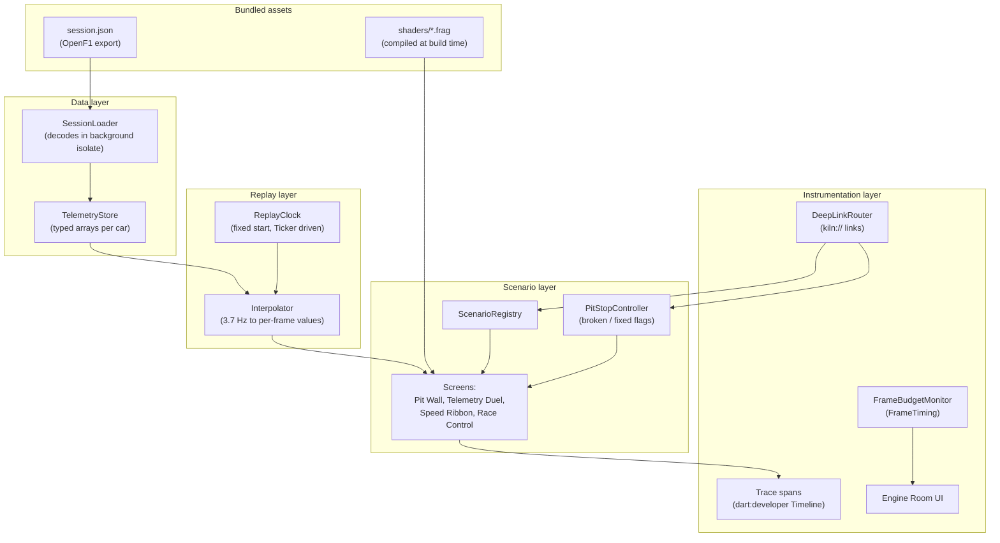
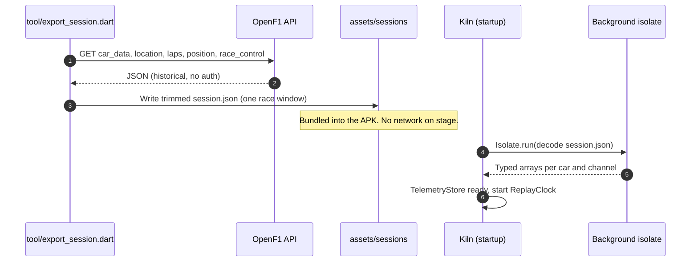
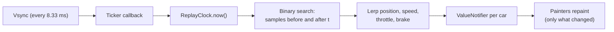
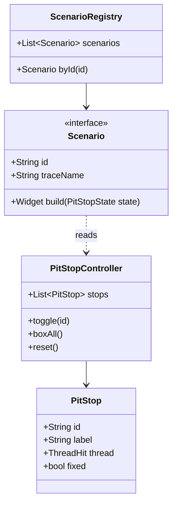
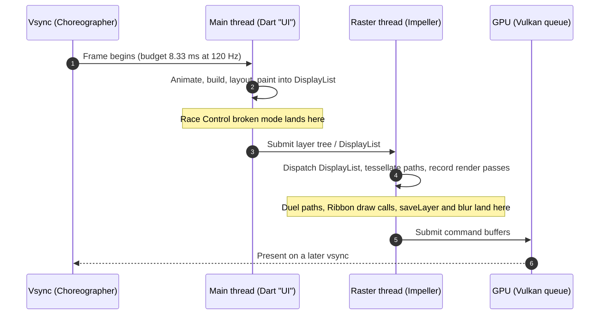

# Technical Requirements Document — Kiln: Pit Wall

| | |
|---|---|
| **Status** | Draft v1 |
| **Toolchain** | Flutter 3.47 stable · Dart 3.13 · DevTools 2.60 |
| **Target** | Android 10+ (API 29+), Impeller on Vulkan, 120 Hz device |
| **Related** | [PRD](../product/PRD.md) · [Impeller architecture](../research/01-impeller-architecture.md) · [Profiling toolchain](../research/02-profiling-toolchain.md) |

---

## 1. Purpose

This document describes how Kiln is built so that every anti-pattern is **realistic,
isolated, switchable and measurable**. The app is an instrument first and a product second:
every architectural decision favours clean, repeatable traces.

## 2. Architecture overview



## 3. Technical requirements

| ID | Requirement |
|---|---|
| TR-1 | No third-party state management. Use `ValueNotifier` / `ChangeNotifier` / `Listenable` so the framework overhead in traces is minimal and recognisable. |
| TR-2 | Telemetry stored in typed arrays (`Float32List`, `Int32List`) per car and channel, not lists of objects. |
| TR-3 | Session JSON decoded once at startup on a background isolate (`Isolate.run`). Only the Race Control scenario decodes on the UI thread, and only in its broken mode. |
| TR-4 | The replay clock is driven by a `Ticker` and a fixed start offset, so every replay renders the same timestamps. |
| TR-5 | Every scenario has exactly two implementations (`broken`, `fixed`) behind one interface; the toggle swaps the implementation, nothing else. |
| TR-6 | Each scenario paint is wrapped in a `Timeline` span named `KILN::<Scenario>::<Phase>`. |
| TR-7 | The Engine Room display is its own `RepaintBoundary` with a single `CustomPainter`; text readouts update at most 4 times per second. |
| TR-8 | Deep links via the `kiln://` scheme using Flutter's built-in deep linking and the Router API. |
| TR-9 | Fragment shaders declared under `flutter: shaders:` in `pubspec.yaml` and loaded with `FragmentProgram.fromAsset`. |
| TR-10 | Builds for the stage use `--profile`; DevTools and `--trace-systrace` are supported in that mode. |
| TR-11 | Minimum SDK 29; the manifest must not disable Impeller. |
| TR-12 | No network permission requirement at runtime for the demo flavour. |

## 4. Proposed folder structure

```text
lib/
  main.dart
  app/                 # App shell, theme, router
  core/
    design/            # Tokens: colours, type, spacing (see design-system.md)
    data/              # SessionLoader, TelemetryStore, models
    replay/            # ReplayClock, Interpolator
    instrumentation/   # FrameBudgetMonitor, trace span helpers, deep links
  features/
    lights_out/
    pit_wall/
      track_map/       # broken + fixed painters
      tower/           # broken + fixed list
      kpi_cards/       # broken + fixed glass
    telemetry_duel/
    speed_ribbon/
    race_control/
    engine_room/       # budget display, pit stops, rosetta tab
assets/
  sessions/            # bundled OpenF1 export
shaders/               # .frag files compiled by impellerc at build time
tool/
  export_session.dart  # one-off OpenF1 export script (run before the talk)
```

## 5. Data pipeline



- Export a **window** of the race (for example 3–5 laps) to keep the asset small.
- Normalise location `x, y` into a unit square once, at export time.
- Pre-sort samples by timestamp per car so the interpolator can binary-search.

See [OpenF1 data](../research/03-openf1-data.md) for endpoints and limits.

## 6. Replay and interpolation

OpenF1 samples arrive at about 3.7 Hz; the display needs a value every 8.33 ms.



- Position uses linear interpolation; optional Catmull-Rom smoothing for the track map.
- Interpolation is cheap by design so it never appears as the bottleneck — the anti-patterns must be the story.

## 7. Scenario and pit-stop model



| Pit stop ID | Scenario | Broken implementation | Fixed implementation |
|---|---|---|---|
| `duel-paths` | Telemetry Duel | Full-resolution curves rebuilt for every trace every frame | Min/max decimation to ≤ 2 samples per pixel, path built once per size, cursor in a separate painter |
| `ribbon-vertices` | Speed Ribbon | One `drawPath` per track segment (~5,000) | One `Canvas.drawVertices` with per-vertex colours |
| `ribbon-shader` *(optional)* | Speed Ribbon | Same as above | Fragment shader colouring a single track mesh |
| `tower-fade` | Pit Wall | `Opacity` around row groups, `Clip.antiAliasWithSaveLayer` | Fade leaf colours (no `Opacity`), rounded `BoxDecoration` instead of a clip |
| `glass-group` | Pit Wall | One `BackdropFilter` per KPI card | `BackdropGroup` + `BackdropFilter.grouped` (identical filters, non-overlapping cards) |
| `map-layers` | Pit Wall | Circuit and cars in one painter, `shouldRepaint` always true | Static circuit painter behind `RepaintBoundary`; cars in a separate light painter |
| `feed-isolate` | Race Control | `jsonDecode` of the message batch inside `build()` | `Isolate.run`, results cached in a notifier |

## 8. Frame lifecycle and where each anti-pattern hits

Since Flutter 3.29, Dart code on Android and iOS runs on the platform **main thread**; there
is no separate UI thread. DevTools still labels this work "UI". The raster thread is
unchanged and is where Impeller runs.



## 9. Instrumentation

### 9.1 Frame budget monitor

- Source: `SchedulerBinding.instance.addTimingsCallback`.
- Per frame: `buildDuration` (UI), `rasterDuration` (raster), `totalSpan` (vsync to raster finish).
- Rolling window of 240 frames (2 s at 120 Hz) for p50, p90, p99 and jank count.
- Colour rule (F1 timing colours): purple ≤ 6.0 ms, green ≤ 8.33 ms, yellow ≤ 12 ms, red above.

### 9.2 Trace spans

```text
KILN::TelemetryDuel::paint
KILN::SpeedRibbon::paint
KILN::PitWall::trackMap
KILN::PitWall::tower
KILN::PitWall::glass
KILN::RaceControl::decode
KILN::Replay::tick
```

Spans appear in DevTools Timeline Events, and in Perfetto when the app runs with
`--trace-systrace`. On stage: "search for KILN".

### 9.3 Renderer badge

Shows "Impeller · Vulkan" or "Impeller · OpenGL ES" so the audience can trust the
backend. Detection approach to confirm during build (for example engine log line at
startup, or a platform-channel query); if unreliable, verify in rehearsal with
`adb logcat` and show a static badge.

## 10. Deep links (laptop control)

| Action | Command |
|---|---|
| Open a scenario | `adb shell am start -a android.intent.action.VIEW -d "kiln://scenario/duel"` |
| Toggle a pit stop | `adb shell am start -a android.intent.action.VIEW -d "kiln://pitstop/duel-paths/on"` |
| Apply every fix | `adb shell am start -a android.intent.action.VIEW -d "kiln://pitstop/all/on"` |
| Reset to broken | `adb shell am start -a android.intent.action.VIEW -d "kiln://pitstop/all/off"` |
| Replay 5 s | `adb shell am start -a android.intent.action.VIEW -d "kiln://replay"` |

## 11. Build and run modes

| Purpose | Command |
|---|---|
| Stage run with full tracing | `flutter run --profile --trace-systrace` |
| Skia comparison (recorded clip only) | `flutter run --profile --trace-systrace --no-enable-impeller` |
| Release sanity check | `flutter run --release` |

Debug mode is never used for measurement: it runs JIT-compiled Dart and extra checks.

## 12. Testing and validation

| Check | Method |
|---|---|
| Each broken mode produces red frames | Manual, on device, Engine Room + DevTools |
| Each fixed mode improves the expected thread | Exported DevTools snapshots, before and after |
| Fixed state meets NFR-1 | 5 s replay, p90 from FrameBudgetMonitor, confirmed in Perfetto |
| Determinism | Three replays, p90 within ±10% |
| Engine Room overhead | Compare with the display hidden |
| Backend | Renderer badge plus `adb logcat` during rehearsal |
| Thermal stability | 10-minute soak run; note raster drift |

## 13. Risks and constraints

- Impeller's Vulkan backend has limited timeline events in its encode and submit path
  (see [flutter#193399](https://github.com/flutter/flutter/issues/193399)), so per-draw
  Vulkan cost is not visible in DevTools without a custom engine build. The talk states
  this openly.
- Impeller has no Skia-style raster cache; `RepaintBoundary` isolates repaints but does not
  guarantee a cached texture. `SnapshotWidget` is the explicit alternative.
- Backdrop blur on Impeller can cost more than on Skia in some cases; the grouped fix
  only helps when filters are identical and non-overlapping.
